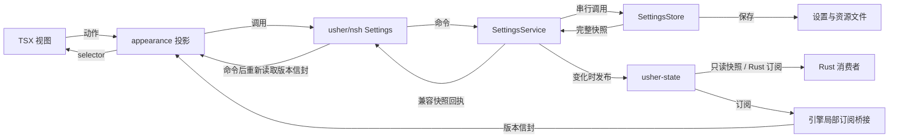

# Usher NSH 架构

本文描述项目的模块职责、状态归属、数据流和平台适配边界。运行与构建说明见 [README](README.zh.md)，开发约束见 [CONTRIBUTING.md](CONTRIBUTING.md)，实施与验收状态见 [scaffolding.md](scaffolding.md)，发布流程见 [部署与发布](docs/deploy.md)。

## 1. 系统结构

应用使用 NSH 渲染 TSX 界面，Rust 管理设置、资源、诊断和更新规则。`App.tsx` 创建窗口级状态并装配页面；`src/lib.rs` 注册 `usher/nsh` 桥接模块和平台原生组件。

| 模块 | 位置 | 职责与依赖 |
| --- | --- | --- |
| 界面 | `ui/features/`、`ui/components/`、`ui/layout/` | 页面、控件和窗口布局；读取视图投影并发送动作。 |
| 视图投影 | `ui/state/`、`ui/router/` | 设置快照、操作状态、路由历史和本地化投影；调用类型化桥接接口。 |
| 设置与资源 | `src/settings.rs`、`src/style_themes.rs`、`src/background.rs` | 偏好校验、状态变更、持久化、主题解析和背景资源管理。 |
| NSH 桥接 | `src/settings_bridge.rs` | DTO 转换、后台调用、宿主目录解析及原生能力查询。 |
| 平台适配 | `platforms/macos/` | 窗口材质、系统图标和原生控件；持有 AppKit 对象并处理其生命周期。 |
| 诊断 | `src/diagnostics.rs` | 结构化事件、后台写入、日志保留和归档导出。 |
| 更新领域库 | `crates/usher-update/` | 无 I/O 的更新状态机、发布签名和完整性校验。 |
| 发布工具 | `crates/usher-update-tool/` | 发布侧密钥与清单处理，复用更新库；应用运行时不依赖该工具。 |

设置、主题和背景能力当前以根 crate 内的模块组织。更新规则独立为 crate，隔离 NSH、窗口和系统 I/O。

## 2. 状态与设置桥接

### 状态归属

| 状态 | 拥有者 | 生命周期 |
| --- | --- | --- |
| 生效的用户偏好、主题和保存状态 | Rust `SettingsStore` | 按设置文件路径共享于进程内；无数据目录时使用引擎局部的会话 Store。 |
| 设置只读投影 | `ui/state/projection.ts` | App 装配订阅，appearance 与借用门面读取同一投影。 |
| 请求、预览、分类和主页计数 | `RouterService` 的 session | Rust 窗口 Store；TS 仅借用投影，回执与预览清理使用票据。 |
| 路由、历史游标和面包屑 | `usher-router` / `RouterService` | 同一 VM 内每个宿主窗口各有唯一历史，动作绑定 Rust StoreId，关闭后身份失效。 |
| 焦点、悬停、抽屉和组件临时状态 | TSX 组件及布局控制器 | 随所属组件挂载和释放。 |
| 日志队列、写入线程和实时健康 | Rust 诊断模块 / `diagnostic_state` | 进程级管理，同一日志目录复用实例；健康和丢弃计数独立发布，旧管线代次不能回写。 |

`SettingsStore` 是偏好的写入入口。TSX 通过框架无关门面读取快照，NSH 响应式图由状态适配器管理；共享拖动预览位于 Rust 窗口 session，提交偏好仍由设置服务校验并保存。

### 请求与快照



`ui/state/appearance.ts` 串行提交设置请求，防止较早的回执覆盖较新的选择。`settings_bridge.rs` 在后台任务中通过 `app_state` 获取路径对应的 `SettingsService`。全局注册表锁不覆盖初始化或 I/O，每个服务串行执行设置变更、保存和通用快照发布。原 Store 保留规则与文件格式；只读 `StoreReader` 无需业务锁即可读取和订阅。旧 JS 命令仍返回原 `SettingsSnapshot`；新增 `SettingsState` 提供版本读取和订阅，TS transport 在旧命令完成后重新读取一致信封。所有输入通过同一版本接收器，旧回执和销毁后的回调不能覆盖新值。

快照包含偏好、已解析主题、资源元数据、`revision` 和保存状态。实际状态变更推进版本，重试保存沿用当前版本。业务错误通过稳定错误码返回，展示层负责翻译和操作反馈。

### 通用状态管理目标设计

设计与实施顺序以 [通用状态管理方案](docs/state-management.md) 为准，任务索引见 scaffolding 03.08 至 03.13。SM1 已实现独立核心，SM2 已将设置接入并保持请求—响应兼容。`app_state.rs` 装配目录注册表与独立会话，`settings_service.rs` 负责预检、串行提交、变化比较与异常关闭；SM3 已实现引擎局部订阅、独立 TS 传输及 NSH 适配器；SM4 已迁移窗口历史、分类、预览、操作反馈、导出与计数；macOS 原生同 VM 多窗口、真实源码 HMR 与关闭重开已在隔离数据目录验收。

通用状态机与状态发布层已独立为内部 crate `crates/usher-state/`，提供纯转换契约、不可变快照、只读句柄与后端无关的订阅接口。应用通过工厂注入具体实现，`tokio::sync::watch` 仅为首个可选后端；公共接口不暴露通道、锁守卫或后端错误，更换实现以相同调用方通过契约测试为验收条件。crate 不依赖 NSH、平台、网络与文件系统。更新业务状态机继续归 `usher-update`；设置校验及持久化继续归设置模块，通过应用适配复用底座。

测试依赖独立于运行时架构：`crates/usher-test-support/` 仅提供不含业务依赖的 poll / 唤醒及夹具身份校验工具，由状态、路由和应用的开发依赖使用，不进入其生产依赖图。状态参考后端和场景夹具仍在 `usher-state/tests/`。单测与 crate 契约就近，跨模块应用集成及 E2E 分别集中在 `tests/integration/`、`tests/e2e/`；具体边界和当前实现见 [测试方案](docs/testing.md#3-测试分层与目录)。

应用按数据目录或引擎会话装配应用域，并按宿主窗口身份装配窗口域，由领域服务接收类型化动作并有序发布快照。领域版本与通用发布序号分开，保存状态变化即使没有推进设置 `revision` 也必须通知。桥接在引擎线程投递并管理订阅清理，TS 传输适配器隐藏原生桥接，`ui/state/runtime/nsh.ts` 集中封装 NSH context、signal、computed 与生命周期，组件通过项目状态门面访问投影。状态订阅保留最新值；需要逐条送达的消息和只执行一次的业务效果由各自领域执行器负责，不通过快照广播执行。

迁移范围为全部跨页面共享或跨页面切换保留的数据，包括设置和诊断状态、导航历史、设置分类、共享透明度预览、导出及操作反馈、主页保留计数和相关 selector。导航等会话状态同样复用新 crate，但保持窗口隔离；单视图测量、焦点、动画及资源句柄仍按局部生命周期管理。逐项清单见 [状态管理方案第 8.3 节](docs/state-management.md#83-全量迁移清单)，不能只完成设置订阅就标为全量迁移完成。

### 本地设置

宿主提供应用数据目录，Rust 据此定位 `settings.toml`、`themes/`、背景资源及诊断目录。JavaScript 调用方通过语义命令操作资源，文件位置由 Rust 决定。

设置文件使用带 `schemaVersion` 的 TOML，保存外观、语言和诊断偏好。加载时完成旧格式迁移与校验；损坏文件保留备份，较新版本文件或无法安全恢复的文件受到写保护。缺失或暂不可用的主题与控件族保留原偏好，视图采用可用实现。

Store 先保存待提交的主题文件，再将完整设置写入同目录临时文件，刷盘后替换原文件。主题文件与设置文件分别写入，Store 负责提交顺序和失败重试。保存失败时保留内存状态并返回未保存标记，成功后清理不再引用的背景资源。无可写目录的宿主使用会话状态。

## 3. 窗口与导航

`ui/layout/Frame.tsx` 装配窗口背景、标题栏、固定窄菜单、二级菜单、内容区和状态栏，页面作为子节点传入。布局模块通过外观、导航和能力契约取得数据。

| 目录 | 职责 |
| --- | --- |
| `ui/layout/components/` | 区域视图和背景资源的展示生命周期。 |
| `ui/layout/controllers/` | 窗口装饰测量、菜单停靠、抽屉及布局动画。 |
| `ui/layout/contracts/` | 账户和更新入口的只读投影及动作回调。 |

宽桌面窗口将二级菜单停靠在内容区旁，窄窗口和移动布局使用抽屉。停靠偏好由 Rust 保存，动画过程和抽屉开关由布局控制器管理。窗口装饰通过 `nsh/desktop` 测量，移动布局使用宿主安全区。尺寸、间距和动画时长来自主题度量。

`ui/pages/routes.json` 定义路由 ID、父级、路径、pageKey、标题键与菜单角色，生成 typescript 契约。旧 ui/navigation 已移除。菜单、历史按钮、快捷键和面包屑统一调用 ui/router，历史由 Rust 窗口 Store 持有，页面按 entryKey 卸载 / 挂载。

实现与后续扩展见 [独立路由模块方案](docs/routing.md)。纯规则独立为 `crates/usher-router/`，首个路径匹配适配器使用 matchit；应用服务通过 `usher-state` 发布唯一窗口历史，`ui/router/` 提供命名导航、当前路由与 RouterView。路由动作只经过 Router，通用 state 不另设修改历史的入口。

业务页面入口集中在 `ui/pages/`，`routes.json` 作为可序列化目录的单一来源，`index.ts` 对 pageKey 做穷尽组件绑定；运行时注册同一目录到 Rust，避免 TSX 代码包与外壳各有一份路由表。App 仅装配 Frame 和 RouterView。目录与页面绑定的版本、初始化错误、HMR 失效条目及原生导航能力按 RT1 至 RT4 验收；首版为桌面单出口内存历史。

现有首页、设置页、菜单、快捷键、面包屑与历史入口已按 [路由整改清单](docs/routing.md#81-现有页面整改清单) 迁移。验证分为纯 crate 契约、应用集成、mock 界面和真实桥接 E2E，目录、数据隔离与计划命令见 [测试方案](docs/testing.md)；当前已实施状态 / 路由核心、通用工具、设置 / 窗口应用集成、真实桥接及无头 E2E 命令，不能将无头组件测试等同于原生或发布产物验收。

设置页面按自身可用宽度选择分类列表或下拉框，当前分类保留在 Rust 窗口 Store 中。布局、键盘导航和浮层使用 NSH 组件的公开接口；应用提供主题样式和可用宽度，框架负责焦点行为、浮层层级与碰撞避让。

账户和更新入口由 `Frame` 接收可选契约，未提供实现时按钮禁用。窗口布局通过契约消费能力，与账户和更新的内部实现解耦。

## 4. 主题与背景资源

### 外观模型

| 字段 | 职责 |
| --- | --- |
| `themeId` | 选择样式 token、主题名称和材质声明。 |
| `colorMode` | 保存 `light`、`dark` 或 `system` 偏好，由 NSH 解析实际明暗。 |
| `componentFamily` | 选择 NSH 或可用的 AppKit 控件实现。 |
| `accent` | 覆盖主题强调色，校验颜色格式并派生可读的前景色。 |

样式主题、明暗模式和控件族独立保存。组件切换复用同一份 Rust 设置状态。`ui/components/` 及设置视图根据能力投影选择控件实现，原生事件进入相同的设置命令。

### 主题解析

所有主题采用统一 JSON 格式。`build.rs` 收集 `ui/theme/builtin/` 和 `ui/theme/presets/` 中的内置主题；`src/style_themes.rs` 合并本地 `themes/`，解析继承链与 `var()` 引用，校验取值并生成完整 token 表。无效文件被隔离，其错误随快照返回。

`default` 定义基础 token，其他主题通过 `extends` 覆盖差异。`cssVars` 区分共享、明暗和触控度量；主题名称及本地化名称由主题文件提供。调色板编辑器生成的主题同样由注册表解析。

`ui/theme/index.ts` 将解析后的 token 投影为语义颜色和度量，`ui/theme/look.ts` 组合控件样式与状态反馈。视图依赖语义角色，新增配色通过主题文件扩展。外部设计体系以固定版本的 token 快照接入，映射保存在 `ui/theme/sources/`，署名记录在 `NOTICE`。

### 背景资源

背景图片由 `src/background.rs` 校验并保存为应用自有资源，设置快照仅携带 ID 和名称，图片字节通过独立二进制桥接按 ID 读取。导入先写入完整资源，再提交设置引用；设置保存成功后回收旧资源，失败时保留候选供重试。共享限制和默认值来自 `ui/config/background.json`。

`WindowBackdrop` 在交互区域下方组合原生材质、主题叠色和用户图片。组件持有图片的 blob URL，在资源替换或卸载时释放，并忽略过期加载结果。图片加载失败时回退到主题背景。

图片不透明度与内容背景透明度分别建模。`contentBackgroundColor` 只调整面板填充色的 alpha，菜单、内容区和设置卡片复用该规则，文字与控件保持自身的绘制属性。

## 5. 国际化

`i18n/messages/en.json` 和 `zh-Hans.json` 是界面文案来源，`ui/i18n/index.ts` 提供类型化键、语言解析和参数替换。英文目录定义键集合，中文目录接受同形检查。业务状态和错误保存标识及参数，视图在读取时翻译。

语言偏好由设置 Store 保存为 `system` 或显式语言标记。显式选择优先；跟随系统时解析 NSH `locale()`，识别支持的简体中文地区或脚本，其余回退到英文。数值参数使用实际语言的 `Intl.NumberFormat` 格式化。

主题显示名称读取主题自身的 `names`，缺失时使用 `name`。主题注册信息与通用消息目录分别维护。

## 6. 平台适配与生命周期

共享 TSX 和 Rust 模块通过 NSH 宿主运行。项目维护的原生适配集中在 `platforms/macos/`，由 `src/lib.rs` 按目标平台注册。

| 模块 | 职责 |
| --- | --- |
| `window_material.rs` | 安装窗口材质，监听系统外观与辅助功能变化，并报告材质可用状态。 |
| `window_geometry.rs` | 设置窗口初始几何与最小尺寸，避免界面重挂载重置窗口。 |
| `system_symbol.rs` | 将系统 SF Symbols 作为原生图标组件提供给 TSX。 |
| `controls.rs` | 适配设置页所需的 AppKit 控件及属性、事件桥接。 |

窗口材质和系统图标独立注册。AppKit 设置控件受构建选项和运行时能力检测共同约束；不可用时使用 NSH 控件并保留偏好。原生材质不可用，或系统开启降低透明度、增强对比度时，使用主题实色表面。

AppKit 对象由主线程适配器持有，组件释放时清理事件对象、观察器和附加视图。TSX 的事件绑定、计时器和资源通过所属组件的清理逻辑释放。Rust 源码和原生适配变更由宿主重建加载；TSX 热更新的状态保留范围由 NSH 的组件生命周期决定。

Windows、Linux、Android 和 iOS 的项目原生适配，以及桌面托盘和商店服务，属于平台扩展边界。原生句柄由对应平台宿主持有，业务行为通过应用命令和快照连接共享模块。具体接入范围记录在实施清单。

## 7. 更新子系统

更新方案的决策、流程与目标模块划分以 [应用更新方案](docs/update.md) 为准。以下描述批次 3 至 5 的当前实现，平台与发布验收范围见该文档。

### 状态机与执行器

`crates/usher-update/src/state.rs` 定义纯 reducer，以事件推进状态并返回效果。调用方负责执行检查、下载、文件验证和安装交接，再将结果作为事件送回状态机。

状态机通过 `ticket` 拒绝迟到回执，合并重复检查，并在下载开始后锁定候选。只接受正式版且不降级；代码包与外壳主次版本必须一致，否则走整包路径。自动检查开启时静默下载代码包，整包需用户确认；关闭时只接受手动检查，下载需确认。失败分为 Network、Busy、Rejected、Disk、Cancelled、Unknown，只有后三类中的 Rejected、Disk、Unknown 计入失败预算。没有取消事件或执行者交接。

```text
Downloading → ReadyToInstall → Installing → AwaitingFirstLaunch
```

NSH 在下载内完成校验，无独立验证回调。领域不依赖 NSH、状态库或日志实现。`UpdateState` Rust 桥接和 `ui/features/updates/` 控制器已接入。Rust 保存版本 / 构建号、检查时间 / 结果和下载状态；TSX 通过通用状态投影消费快照，持单执行租约串行调用 `nsh/updater`，配置及自动检查参数来自 `ui/config/updates.json`（30 秒 / 6 小时 / 2 次）。每个候选的 `canInstall` 决定整包是否只能手动升级，不阻止兼容代码包。

`App.tsx` 将同一更新门面交给布局和设置页。Rail 通过布局契约显示安静、强调与 Canvas 进度环三种形态；设置分区与 Popover 共用详情组件，状态、可换行说明和操作分行排列，就绪时隐藏不可用的检查按钮。自动代码包下载同样投影为进度环，不自动打开面板；强调图标优先使用系统 square.and.arrow.down，大小由 size-update-icon 主题 token 控制。Popover 标题行组合 View、Button 和 SystemIcon 显示右上角关闭入口，使用现有 iconButtonLook 主题样式；关闭不改变共享更新状态。自动开启时静默下载代码包，整包下载与任何重启都需用户操作。视图释放停止订阅与计时器，同 VM 保留执行租约和在途 Promise；传输失败不重做原生操作。完整执行 VM 销毁仍无租约交接，须重启应用恢复。

### 发布信任边界

清单、代码包签名、证书与信任库由 NSH 原生工具链和运行时负责；旧 `signature.rs`、`trusted_keys.txt` 与 `usher-update-tool` 已删除。发布脚本生成并核验 NSH 产物，应用状态机只消费检查与执行结果，不重新实现签名。macOS arm64 标准变体的本地真实整包替换已验证。tests/e2e/shell-update 的驱动只注入临时源码，通过生产更新门面执行动作；Python 宿主复用本地源和隔离命名空间，核对安装文件、NSH 重启后的版本 / 设置和失败后旧版可用性。应用身份拒绝优先归入 Rejected，不能被通用安装错误归为 Disk。真实发布、Gatekeeper、其他平台及变体转换仍按更新方案推进。

## 8. 诊断日志

`crates/usher-logging/` 提供无 NSH / 应用依赖的进程级结构化日志管线；`src/diagnostics.rs` 通过 StatusObserver 将健康状态适配到应用状态服务。凭据字段和文本凭据会被掩码，主目录前缀替换为 `~`。事件经过等级过滤、字段脱敏和格式化后进入有界队列，由单一后台线程完成写入、按事件本地日期分桶、分片和保留清理。等级可在运行时调整；队列满时警告与错误等待入队，较低等级事件允许丢弃并计数。

TSX 通过受限桥接提交模块名和事件名，诊断快照提供写入健康状态及丢弃计数。文件目录与保留策略由诊断模块管理。

导出先刷新写入队列，再读取限定日期范围内的普通日志文件，跳过符号链接并限制单文件及总大小。归档在临时文件中完成后发布，失败或取消时清理临时文件。当前桥接将归档保存到应用的 `exports/` 目录并打开目录，系统保存与分享接口由平台适配层扩展。


### SM4 原生窗口绑定

NSH 的一个 VM 可承载多个原生窗口。WindowState 的 Local 保存按宿主窗口注册的服务表，TS 传输在渲染时捕获 currentWindow，后续请求使用 Rust 分配的 StoreId，不能因当前焦点变化而写错窗口。窗口关闭监听由窗口生命周期持有，每次 opening 通过 Rust 仅领取一次，独立于页面投影的 owner；同步临时监听覆盖注册当轮的关闭。最后一个内容 owner 卸载也不移除窗口监听，关闭后服务与监听释放，同名重开获得新 StoreId。普通投影取消 / HMR 只释放其订阅；VM 结束清理整张服务表。

macOS 验收使用真实 Window、生产投影与官方 dev watcher，覆盖同 VM 偏好共享 / 会话隔离、真实源码 HMR、旧守卫和订阅失效、内容先卸载再关闭及同名重开。隔离数据与实际证据见 [测试方案第 14 节](docs/testing.md#14-sm4-原生窗口与-hmr-验收)。RT4 已增加目录内容原子迁移：新 identity 重解析历史 URL、保留 entry key / 游标 / session，一次发布并取消旧 pending；新桥接绑定带目录版本，旧 register / StoreId 接口仍兼容。主窗口的 UrlScheme 与聚焦窗口的 BackHandler 统一经路由守卫；根返回交还平台，浮层由 NSH 优先处理。macOS 目录 HMR 和返回输入通过；本机 arm64 ad-hoc 发布包的系统 URL 注册、外部冷启动 / 同进程唤醒及 Cmd+R 完整 VM reload 已通过隔离验收；VM 重建恢复持久偏好并重置窗口会话、拒绝旧回调。其他宿主、分发与升级仍待验收。

### 更新应用服务（SM5）

`src/update_service/` 组合 usher-update 和 usher-state，负责单执行租约与效果领取。采用 A 方案：SettingsService 创建时同时持有未配置更新服务，窗口借用同一实例，Configure 只成功一次；未配置业务命令与执行者领取返回 updates_not_configured。目录作用域由进程设置注册表保留，借用视图或订阅销毁不关闭服务；无目录会话随 VM 关闭。执行者身份保留到作用域关闭，无撤销和交接；执行 VM 销毁后需重启应用恢复执行，不能宣称 VM reload 可续接。

`src/update_bridge.rs` 提供配置、读取 / 订阅、意图、领取、进度及完成 DTO。私有效果通过服务签发的标识领取，快照不广播租约；发布失败保持领域与队列原状。`[updates].auto_check` 默认开启且默认段省略；旧文件可直接读取。设置事务串行配置和偏好同步，保存失败保留真实 saved=false 并即时更新运行中策略，安装前重试保存，未保存则拒绝交接。复杂 DTO 使用 JSON 字符串，整数序号和字节数用十进制字符串。桥接将已提交日志与通过校验的 NSH 失败详情写入 usher-logging，reason 仅用于排查。

更新模拟的数据隔离由脚本拥有：每轮唯一测试应用 ID，每例独立临时 data/cache/saved-state，系统目录只创建该 ID 的专属链接，不改 HOME。`scripts/macos_test_data.py` 统一链接归属保护，供发布路由和更新模拟复用；它属于宿主测试工具，不进入产品 Rust 依赖或 usher-test-support。停止并确认测试进程退出后清理；若停止失败或归属变化，保留隔离并报告失败。`serve` 同样拥有进程生命周期；旧壳、新代码包和一次性签名密钥都在临时树，报告单独保存。具体命令和有效场景范围见更新方案第 12 节。
