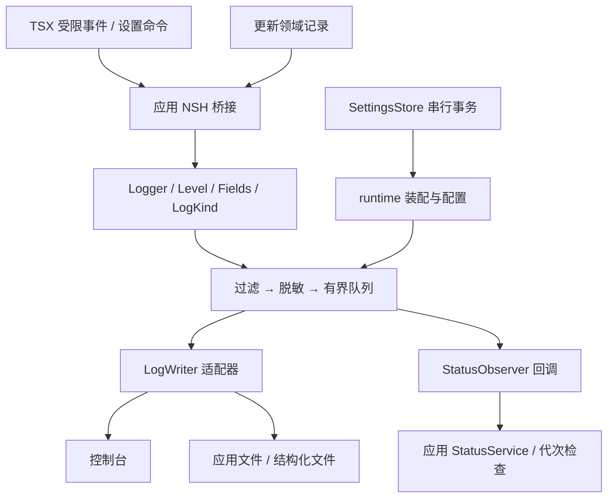

# 日志模块架构

本文规定独立 `usher-logging` 的边界、接口与后端设计。批次及验收统一见 [迭代台账](todo.md#logging)。相关约束见 [开发规范](../CONTRIBUTING.md)、[项目架构](../architecture.md#8-诊断日志)、[测试架构](testing.md)及[更新方案 8.6](update.md#86-日志-crate)。

## 1. 目标与原有文档

`crates/usher-logging/` 对外提供稳定门面与装配接口，JSON、时间、路径、分片和归档等具体实现保留在私有后端。业务通过公共契约调用，不依赖底层辅助函数。

普通业务只需输出事件、打印结构化日志、查询过滤条件和设置等级。替换底层输出实现时，更改日志 crate 的适配器与装配选择，业务、页面和更新状态机保持同一调用契约。不发布到 crates.io，不增加远程收集、第三方库全局拦截或运行中无损替换协议。

## 2. 沿用的取舍

| 约束 | 实现 |
| --- | --- |
| 通用日志独立于应用 | 不依赖根 crate、`usher-state`、NSH 或窗口；领域 `usher-update` 继续只产生类型化记录 |
| 小型健康观察者 | `runtime::StatusObserver` 回调在应用 `StatusService` 的发布顺序内采样，旧 source 代次被应用拒绝 |
| 整体基础设施独立 | 过滤、脱敏、格式化、后台线程、按日分桶、保留、归档、进程入口、panic 和退出刷新均留在日志 crate |
| 凭据脱敏 | token、secret、authorization、bearer、password、passwd、apikey、api_key、credential 类字段及文本凭据掩码；递归对象、数组；主目录替换为 `~` |
| 不扩大删除范围 | 不因 body、content、email、cookie 字段名直接删除；仍禁止主动采集用户正文 |
| 受限 TSX 入口 | 普通桥接仅等级、模块、事件短标识；非空、最多 64 字节、ASCII 字母数字及 `_`、`.`、`-`，无任意字段、文本或路径 |
| 更新故障详情 | 通过有效完成回执校验后的 `detail`、`reason` 由 Rust 写入；reason 仅供排查，不参与状态机决策 |
| 队列与生命周期 | 一个有界队列、一个写入线程；WARN / ERROR 满队列等待，其余允许丢弃并计数；panic 链接原钩子、不记录 payload、不主动退出 |
| 保存失败 | 设置事务仍将新偏好应用于当前进程，保留 `saved=false`，后续可重试保存 |

## 3. 类型、等级与输出目标

参考同级 Slint 版 `../usher/docs/specs/diagnostics.md`、`src/logger/debug_logger.rs` 和 `tracing_logger.rs`。那里的五个控制项既有输出目的地，也有额外采集能力，不能全部当作日志等级，也不需要现在建立动态类型注册系统。

| 诊断页控制项 | 含义 | 本次行为 |
| --- | --- | --- |
| 应用文件日志 | 普通日志输出目的地 | 独立开关，默认开启，`usher.log` |
| 控制台日志 | 普通日志输出目的地 | 独立开关，默认关闭，stdout |
| 结构化诊断 | 独立诊断流及文件输出 | 默认关闭，`usher_tracing.log`；当前记录诊断配置与更新状态转换 |
| 终端详细日志 | 终端额外采集 | 禁用开关并显示“尚未接入” |
| 内存诊断 | 周期采样 / 检查点 | 禁用开关并显示“尚未接入” |

终端与内存项按用户确认保留可见占位，应用命令拒绝启用。crate 的 `LogKind::{Application,Tracing,Terminal,Memory}` 已定义类型与过滤规则，测试可注入这四类事件；这不代表已有真实终端 / 内存采集器。后续采集器必须先调用 `enabled(level)`，关闭时不构造昂贵数据，按领域模块实现，不把采样任务放进 logger。

`Output::{Console,File,Structured}` 与 `LogKind` 分开：Application 写所启用的 Console / File；Tracing 只写 Structured；Terminal / Memory 要先启用对应采集标志，再写 Console / File。所有类型共用 `OFF、ERROR、WARN、INFO、DEBUG、TRACE` 过滤。OFF 是关闭过滤条件，不能输出 OFF 事件；结构化诊断与 TRACE 等级无关。普通应用文件沿用 JSONL，不改成 Slint 版的纯文本，不引入第二套 tracing 引擎或 span 系统。

## 4. 模块与依赖



观察者是回调方向，不是日志 crate 到应用的编译依赖。

| 位置 | 职责 |
| --- | --- |
| `src/lib.rs` | 小型普通日志门面，无文件 / 线程句柄 |
| `event.rs`、`level.rs` | 自有字段值、类型、输出、提交结果及等级 |
| `record.rs`、`redaction.rs` | 受控记录、序列化、统一脱敏 |
| `pipeline.rs` | 过滤、路由、队列、健康与后台执行 |
| `runtime.rs`、`lifecycle.rs` | 装配、归档能力、观察者、进程复用及钩子 |
| `backends/file.rs`、`files.rs`、`archive.rs` | 内置控制台 / 文件适配、分片保留及归档 |
| `config/defaults.json` | 文件名、容量、时间和默认输出策略 |
| 应用 `src/diagnostics.rs` | 进程装配、健康源代次与启动 / 配置事件 |
| 应用 `diagnostic_state.rs`、`diagnostic_bridge.rs` | 状态所有权及 NSH 只读订阅 |
| 应用 `settings_service.rs`、`settings_bridge.rs` | 偏好持久化、串行更新运行配置、宿主目录、导出展示 |

文件后端的 chrono、serde_json、tar 等依赖仍在 crate 内；公开门面不泄漏它们。当前没有拆成多个后端 feature，不宣称不选择文件适配器就不编译这些依赖。

## 5. 普通门面与后端替换

```rust
use usher_logging::{Fields, Level, LogKind};

if let Some(log) = usher_logging::current() {
    log.info("app", "started", Fields::new().with("version", "0.1.0"));
    log.warn("update", "retry", Fields::new().with("attempt", 2_u64));
    log.set_level(Level::Debug); // In-memory only; the settings service owns persistence.
    let trace = log.for_kind(LogKind::Tracing);
    if trace.enabled(Level::Debug) {
        trace.debug("update", "phase", Fields::new().with("name", "download"));
    }
}
```

普通门面包含 `Logger::{log,error,warn,info,debug,trace,enabled,level,set_level,for_kind}`。自有 `Fields / FieldValue` 支持空值、布尔、整数、有限浮点、文本、数组和对象；非有限浮点返回 `InvalidFields`。打印文本可作为 `Fields::new().with("message", text)` 进入同一脱敏流程，无绕过管线的自由 println 入口。

`Submit::{Filtered,Enqueued,Dropped,Unavailable,InvalidFields}` 仅表示过滤与提交结果，不能用 Enqueued 判断落盘或业务成功。未初始化的 `current()` 返回 None，不自动创建目录或缓存记录。

装配方使用 `runtime::Runtime`，普通业务不引入文件与导出辅助函数。`LogWriter` 接收已过滤、脱敏的 `Record` 与目标，提供 `write`、`flush` 和周期 `flush_pending`；可选 `ArchiveProvider` 提供高层导出能力。`Runtime::with_backend` 创建隔离实例，契约测试据此注入 capture / 故障后端；内置 `Runtime::file` 和进程 `install` 选择文件适配器。替换生产后端时调整这两个装配入口的选择及对应归档能力，调用方仍只使用 Logger。进程安装目前按目录复用，不提供在运行中切换任意后端的协议。

观察者只能同步采样，不得反向调用 logger；后端也不得重入日志，避免队列或锁递归。后端不再重复业务过滤、脱敏或创建异步日志队列。

## 6. 配置与诊断页

`[diagnostics]` 在原等级基础上增加 `console`、`file`、`structured`。默认 INFO、false、true、false；旧文档缺项采用默认值，默认段省略。该段由现有 SettingsStore 保存，不另存日志偏好文件。类型控制、文件名和非用户策略集中在 crate 的 `config/defaults.json`；页面等级、分组和归档日期选项在 `ui/config/diagnostics.json`。

设置事务串行同步日志与持久化，防止两次设置命令以相反顺序应用。已有 Logger 句柄共享新等级和输出配置。关闭目标后，尚未开始写入该目标的排队事件被跳过；启用新目标不会补写其未接收的旧事件。已经进入后端的写入不能撤回。关闭不删除历史文件，导出仍可包含它们。OFF 保留三个开关的偏好；等级变更审计沿用 from / to 特例，在新过滤器生效前写出。

设置分区顺序为“通用、主题、更新、诊断”。诊断页按日志输出、详细程度、专项诊断、归档四组组织，复用主题控件、下拉框和开关；AppKit 控件族使用已有原生 Popup。错误、丢弃数与 OFF 说明放在相关区域，不在页面暴露线程、队列或存储实现术语。 设置标题下不再显示实时保存状态文案。保存期间保留三个已接入开关的点击保护，但不应用灰显样式，避免一次操作让其它开关同时闪烁；灰显仅用于尚未接入的专项诊断。

## 7. 文件、导出与保留边界

默认应用 JSONL 保持 `ts / level / module / event / fields`；非 Application 事件增加 `category`。两个文件流按事件本地日期写入 `logs/YYYY-MM-DD/`，单文件 8 MiB 分片，共享 14 天 / 256 MiB 保留清理；当前日期桶不会为配额而删除，不能把配额当作任何时刻的硬上限。文件 Unix 权限为 0600。

归档仍限普通日志文件，跳过符号链接，日期范围由应用校验，单源文件 8 MiB、总源数据 64 MiB；最新内容优先，临时文件成功后发布，保留最近五个归档。当前导出到宿主数据根的 exports 并打开目录，未实现系统保存 / 移动分享入口。

本次保留旧行为的明确限制：WARN / ERROR 等待入队，`flush(timeout)` 的 timeout 只覆盖发送后的确认等待；阻塞发送与线程 join 没有总截止时间。flush 确认表示队列屏障，不保证 durable write；刷新错误不由该 bool 表达。退出与 panic 刷新也不承诺异常进程终止无丢失。盘满、强杀、跨平台分享另行验收，不将这些问题混入接口重构。

## 9. 测试架构与命令

所有命令从项目根目录执行，NSH 命令串行运行。统一入口写入 target/test-reports，拒绝零用例、跳过、过滤或必测组缺失；CI 使用相同入口。

| 层次 | 位置 / 命令 | 证明范围 |
| --- | --- | --- |
| 规则单测 | `crates/usher-logging/src/*`；`python3 scripts/test.py logging` | 等级、脱敏、日期 / 分片、清理、归档、确定性队列、进程复用 |
| 公共契约 / mock | `crates/usher-logging/tests/contracts.rs`；`python3 scripts/test.py logging-mock` | 只 import 公共 API；Capture、故障和门控后端；真实文件对照 |
| 应用集成 | `tests/integration/diagnostics.rs`；`python3 scripts/test.py integration` | 真实设置服务保存 / 失败 / 恢复、运行配置、双文件及归档 |
| 真实 NSH 桥接 | `tests/integration/diagnostics_bridge.test.tsx`；`python3 scripts/test.py state-ui` | 三个偏好、状态 DTO、OFF 保留、拒绝不可用类型和自由文本 |
| 应用 UI 回归 | `tests/ui/diagnostics.test.tsx`、`settings-layout.test.tsx`；`python3 scripts/test.py ui` | 控件交互、分区顺序、键盘导航、不可用标记、中文、导出错误 |
| 全工作区 | `cargo test --locked --workspace`、`cargo clippy --locked --workspace --all-targets -- -D warnings`、`nsh check` | 现有应用及其他模块回归 |

mock 矩阵为四类事件 × 六档过滤配置 × 六档提交等级，包含 OFF 无事件；逐输出核对确切记录，不只检查 enabled 返回值。另枚举全部 32 种输出 / 采集标志组合，覆盖动态切换、已入队目标关闭、不向新目标补写、字段脱敏、后端局部失败和非有限值。真实文件适配器与 Capture 对照全部类型 / 等级的结果。终端 / 内存事件是合成输入，不能据此宣称真实采集已接入。

队列单测使用通道暂停写入器、确定占满队列、检查丢弃计数与 WARN / ERROR 保留，不依赖吞吐压测碰巧占满。每例独立 Runtime / 临时根；仅进程生命周期单测使用串行保护的全局安装。不要把日志专有 mock 放进 usher-test-support，不增加测试用公开内部函数，不把 mock 页计为真实桥接或平台验收。
