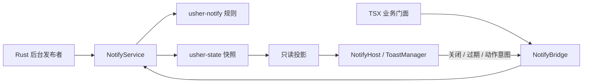

# 独立 Notify 模块方案

本文设计应用内通知的统一入口、领域契约、界面适配及后续消息中心与系统通知扩展。遵循 [开发与贡献规范](../CONTRIBUTING.md)、[交互设计规范](interaction-design.md)、[状态管理方案](state-management.md) 和 [项目架构](../architecture.md)。

本文描述目标架构，不代表全部能力已经实现；实施状态与前置核验统一见 [迭代台账](todo.md#notify)。

## 1. 目标与范围

程序在 Rust 后台任务、TSX 业务控制器和页面中通过同一语义契约发出通知。调用方不依赖 Toast、窗口布局、主题、原生句柄或 NSH 响应式对象。通知在页面切换后保留，按所属窗口隔离，并支持关闭、替换、去重和关联动作。

区分三种能力：

| 能力 | 数据与生命周期 | 本方案范围 |
| --- | --- | --- |
| 应用内 Notify | 窗口内短时或手动关闭的反馈；不落盘 | 首批核心交付 |
| 消息中心 Inbox | 应用域历史、已读、查询、删除与持久化 | 独立消息域，与可靠接收服务衔接 |
| 系统通知 | 操作系统通知中心及点击激活 | 独立平台适配器 |

Notify 不承担业务任务执行、更新状态机、服务端连接、更新公告获取或诊断日志存储。首批不包含通知历史页、未读角标、操作系统权限申请或任意自定义组件注入。长时间任务的进度仍由业务页面展示；通知用于结果、异常和可选下一步操作。

## 2. 现有组件与参考实现

### 2.1 NSH 组件核查

项目 Rust 依赖固定 `nsh-core = 0.5.0`；界面使用 `nsh/base`。Primer、Geist、Slate、Radix Sand 等是本项目的主题 token 快照，不代表引入这些设计体系的 React 组件库。

已在本地生成的 `.nsh/types/nsh/base.d.ts` 核实以下公开 API，并与 [NSH 官方 Toast 文档](https://nsh.dev/elements/toast/) 及 [发布说明](https://nsh.dev/releases/) 的组件说明交叉核对：

| 能力 | 已有 API | 项目需要补充的部分 |
| --- | --- | --- |
| 单条通知 | `Toast` | 主题样式、标题、正文、图标、动作与关闭按钮 |
| 堆叠 | `ToastStack` | 用 `Overlay` 放置在窗口安全区内；配置宽度与位置 |
| 生命周期 | `ToastManager` | 创建 owner、同步领域队列、驱动时钟与清理 |
| 自动消失 | `push(id, value, { timeout })`、`advance(paused)` | 从配置取得时长；展开及键盘交互期间暂停 |
| 替换与关闭 | `push` 同 ID 替换、`dismiss`、`dismissAll` | 领域代次校验、关闭原因与业务回执 |
| 过渡 | `starting / present / ending`、motion 配置 | 与主题动效及降低动态效果偏好连接 |
| 交互 | 滑动关闭、`onExpandedChange`、`onCancel` | 将交互发送到 Notify 命令入口 |
| 无障碍 | `Toast` 的 alert 语义与 `accessibilityLabel` | 本地化完整朗读内容、焦点和键盘验证 |

`ToastManager` 不自行启动定时器；宿主需要调用 `advance`。`entries()` 按旧到新返回。`visible(limit)` 包含最新的非 ending 项以及退出中的项，因此 limit 不是存储上限，也不能单独保证挂载数上限。`dispose()` 后对象不可再使用。

结论：复用 `Toast`、`ToastStack`、`ToastManager`、`Overlay`、`Button`、`Text` 等公开组件，应用只补充领域服务、适配器和主题组合。无需引入额外通知 UI 库，无需修改 NSH 组件内部实现。API 存在不等于布局、键盘或多窗口契约成立，原生验证方法见第 10 节。

### 2.2 Slint 版 Usher 参考

核查来源为同级仓库当前工作区，不依赖其作为构建输入：

- [`../usher/ui/state/notification.slint`](../../usher/ui/state/notification.slint)：`NotificationOptions`、四种语义级别、便捷方法及按 ID 关闭。
- [`../usher/src/notification.rs`](../../usher/src/notification.rs)：有界 Banner 队列、稳定模型、悬停暂停、计时器代次及 Inbox 对账。
- [`../usher/src/notification/ingress.rs`](../../usher/src/notification/ingress.rs)：有界入口、ticket、同 ID 最新回执及后台提交。
- [`../usher/src/ui/components/github/notify/`](../../usher/src/ui/components/github/notify)：通知卡片、关联动作、队列菜单及根浮层呈现。
- [`../usher/docs/specs/messages.md`](../../usher/docs/specs/messages.md)、[`../usher/crates/usher-messages/src/model.rs`](../../usher/crates/usher-messages/src/model.rs)：短时反馈与持久 Inbox 分离、来源/通道/分类、幂等键和系统投递策略。

| Slint 经验 | NSH 采用方式 |
| --- | --- |
| `info / success / warn / error / show` 统一入口 | 保留便捷门面，内部归一为 Publish 命令 |
| 按 ID 操作与旧计时器代次检查 | ID、通知 revision、宿主 epoch 共同拒绝旧回调 |
| 队列容量与入口预算 | 同时限制条数、内容字节、动作数量和退出中挂载量 |
| 关闭 Banner 不修改 Inbox | 关闭、已读和删除作为不同命令 |
| 系统投递与 severity 正交 | 将系统投递放在后续应用适配，不由 error 等级自动触发 |
| source、channel、category 分开 | 保留语义分类，去重键按发布者命名空间解释 |
| 详情只在 Inbox 展示 | 短时通知只保留安全摘要，技术细节进入诊断模块 |

不照搬 Slint 的全局窗口弱引用、Slint Model、图片对象、手写动画和多个全局计时器表。NSH 用窗口作用域、通用状态订阅及现有 Toast 组件替代。Slint 当前的固定时长和容量仅是参考，不能直接写成新实现中的常量。Slint 的 duration 注释与 Rust 对零值的处理存在表述差异，本方案使用显式寿命枚举避免负值/零值哨兵。

## 3. 模块划分与依赖

采用独立 `usher-notify` crate，原因是 Rust 后台与 TSX 入口需要共享规则，规则须可在无 NSH、无窗口的环境独立编译和验证。公共契约不绑定具体状态后端。

| 目标位置 | 职责 |
| --- | --- |
| `crates/usher-notify/` | 普通 Rust 类型、输入验证、去重、替换、容量规则与纯状态转换；无 NSH、I/O、平台和业务依赖 |
| `src/notify_service/` | 串行提交、`usher-state` 发布、窗口服务生命周期、通知 ID 和宿主代次；注入状态后端 |
| `src/notify_bridge.rs` | DTO、命令回执、订阅及引擎线程投递；复用既有窗口身份验证 |
| `ui/notify/contracts.ts` | 框架无关的调用、快照、错误及动作契约 |
| `ui/notify/transport.ts` | NSH 桥接与版本信封处理 |
| `ui/notify/projection.ts` | 只读投影、本地化、领域记录与展示实例的差异同步 |
| `ui/notify/presentation.ts` | ToastManager、时钟、展示宿主 epoch、退出缓存与清理 |
| `ui/notify/NotifyHost.tsx` | Overlay、ToastStack、通知卡片与公开组件组合 |
| `ui/notify/index.ts` | `createNotify`、Provider、`useNotify`；向业务隐藏渲染细节 |
| `ui/config/notify.json` | 行为策略及资源预算的单一来源，Rust 与 TS 使用同一配置 |
| `ui/theme/`、`i18n/messages/` | 通知视觉 token 与语义文案 |

依赖方向：业务调用方 → Notify 公共契约 → 应用服务 → `usher-notify` 与 `usher-state`。展示适配器读取快照并调用 NSH；核心不反向依赖应用、路由、更新或主题。

`App.tsx` 在窗口状态就绪后装配 NotifyProvider 与唯一 NotifyHost，Host 位于 RouterView 生命周期之外并消费同一外观投影。Notify 服务使用独立 Store，和路由服务共用窗口生命周期身份，不把通知字段塞进导航历史。

## 4. 公开契约

### 4.1 数据模型

| 字段 | 语义 |
| --- | --- |
| `NotificationId` | 服务生成的不透明标识，限定在窗口 opening 内；不使用列表下标 |
| `revision` | 同一通知替换时递增，与通用快照 sequence 分开 |
| `severity` | `info / success / warning / error`，只表达语义级别 |
| `title`、`body` | 标题可选，正文必填；应用文案保存 message key 与类型化参数 |
| `source`、`category` | 发布来源与业务分类；使用注册词表和有界字符串 |
| `deduplicationKey` | 可选，按 source 和窗口隔离；相同语义发布重试不重置计时 |
| `lifetime` | `default / timed(durationMs) / persistent`；时长必须为有限正值并符合配置范围 |
| `actions` | 稳定 action ID、本地化标签、语义目标；不含闭包、JS 对象或原生句柄 |
| `messageId` | 后续 Inbox 关联标识；首批无消息中心时为空 |
| `actionState` | 空闲、执行中或稳定失败码；由服务维护，不能只在按钮中防重 |

不允许调用方传入颜色、布局数值、任意组件、文件图标路径、可执行代码或原始异常对象。图标按 severity 和主题语义映射，复用现有系统图标能力与回退资源。未来服务端正文使用单独的受限纯文本类型，不能当作本地化键、HTML 或可执行操作。

### 4.2 调用方法

以下为目标 API 语义，具体 Rust/TS 签名在 N1 固化；并非已可调用接口。

| 方法 | 行为与回执 |
| --- | --- |
| `show(request)` | 验证后提交，返回 `accepted(id, revision)`、`deduplicated(id, revision)` 或稳定错误 |
| `info / success / warn / error(request)` | 只填充 severity，复用 show；warn 对应 warning |
| `replace(handle, request)` | 使用期望 revision 原子替换；返回新 handle，旧计时和旧动作失效 |
| `dismiss(handle)` | 关闭指定代次；重复关闭幂等，旧代次不能关闭替换后的通知 |
| `dismissAll()` | 原子关闭执行时的窗口队列，不影响之后入队项或持久 Inbox |
| `invokeAction(handle, actionId)` | 校验动作与执行状态后返回一次性的执行 ticket |
| `completeAction(ticket, outcome)` | 接受当前执行结果；旧 ticket 无效，失败后按策略允许重试 |
| `read / subscribe` | 返回不可变快照；订阅取消仅释放借用，不销毁窗口服务 |

门面方法返回 Promise 或 Rust Result，成功表示领域准入，不表示已经绘制、持久化或系统投递。关闭、去重、替换和动作分别有明确回执，禁止把所有异常吞掉后返回成功。

错误至少区分：`invalid_request`、`capacity_exhausted`、`stale_revision`、`window_closed`、`host_stale`、`action_unavailable`、`action_busy`、`state_unavailable`。通过结构化日志记录错误码和关联 ID，避免将通知正文写入日志；通知服务自身失败不得递归产生通知。

### 4.3 关联动作

业务通过应用装配注册动作处理器，Notify 仅接收语义 action ID 与有界参数。导航动作交给 Router，重试交给原业务服务，不在 Notify 内编码更新、设置或路由规则。

动作先在服务中领取 ticket，再由原调用入口执行，不通过快照广播执行副作用。无处理器时禁用动作并提供可解释状态。跨页面存续的处理器由窗口应用 owner 持有，不能捕获已卸载页面对象。Rust 后台发布者不需要持有 TS 闭包。

执行期间按钮内显示加载图标并禁用，服务拒绝重复领取。失败保留通知并显示稳定错误；成功可按动作声明关闭或保留。超时、HMR 或窗口关闭不承诺业务副作用回滚；业务服务负责自身幂等与取消，未确认结果不能盲目再次执行。

## 5. 状态、队列与展示生命周期

### 5.1 单一数据来源

Rust 持有窗口队列、通知内容、revision、去重信息和动作状态；这些数据跨页面保留。ToastManager 只持有展示镜像、动画 phase 与当前挂载期间的剩余时长，不能成为另一份业务 Store。

共享状态订阅可能合并中间快照，因此服务发布完整的保留队列，而不是把通知当作一次性瞬时事件。队列内的通知会一直保留到关闭、超时确认或明确替换；准入失败返回调用方。首批容量满时拒绝新项，不静默挤掉未展示的旧项。同 ID 替换可在预算允许时完成。

区分 `queueCapacity`、`maxPayloadBytes`、`maxVisible`、`maxMounted`。正文长度、参数、动作数量和单条字节数同样有界；退出中的卡片占用挂载预算。显示容量不等于保存容量。

### 5.2 展示规则

1. 服务按准入顺序保留记录，Host 选取最早等待的通知填充可见槽；同一可见组内按 ToastStack 的旧到新顺序提供 children。
2. 等待项尚未进入 ToastManager，不消耗显示时长。可见项退出前占用槽位；不依赖 `visible(limit)` 隐藏项是否继续计时的行为。
3. 新 ID 只 push 一次；未变更记录不重复 push。显式 replace 才重启该通知寿命；主题、语言、无关快照变化不重置计时。
4. ToastManager 保存 ID 与 revision 等轻量展示标识，卡片正文由当前投影读取。退出动画需要的最后一份展示数据只在有界退出缓存保留。
5. `advance` 报告 timeout ending 时，以 ID、revision、host epoch 提交过期命令；关闭交互也先提交同一命令入口。服务失败时保留领域记录，重建该展示项并报告故障，不永久隐藏仍有效的记录。
6. 服务快照删除记录后，Host 调用 dismiss 完成退出；`removed` 仅清理局部展示资源，不能再次删除其他代次的领域记录。
7. 当前组全部或部分退出后，按空余槽位准入等待项。无挂载项时停止时钟；新项到来再启动。

首批使用库提供的堆叠交互，不照搬 Slint 的“只显示最新一张 Banner”布局。通知区域默认规划在窗口右上方，避开标题栏与安全区；位置属于配置项。若原生验证表明公开 Overlay/ToastStack API 无法满足安全区、模态层级或焦点要求，应按交互规范提交具体缺口与处理方案，不能自建布局系统绕过。

### 5.3 暂停与重挂载

ToastStack 展开、通知内键盘焦点或关联动作执行期间暂停当前展示组的自动关闭。鼠标、键盘暂停原因独立计数，任一原因存在即暂停，不能用一次 mouse leave 覆盖键盘焦点状态。暂停恢复不得重新 push。

页面切换不重建 Host，剩余时长持续。仅展示 Host 因 HMR 重建时，Rust 保留尚未关闭记录，新 Host 重新给出完整显示时长；首批不保存逐帧剩余时长，不承诺 HMR 前后毫秒连续。新的宿主 epoch 使旧 tick、动作展示回调和关闭回执失效。ToastManager 的时钟只计算实际挂载且未暂停的显示时间，不是进程级 TTL。

每个窗口只有一个有效展示 owner；重复普通挂载拒绝，HMR 按释放旧 owner、领取新 epoch 的顺序交接。窗口关闭释放订阅、计时器、ToastManager、动作注册与窗口服务；同名窗口重开得到新身份。完整 VM 重建按现有窗口 session 语义清空短时通知，不伪装成持久恢复。

## 6. 多窗口与后台调用

TSX 调用使用创建门面时捕获的窗口 StoreId，不能每次按当前焦点寻找目标。Rust 后台任务在启动时取得该窗口的发布句柄；窗口关闭后返回 `window_closed`，不转投其他窗口。

首批只支持显式窗口目标，不提供进程级全局 `notify()` 单例。跨窗口广播由后续应用分发适配器显式遍历存活目标，每个窗口获得独立的通知寿命与关闭状态；一次广播的部分失败须逐目标返回。业务需要全应用保留的事件应进入未来 Inbox，不能靠广播短时 Toast 代替。

## 7. 主题、国际化与交互

卡片采用中性浮层背景，severity 通过语义图标和强调色表达；不整块覆写页面主题。宽度、最大高度、间距、边框、圆角、字体、阴影、关闭按钮尺寸、滑动阈值和动效参数均来自主题 token。业务配置包含寿命策略、预算、位置和时钟推进间隔，不把行为时长混入颜色主题。

实施时在默认主题定义完整通知 token，其他主题按既有继承规则覆盖。禁止按 themeId 分支。reduceMotion 同时作用于 ToastManager 的 motion 和渲染样式，避免视觉已结束但生命周期仍等待。数值将在实施批次作为配置数据集中确定，不直接复制 Slint 常量，不在代码中散落默认值。

应用文案使用 `i18n/messages/en.json` 与 `zh-Hans.json` 的语义键，已显示通知随语言切换重新投影；不重建通知身份。正文可换行，受最大高度约束，长内容通过业务详情动作查看；不显示原始堆栈、URL 凭据或响应正文。

必须验证：

- 通知出现不抢夺输入焦点；键盘能进入动作和关闭按钮，焦点仍在通知内时不自动消失。
- 关闭后恢复合理焦点；Escape/Back 仅按组件支持和浮层优先级关闭最新可见通知，不能穿透模态框或误触发路由返回。
- `accessibilityLabel` 包含完整本地化摘要，不仅依靠颜色区分等级；普通提示使用库当前 alert 语义，后续若要求 polite 宣读需单独核验公开 API。
- 窄窗口、长英文/中文、较大字体、明暗主题、降低动态效果、触控及菜单/Popover 并存。
- 窗口外与空白区域不被透明通知层拦截；无通知时不挂载交互浮层。

## 8. 消息中心与系统通知扩展

### 8.1 Inbox 边界

未来 Inbox 使用独立应用域服务，与 06.08 的实时消息接收分开。接收适配器负责认证、重连、补取及外部数据归一化，Inbox 负责持久消息与已读；Notify 只负责展示。更新公告获取仍归 06.07，不移入 Notify。

需要保留历史的发布先由消息中心取得稳定 messageId，再请求短时展示。关闭或超时不标记已读、不删除历史；打开详情是否标记已读由 Inbox 命令决定。Inbox 删除后按 messageId 撤回关联 Toast，旧发布回执必须重新检查消息存在性，避免复活已删除记录。未读数来自 Inbox selector，不来自 Toast 队列长度。

持久消息使用 schema 版本、有界保留策略及原子保存。后台写入区分内存准入与真实保存结果，并支持同 revision 重试；启动加载必须合并加载期间的新消息，不能用旧磁盘快照覆盖它们。系统通知失败和短时队列满不回滚已接受的 Inbox 消息。

详情只接受发布方显式提供的安全数据，短时 Toast 和系统通知仅取摘要。历史页、筛选、分页、详情、已读与批量删除需要独立实施及真实验收，不因 Notify 可显示消息就标记完成。

### 8.2 系统通知边界

后续定义 `NativeNotifier` 平台接口，投递策略为 `Never / WhenUnfocused / Always`，与 severity、category 和记录身份正交。应用内首批等同 Never；未来普通记录事件可按配置使用 WhenUnfocused。焦点判定按应用是否活动，而非某个后台窗口是否失焦，避免与前台 Toast 重复打扰。

平台适配器负责权限、能力查询、操作系统线程约束、发送回执与点击激活。无权限或不支持时保留应用内/Inbox 能力并返回明确投递状态。原生点击携带已验证的消息/动作 ID，通过应用入口重新校验有效性；冷启动与已删除消息有独立路径。

持久化 worker 与原生发送 worker 分开、均有界；后台调用不阻塞 UI，不在订阅回调持锁时执行。退出停止发布者后排空或取消，并报告未完成项。是否使用 NSH 原生 API 或额外库在平台批次调研决定，不预设 `notify-rust` 或其他依赖，也不承诺跨进程恰好一次投递。

## 9. 现有功能接入

| 调用场景 | 接入方式与限制 |
| --- | --- |
| 设置显式保存或导入 | 真实成功后显示成功；失败仍保留页面的未保存状态及重试入口 |
| 诊断导出 | 从既有操作完成回执发布一次结果；不通过观察每次快照重复通知 |
| 手动检查更新 | 显示已是最新、发现版本或检查失败；文案来自更新语义结果 |
| 自动更新检查 | 保留静默策略，不能因通用 Notify 接入自动弹出成功或错误通知 |
| 下载/安装 | 业务面板继续承担进度与确认；通知动作只能调用既有意图入口 |
| 未来服务端消息 | 先归一化并写入 Inbox，Notify 展示安全摘要 |

当前 `ui/features/updates/controller.ts` 对 `effect.type === "notify"` 直接回复 `notified`，并未显示通用通知。后续接入须先修改 [更新设计](update.md)，明确每种 notice 的展示策略和完成语义。Notify 不得绕过更新执行租约，也不能让通知队列满导致下载、安装或 effect pump 无限重试；`notified` 应明确表示通知意图已按策略处理，是否成功显示另有可观测结果。按 effect token 去重，不从多窗口共享更新快照重复产生通知。

## 10. 验证方案

| 层级 | 关键验收 |
| --- | --- |
| 核心单测 | 输入与预算、同 source 去重、显式替换、ID/revision、持久寿命、满载拒绝、动作 ticket |
| crate 契约 | 无 NSH 编译、公开类型、确定性转换、失败不改变候选状态 |
| 应用集成 | `usher-state` 发布失败原子性、快照合并不漏保留项、多窗口隔离、关闭后拒绝旧句柄 |
| TS 投影 | 乱序/重复信封、只对新增或替换 push、语言主题变更不重置、host epoch、订阅清理 |
| 展示适配 | 手动时钟推进、暂停原因叠加、等待项不计时、退出中容量、过期提交失败恢复、dispose 后无调用 |
| UI mock | 四种级别、标题与正文、动作加载禁用、关闭、换行、空队列移除浮层 |
| 真实桥接 E2E | Rust 和 TS 两类入口、跨页面通知、后台完成、并发发布、HMR、关闭重开、动作防重 |
| 原生交互 | 安全区、点击穿透、焦点、屏幕阅读器、Escape/Back 与模态优先级、缩放与减少动效 |
| 后续扩展 | Inbox 加载合并/保存失败/删除对账；系统权限、应用失焦、冷启动点击、平台不支持 |

Rust 规则单测就近，公开契约放 crate `tests/`；TS 投影测试放 `ui/notify/__tests__/`；应用集成与 E2E 归根 `tests/integration/`、`tests/e2e/` 并接入现有测试入口和 CI。实施后按范围运行 `cargo test --locked --workspace`、`nsh check` 及项目对应 UI/E2E 命令；新测试命令须先实现并同步测试方案，本文不声明尚不存在的命令可用。

原生测试使用隔离应用身份与数据目录，不修改真实用户设置，不改 HOME。mock 通过不代替真实桥接或原生交互验收；平台不支持、能力跳过和零测试均不能记为通过。

