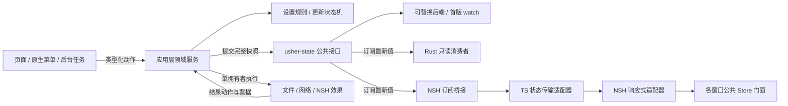

# 通用状态管理方案

本文规定共享状态的通用契约、独立 crate 边界、订阅流程与分批实施计划。模块关系见 [architecture.md](../architecture.md)，开发约束见 [CONTRIBUTING.md](../CONTRIBUTING.md)，项目任务索引见 [scaffolding.md](../scaffolding.md) 的 03.02 与 03.08 至 03.13。更新业务规则仍以 [update.md](update.md) 为准。

**当前阶段：SM1 至 SM5 已完成；SM6 部分完成，跨平台宿主等缺口仍待补齐。** 独立核心、设置服务、Rust → NSH 订阅及 TS 投影已实现并在 NSH 0.5.0 无头宿主验证。旧桥接命令与持久化格式保持兼容，现有外观入口已读取订阅投影。SM4 已交付全量现有共享数据迁移、无头旅程以及隔离目录下的 macOS 同 VM 多窗口、真实源码 HMR 与关闭重开验收。SM5 已交付更新应用服务及执行协调器；SM6 已完成本机回归与成本验收，整体保留跨平台 / 远端验收缺口。

## 1. 目标与现状

目标是提供类似 Pinia / Vuex 的共享状态入口，使页面、窗口、原生菜单和后台任务通过类型化动作修改状态，并通过订阅取得一致的最新快照。模块对外提供与具体后端、框架无关的接口，后续替换存储或分发实现时，调用方无需调整。项目所有跨页面共享或跨页面切换保留的状态均纳入迁移，详见第 8.3 节；共享机制统一，作用域仍区分应用与窗口。独立进程和服务端之间的同步需要额外传输与业务协议，不由本模块自动提供。

| 当前实现 | 已有能力 | 缺口 |
| --- | --- | --- |
| `src/settings.rs`、`src/settings_service.rs` | 设置校验、串行持久化、业务 revision 和通用版本发布 | 继续按业务需要分离纯规则与 I/O |
| `src/settings_bridge.rs`、`src/state_bridge.rs` | 按路径共享服务，初始化 / I/O 不持有全局表锁；版本订阅、幂等取消、引擎清理 | macOS 同 VM 多窗口、关闭重开及真实 HMR 已通过；其他平台待验收 |
| `ui/state/appearance.ts`、`ui/state/projection.ts` | 设置只读订阅投影、统一版本接收、NSH 适配与借用门面；能接收其他入口变更 | 窗口 Store 与投影已迁移；macOS 多窗口 / HMR 已通过 |
| `crates/usher-update/` | 独立更新业务状态机，事件输入、状态与效果输出、票据校验 | SM5 由应用 update_service 适配发布与订阅，领域 API 保持兼容 |

通用状态管理与业务状态机分层：前者负责读取、发布和同步，后者负责某一业务允许哪些转换。外观设置不必建模成下载式阶段；更新流程继续使用自己的状态与事件。

## 2. 选型与决策

| 编号 | 决策 | 原因与边界 |
| --- | --- | --- |
| S1 | 新建独立内部 crate `usher-state`，目录 `crates/usher-state/` | 用户要求通用状态机层单独成 crate；可独立编译和测试，不绑定宿主 |
| S2 | `tokio::sync::watch` 作为首个可替换后端，隐藏于通用接口之后 | 成熟的跨线程同步原语；调用方不接触 Tokio 类型；不另建运行时 |
| S3 | 按业务域提供 Store，由应用装配统一入口 | 设置、更新、消息分别维护规则和版本；避免无类型全局键值表及全应用大锁 |
| S4 | 通用 crate 提供纯状态转换契约与读写分离的快照通道 | reducer 可无窗口测试；只有领域拥有者持有发布能力；副作用由应用执行器执行 |
| S5 | TSX 状态适配层集中封装 NSH `signal`、`computed`、`context`、`cleanup` | 独立 Rust crate 保持无 NSH 依赖；共享状态消费者只依赖项目门面 |
| S6 | 发布序号独立于领域版本，快照关联 Store 实例身份 | 保存重试、诊断健康变化等可能不改变设置 `revision`，但需要通知 |
| S7 | 保持现有设置格式与桥接命令兼容，先接入设置域 | 用现有正常入口验证通用底座，不同时重写全部业务 |
| S8 | 后端通过工厂与能力接口注入，以同一套契约测试验证替换 | 模块自身定义快照、订阅、关闭与错误语义；替换仅修改后端及装配 |
| S9 | 全部跨页面共享数据使用新模块，窗口会话同样复用 `usher-state` | 导航、分类、共享预览和跨页面操作状态不能继续单独维护可写 signals |

参考 [Tokio watch](https://docs.rs/tokio/latest/tokio/sync/watch/)、[Tokio 同步原语的运行时兼容性](https://docs.rs/tokio/latest/tokio/sync/index.html)及 [NSH 原生模块订阅示例](https://nsh.dev/modules/nsh-native/)。`watch` 只保留最新值，慢消费者可能跳过中间快照；它保证状态收敛，不保证每一条业务事件送达。NSH 官方文档的能力还需在本项目固定的 NSH 版本上验收，不能用示例代替集成验证。

其他方案的取舍沿用前期评估：[redux-rs](https://docs.rs/crate/redux-rs/0.3.3) 提供完整 Redux 模型，但本次调研查到的最新发布为 2022 年的 0.3.3；[Crux](https://github.com/redbadger/crux) 覆盖共享业务核心及效果桥接，引入范围超出本次需求；[reactive_stores](https://docs.rs/crate/reactive_stores/0.4.3) 使用另一套响应式图；[Zustand vanilla](https://zustand.docs.pmnd.rs/reference/apis/create-store.html) 仅解决 JS 侧状态容器；[Statig](https://docs.rs/statig/latest/statig/) 面向层级状态机。首批不引入这些依赖。

`usher-state` 的 `backend-watch` feature 启用可选 Tokio 依赖，仅使用 `sync`，关闭 Tokio 默认 features，版本约束与工作区现有 Tokio 兼容。应用首版显式选择该 feature；关闭它后核心接口、纯状态机及测试后端仍能编译。不启用 `full`、线程运行时或计时器来实现状态订阅，不引入 NSH、平台、网络或文件系统依赖。锁文件已有 Tokio 不等于零成本；实施时记录新增依赖、features、发布包体积及构建耗时差异，跨平台兼容性按实际结果登记。

## 3. crate 与应用边界

下表包含已实施位置与后续目标。`crates/usher-state/` 已按 SM1 实施，应用装配与设置适配已按 SM2 实施；通用订阅桥接及设置 TSX 投影已按 SM3 实施，其余领域按后续批次迁移。crate 内另有 `src/subscription.rs` 与 `src/error.rs` 分别承载取消生命周期和稳定错误。

| 位置 | 职责 |
| --- | --- |
| `crates/usher-state/src/lib.rs` | 公共导出与 crate 文档 |
| `crates/usher-state/src/transition.rs` | `Transition`：显式变化结果和提交后交付的效果；领域自行定义转换函数 |
| `crates/usher-state/src/snapshot.rs` | 快照信封、Store 实例身份与发布序号 |
| `crates/usher-state/src/store.rs` | 后端无关的只读句柄、唯一发布者、订阅及关闭接口 |
| `crates/usher-state/src/backend.rs` | 后端工厂、读取、发布和订阅能力契约；不暴露具体通道类型 |
| `crates/usher-state/src/backends/watch.rs` | 首个可选后端，内部使用 Tokio watch；只在模块内处理底层借用与错误 |
| `crates/usher-state/tests/` | 不启动 NSH 的契约与并发测试，保留状态专用 mock 和夹具 |
| `crates/usher-test-support/src/task.rs` | 仅开发依赖的通用 poll / 唤醒工具，不依赖状态或业务 crate |
| `src/app_state.rs` | 已实现设置路径注册表、进程内 StoreId 分配和独立引擎会话，注入 watch 工厂；窗口域由引擎 Local 内的 Windows 表按宿主窗口注册；传输捕获 currentWindow，动作使用 Rust StoreId，关闭后不复用身份 |
| `src/settings_service.rs` | 设置命令串行、服务层容量检查、快照比较、失败关闭与类型化错误；持久化仍归 SettingsStore |
| `src/window_service.rs`、`src/window_session.rs` | 唯一窗口快照提交与独立会话规则；会话回执及票据类型化，导航发布失败可重试 |
| `src/state_bridge.rs` | 通用订阅生命周期、取消和有界投递；不依赖设置规则，版本 DTO 由领域桥接转换 |
| `src/settings_bridge.rs`、`src/update_bridge.rs` | 各领域的类型化命令、快照 DTO 与适配 |
| `ui/state/contracts.ts`、`ui/state/index.ts` | 框架无关的只读访问器、动作、selector 和访问入口；消费者门面不暴露释放权限 |
| `ui/state/runtime/nsh.ts` | 集中封装 NSH 响应式与作用域 API；实现投影更新、派生值、context 和清理绑定 |
| `ui/state/transport.ts` | 实现项目状态传输接口，隐藏 `usher/nsh` DTO 与订阅对象 |
| `ui/state/projection.ts` | 独立版本接收器、不可变投影、同步状态和绑定代次；通过接口注入传输与响应式实现 |
| `ui/state/app.ts` | 组合传输和响应式适配器，拥有连接 / 销毁权限，通过 Provider 借出只读门面 |
| `ui/state/appearance.ts`、`ui/state/session.ts` | 设置已接入只读投影；窗口 session 由 window.ts / window-contracts.ts 对接 Rust，appearance 不再持有共享 signals |
| `ui/router/`、`crates/usher-router/` | 独立路由门面与纯路由规则；由应用适配使用本模块发布窗口路由状态，见 [路由方案](routing.md) |
| `ui/features/updates/` | 更新文案、布局投影与业务效果执行；共享数据通过状态门面访问 |

依赖方向：应用装配依赖 `usher-state` 和各领域模块；桥接依赖应用层契约；TSX 依赖桥接 DTO 和动作。`usher-state` 不依赖应用根 crate 或 `usher-update`。更新领域可以由应用侧适配为通用转换契约，保持 `cargo test --locked -p usher-update` 无 NSH、无 I/O，不为接入订阅强制增加 Tokio 依赖。



不把设置持久化、更新下载策略、通知去重、文件路径、本地化或原生句柄放进通用 crate。首版不提供插件式 middleware、动态 `Any` 注册表、事件回放、跨域事务或自动持久化。公共抽象对应当前复用需求，不预设完整应用框架。

## 4. 公共契约

下列 Rust 核心接口已在 SM1 实现，公共导出见 [lib.rs](../crates/usher-state/src/lib.rs)。领域服务与 TSX 契约仍由后续批次接入。

| 契约 | 语义 |
| --- | --- |
| `Transition` | 返回 `Unchanged` 或 `Changed(next)` 与待执行效果；未改变状态也可产生效果；拒绝命令返回类型化错误 |
| `Snapshot<S>` | 通过只读方法取得 `store_id`、`sequence` 与 `&S`；字段私有，领域 `revision` 保留在 `S` 中；内部首版用 `Arc` 共享 |
| `StoreReader<S>` | 可克隆；只暴露 `snapshot()`、`subscribe()`；不暴露底层发送端或可变状态 |
| `StoreWriter<S>` | 由创建方独占，不可克隆；负责有序提交、发布与关闭；只交给领域拥有者 |
| `Subscription<S>` | 提供初始快照与后续最新快照；取消或释放后停止等待；不承诺收到所有中间状态 |
| `BackendFactory` 及后端读 / 写 / 订阅能力接口 | 由应用装配注入，创建约定作用域和初值的后端；生产与测试实现遵守同一契约 |
| `StoreError`、`SubscriptionEnd` | 模块自有的稳定错误及结束原因；底层错误由后端转换，不向外返回 Tokio 错误 |
| 领域服务的 `dispatch(Command)` | 统一业务写入口；串行调用转换或兼容适配器，提交状态并返回命令结果；命令失败与订阅失败分别建模 |

### 4.1 可替换后端的接口约束

公共 Store 句柄封装后端能力接口，不把后端实现作为调用方必须指定的泛型参数，也不让调用方创建或传入 `watch::Receiver`、`Sender`。订阅的异步等待使用模块自有接口，仅暴露标准 Rust Future 语义；锁、借用守卫、运行时任务句柄和通道错误都不能出现在公共契约中。领域服务依赖通用读写能力，后端在应用装配处选择。

后端工厂按状态类型实例化为 `BackendFactory<S>`；每个实例的创建方法不再含方法级泛型，以支持对象安全的能力注入。Store 管理实例身份、序号、关闭和变化判定，后端仅存储并通知完整快照；两层不得分别维护版本或重复判定变化。转换结果使用明确的 `Unchanged` / `Changed(next)` 语义，避免同时返回下一状态与不一致的 changed 标志。

首次实现同时提供生产 watch 后端与仅供契约验证的确定性内存测试后端。用同一套黑盒用例验证首次订阅、版本顺序、无消费者发布、允许合并的最新值、幂等取消和关闭语义，并让相同的 Rust 消费者与领域服务测试分别运行于两个后端；替换不要求消费者条件编译、改导入或变更动作调用。测试后端不作为第二套生产功能维护。

替换承诺覆盖符合本接口语义的底层实现。首版支持构造时注入替换，不做运行中的后端热切换；外部协议或领域数据 schema 的变更仍需显式版本兼容，不能借更换后端改变订阅和错误语义。

SM1 实际入口为 `create_store(StoreId, initial, &dyn BackendFactory<S>)`，返回唯一 `StoreWriter<S>` 和可克隆 `StoreReader<S>`。`StoreId` 包装应用分配的 `u128`，不使用全局注册表，也不替应用保证身份唯一性。领域先根据 `writer.snapshot()` 通过自身规则计算 `Transition`，再 `writer.apply(transition)`；`Commit` 仅在成功时交付快照与效果，不执行效果。`publish` 表示领域已判定变化，核心不要求 `S: PartialEq` 或 `Clone`。

`reader.subscribe()` 原子取得初始值与游标，`subscription.initial()` 是注册时已确认的快照，`next().await` 只返回之后的最新值。`cancel()` 立即释放游标；`cancellation_handle()` 可在另一线程唤醒正在等待的订阅，观察到取消后释放游标。丢弃 pending future 不消费值或保留等待任务，丢弃订阅取消自身；显式关闭或丢弃唯一 writer 后，读者仍可读取最终快照，订阅先交付未读最终值再返回 Closed。终止结果保持稳定。参考后端只在 `tests/support/memory.rs`，不会打入生产库。

### 4.2 稳定的 TSX 对接接口

TS 消费者门面定义项目自己的 `Readable<T>`（只读调用函数）、`select`、类型化 `dispatch`、`refresh` 和同步状态；`connect` / `dispose` 仅由装配拥有者持有，应用 / 窗口入口按领域提供，不导出 NSH `Signal`、`.set/.update`、context 对象、原生订阅句柄或底层桥接错误。快照更新、派生值的依赖跟踪和清理由适配器完成；业务组件不能直接覆盖共享快照。

状态传输接口与响应式适配接口分别注入：前者封装桥接的读取、派发、订阅和关闭，后者封装投影、selector、批量更新与生命周期绑定。更换 Rust 后端仅调整 Rust 装配，更换状态传输仅调整传输适配器，更换 NSH 状态绑定仅调整响应式适配器；页面和业务控制器的状态读写接口保持不变。此承诺不包含替换整套 UI 组件框架。

现有 `AppearanceStore`、`Navigation` 的首次迁移允许增加兼容门面并更新调用方；迁移完成后的接口由契约测试约束。同步查询与异步动作的返回语义须在首次接入时明确并保持一致，不因未来后端变化而更改。只读布局契约可继续通过普通属性传递，不得借属性保留第二份可写 Store。

生命周期权限也需隔离：App 装配持有共享投影的 `dispose`，页面取得的是借用门面，只能释放自己创建的 selector 或观察订阅，不能关闭其他页面正在使用的共享投影。路由动作与查询统一从 `ui/router/` 导出；通用状态门面不再另行提供能修改路由历史的 `useNavigationStore()`。

### 4.3 提交与读取规则

纯状态机可单独使用，不要求每个领域都立刻实现同一种 reducer。SM2 保留现有 `SettingsStore`，由 `SettingsService` 串行调用并发布其只读快照，没有第二份可写设置状态。Rust 消费者通过 `app_state` 的类型化命令、快照和 `SettingsService::reader()` 对接；领域仓库与文件写入实现仍为私有。逐步分离纯规则与 I/O 时保持同一契约。

发布者先构造完整的新快照，在短临界区内推进序号并替换通道值，使用无接收者时也能保留最新值的发送方式。首版使用完整快照，不发送字段补丁。消费者不能修改已发布值；`Arc` 用于共享 Rust 快照，不跨语言传递指针。读取后立即克隆 `Arc` 并释放 `watch` 借用，不跨 `.await` 持有通道读锁。

跨线程快照满足 `Send + Sync`，快照数据不得通过共享内部可变对象绕过发布者修改。通用 crate 不要求业务数据实现序列化或绑定 NSH；DTO 转换及稳定错误码映射由应用桥接负责。

`snapshot()` 返回读取时的最新状态，不预留之后的变化；需要持续同步的调用方使用 `subscribe()`，不能先读取后注册回调。

一次提交先校验关闭状态、序号容量和命令前置条件，再构造候选快照；后端替换成功是提交线性化点，之后才确认成功和交付效果。后端发布失败必须保持此前快照可读，不允许先提交领域状态后返回发布失败却继续处理命令。新纯转换领域以已发布状态为事实来源；兼容设置适配器因包含现有可变状态和落盘操作，须在变更前完成可失败的预检，并使用有效生命周期内不会返回可恢复发布错误的内存提交路径。若发生无法保证一致性的内部故障，关闭该领域服务并显式报错，重新从权威仓库装配后才恢复；不能回滚已成功落盘的文件来伪装事务。可替换后端必须满足该提交契约，远程存储后端不在首版替换承诺中。

SM2 在每次可能变更的操作前持有实例串行锁，由服务检查关闭标志、已发布快照 sequence 和领域 revision 的容量；检查与 I/O、发布共享同一锁和唯一 writer。该兼容策略不预留提交，也不保证任意后端后续成功，通用 Store 不再暴露预检方法。实例独占 writer，使用有效生命周期内不会返回可恢复提交错误的 watch 后端。成功和失败响应都与此前已发布完整快照比较，只有可观察变化才发布；校验拒绝及已保存的重复命令不通知。保存失败仍沿用原响应中的 `saved=false` 和错误码。

后端发布失败或命令展开 panic 时关闭 writer，后续服务操作返回已有错误码 `settings_store_unavailable`，旧 reader 只保留最后已发布值；不回滚可能已成功写入的文件。SM2 没有自动恢复入口：生产应用重启后从仓库重新装配；测试通过结束旧服务后创建新注册表验证恢复。revision 或 sequence 耗尽时保守拒绝所有后续变更操作，读取最终快照仍可通过原 reader 完成。

## 5. 版本与订阅顺序

### 5.1 实例身份、发布序号与领域版本

- `store_id` 标识本次 Store 生命周期，由应用装配生成，在同一进程生命周期内不复用。Store 重建生成新身份；同一窗口的 TSX HMR 重绑不重建其 Store，旧绑定回调由绑定身份拒绝；引擎重建遵循所属作用域的销毁规则。
- `sequence` 在单个 Store 内严格递增，只对可观察状态变化推进。它与设置文件 schema、安装版本和领域 `revision` 无关，不持久化。计数溢出返回明确错误，不回绕。
- 设置保存失败到重试成功时，`revision` 可不变，`saved/problem` 变化仍推进 `sequence`。无变化的成功命令不额外发布，转换产生的效果仍按命令结果处理。
- 各域序号不可互相比较；不承诺多个 Store 同时提交。跨域协作由应用用例编排，处理部分失败及重试。
- 桥接将序号编码为十进制字符串，避免 Rust 整数超过 JS 安全整数范围后失真。现有设置 DTO 的 `revision` 和语义保持兼容。

TS 侧必须按整数大小比较序号，不做字符串字典序比较；SM3 已采用规范十进制字符串的长度与字典序组合比较，拒绝无效表示，并覆盖 `9 → 10`、`99 → 100` 和超过 JS 安全整数的用例。

### 5.2 首次订阅与后续发布

1. 在所属作用域创建订阅句柄，再从该句柄取得并标记初始快照；返回初始值与持续读取能力。
2. 注册期间若发生变更，初始值或下一次读取必须包含该变更或更新的完整状态，不能出现先读快照再订阅造成的永久漏收。
3. 后续等待变化并读取最新值；允许合并积压快照。消费者按同一实例的 `sequence` 丢弃重复或较旧回执，接受跳号。
4. 注册失败返回订阅错误，不报告同步成功；结束时区分主动取消、Store 关闭与桥接异常。重连重新订阅完整快照，不假设历史消息可补播。

命令回执继续服务于当前操作的成功、失败与重试反馈。若兼容接口返回快照，回执与订阅通过同一个版本接收函数处理，旧回执不能覆盖新快照。状态内容的接受顺序与本次操作反馈分别管理，其他窗口的写入不能清除本窗口的错误提示或草稿。SM3 保留旧命令返回类型；TS 传输适配器等待命令完成后重新读取一致的版本信封，不将新的序号附到旧回执内容上。订阅、显式读取与命令后的读取共用同一个版本接收器。

## 6. 并发、效果与持久化

同一领域的命令由领域执行器串行处理，发布顺序与提交顺序一致。初期保留设置命令及保存操作的原有顺序，将全局目录表锁缩短为查找或创建领域句柄，各设置实例独立串行；阻塞保存放在后台，不能持有通用发布锁或占用界面线程。不同领域不共用业务大锁，订阅回调不在状态写锁内运行。

纯转换先提交需要展示的状态，再把效果交给执行器。效果携带请求标识、领域版本或更新票据，执行结果作为类型化动作回送；取消后或旧版本的结果由领域规则拒绝。序号只能阻止投影倒退，不能替代票据校验，也不能保证线程调度前命令的用户意图顺序；需要前置条件的命令携带领域版本。

效果只交给单个执行拥有者，不通过 `watch` 广播。多个窗口可以订阅状态，但同一下载、保存或重启效果只能执行一次。更新的 NSH API 执行位置继续遵循 [更新方案第 8 节](update.md#8-模块与目录)，接入时增加执行租约与交接规则；不得让每个订阅窗口都执行效果，也不得因 UI 重挂载重复执行已领取任务。

更新域由应用侧协调器为指定控制器分配执行身份，领取效果时原子关联效果 ID、票据和执行身份，重复领取不启动第二个操作；普通窗口只读状态。交接先撤销旧身份并确认原操作停止，再允许新控制器执行，旧身份的回执失效。对于无法确认是否完成的安装或重启，先查询宿主状态或转入明确的可恢复错误，不因超时直接重复执行。具体 NSH 取消与状态查询能力在 SM5 验收；进程崩溃后的恢复仍归更新领域，通用底座不承诺副作用跨重启恰好执行一次。

通用 crate 不执行磁盘事务。设置仍由原有设置仓库负责 schema、迁移、写保护、临时文件替换、背景和主题文件的提交及回收顺序。保存失败保留内存状态并发布未保存信息，成功只在对应版本确实落盘后确认，旧保存结果不能把较新的状态标记成已保存。取消订阅不取消已接受的业务命令；后台任务是否取消由所属领域决定。

## 7. 作用域与生命周期

SM2 的应用注册表按宿主解析的绝对设置文件路径复用进程内服务；路径别名须由宿主一致解析，JS 无权传入任意路径。全局表只创建或查找初始化槽，初次文件读取 / 迁移在槽内执行，后续 I/O 在实例串行锁内执行；不同目录互不等待。无数据目录时，NSH Local 持有独立会话服务，SM3 在 Local::close 时主动关闭会话，即使仍有其他 Arc 持有它，也拒绝新命令、版本读取与订阅；已有 reader 保留最终快照。StoreId 使用应用进程内不回绕的计数分配，跨注册表和会话不复用，也不落盘。通用 crate 不维护进程全局单例。生产应用保持一个注册表；测试各自使用临时仓库，不允许两个注册表同时写同一个文件。

窗口会话也通过 `usher-state` 创建 Store，应用按宿主确认的窗口身份区分路由、设置分类和会话状态。窗口身份由桥接绑定，不允许页面选择其他窗口；它不等于数据目录。多个窗口共享应用偏好，但导航和预览互不串写。页面切换或同一窗口的 TSX HMR 只释放投影，窗口关闭释放窗口 Store，引擎销毁释放其窗口与会话句柄；进程级应用 Store 不随普通页面卸载消失。窗口会话默认不落盘。

| 对象 | 拥有者与释放规则 |
| --- | --- |
| 领域状态和发布者 | 应用服务；应用域保留到进程退出或作用域关闭，窗口域在所属窗口关闭时释放 |
| Rust 订阅 | 消费者；取消幂等，释放后停止等待；发布者关闭后可读最终快照，再结束订阅 |
| NSH 回调及投递任务 | 所属引擎的订阅对象；只在引擎线程调用 JS，后台仅传可发送的 Rust 数据 |
| TSX 投影 | 当前窗口的 App / context；`cleanup` 释放订阅和本地资源，HMR 重建时重新取得完整快照 |
| 领域效果任务 | 领域执行器；独立于普通视图订阅，按取消、交接和退出策略结束 |

SM3 的 `SettingsState.subscribe` 同步返回 NSH `Stop` 函数，使用固定版本提供的 owner / 模块 / VM 自动清理机制。它关闭引擎局部 Binding 并唤醒初始化、等待或回调确认中的任务，释放游标和回调捕获；不关闭进程共享服务。NSH 已排入队列的调用不能撤回，TS transport 的 active 标志和投影绑定身份共同拒绝迟到投递。测试替代 transport 允许异步注册，迟到句柄也立即释放。引擎销毁由 Stop 清理与任务 drop 双重兜底。

`watch` 的合并语义在 SM3 通过等待 `Callback::call_async` 确认实现：每个绑定最多一个未完成回调，期间更新由 watch 合并，确认后再读取最新值。无需额外线程或第二套待投递队列。最终快照确认后再投递结束事件，初始化失败映射为 error，回调失败终止任务且不自动重试。HMR 保留窗口 Store 是目标契约，需分别验证组件重挂载与 VM / 引擎销毁；无法维持宿主窗口身份时标记为重建，不把重新加载默认值报告为状态保留。

新订阅应能立即取得当前状态，即使此前一直没有消费者。Store 关闭后拒绝新命令与订阅；既有订阅的结束原因在桥接显式映射。订阅异常保留最后快照并标记同步状态，重试由应用层控制；重试参数来自对应配置，不在通用 crate 写固定间隔。

## 8. TSX 投影与事件边界

### 8.1 NSH 机制的封装位置

NSH 的 `signal/computed/effect/context` 是依赖运行时和组件作用域的响应式机制，与业务有限状态机职责不同，参考 [NSH 响应式 API](https://nsh.dev/modules/nsh/)。共享状态接入中对这些 API 的使用集中在 `ui/state/runtime/nsh.ts`；Rust 侧的 `Callback`、引擎线程投递及销毁处理留在 NSH 桥接。独立 `usher-state` crate 只提供框架无关接口，不直接依赖或重新实现 NSH 的响应式图。

每个窗口由状态装配创建投影，适配器内部用 NSH context 提供作用域，组件通过项目门面的 `useSettingsStore()`、`useSessionStore()` 访问；路由通过独立模块的 `useRouter()`、`useRoute()` 访问同一窗口路由 Store。业务 selector 依赖抽象 `select`，状态传输不参与 UI 规则。各域每个窗口只建立一份共享订阅，不按页面重复订阅。SM3 由 App 的 appearance 装配创建 settings owner，`SettingsProvider` 借出相同门面；原有属性调用仍兼容。订阅失败保留最后快照并显示同步错误，重试入口由 owner 显式重新连接。NSH 适配器负责依赖跟踪和批量更新，确保通过公共只读函数仍能触发界面更新。

`Frame` 的布局契约保持只读状态与动作回调，不依赖业务内部实现。组件可继续使用 NSH UI、布局和原生能力；本要求集中封装共享状态机制，不封装整个 NSH 框架。完全组件局部的焦点、测量、动画与未提交编辑可使用局部 signals，但不得成为跨页面共享来源。

### 8.2 统一共享机制与作用域

共享的持久偏好与业务任务归应用域；导航历史、分类、跨页面保留的操作状态和共享预览归窗口域。两者都由 `usher-state` 管理，TSX 只持有投影，不再独立修改共享业务数据。跨窗口传来的设置快照更新已提交状态，不直接覆盖本窗口尚未提交的预览；窗口预览提交后由对应动作协调清理，发生版本冲突由领域规则处理。

操作状态保存数据化的请求标识、错误码和参数，不把闭包、JS 回调、Blob URL 或原生句柄塞入通用状态。异步执行器负责文件选择、图片载入和导出，再把结果回送所属 Store。资源对象及取消句柄按所在适配器生命周期清理。

### 8.3 全量迁移清单

基于迁移前的 App、appearance、navigation、设置页面及布局控制器盘点；当前代码已迁至 ui/pages、ui/router 和窗口 / 诊断投影，逐项状态如下。新增功能若跨页面读写、随页面切换保留，或由页面与常驻 Shell 共享，必须登记并使用同一门面；不能以“仅是界面状态”为由绕开新模块。

| 状态及当前入口 | 目标与边界 | 迁移批次 / 状态 |
| --- | --- | --- |
| 外观、语言、主题、背景资源元数据、侧栏和状态栏偏好；`appearance.snapshot` / `SettingsStore` | 应用 `settings` 域；主页、设置页、标题栏、菜单、状态栏与背景组件读取同一来源 | SM2 / SM3 完成；SM4 门面与全部既有页面接入完成 |
| 日志等级、健康状态和丢弃计数；设置桥接 | 等级偏好由 settings 发布；动态健康 / 丢弃计数由 diagnostic_state 独立发布，旧 DTO 字段保留兼容 | SM4 实时健康订阅完成，真实日志线程到 Store 已验证 |
| 当前路由、历史游标、前进后退与面包屑；`createNavigation` | 独立 `usher-router` 决定路由转换，应用通过窗口 Store 发布；`ui/router/` 唯一导航入口，业务页面在 `ui/pages/` 集中注册 | RT1 至 RT3 与 SM4 已迁移；原生扩展待 RT4 |
| 当前设置分类；`appearance.settingsSection` | 窗口 `session` Store；离开设置页再回来、宽窄布局转换时保留，不与其他窗口同步 | SM4 已完成；无头回归及 macOS 窗口 / HMR 验收见第 13 节 |
| 设置请求阶段、校验、目录操作、图片选择与加载反馈；`appearance` 操作状态 | 窗口操作状态，归 session；按请求标识归属反馈，执行器与回调留在适配层 | SM4 已完成；无头回归及 macOS 窗口 / HMR 验收见第 13 节 |
| 诊断导出进度和结果；`appearance.exportState` | 任务执行及结果由 Rust 诊断服务负责；共享任务状态通过通用 Store 发布，窗口 session 关联本次操作，页面卸载不制造重复导出 | SM4 已完成；无头回归及 macOS 窗口 / HMR 验收见第 13 节 |
| 背景不透明度与内容透明度预览；`appearance` draft | 窗口预览 Store，设置页和常驻背景 / Shell 都从门面读取；提交偏好仍走应用 settings | SM4 已完成；无头回归及 macOS 窗口 / HMR 验收见第 13 节 |
| 主页计数；`App.clicks` | 虽当前只在主页显示，已有跨页面切换保留行为，一并纳入窗口 session；不落盘 | SM4 已完成；无头回归及 macOS 窗口 / HMR 验收见第 13 节 |
| 调色板、主题名称、翻译函数与可见按钮状态 | 从 settings、session 和宿主环境派生的 selector；可缓存计算结果，不复制成可写业务状态 | SM4 已完成；无头回归及 macOS 窗口 / HMR 验收见第 13 节 |
| 更新面板、菜单标记、设置更新分区和后台任务；当前仅布局契约，业务待接入 | 应用 updates 域通过同一门面接入，单执行者领取效果；面板开关仍为局部视图状态 | SM5 应用服务已实现；产品桥接、自动检查与界面仍归更新批次 4 / 5 |
| 账户入口、全局消息；当前账户只读契约与 06.08 规划 | 功能实际实施时直接使用 account / notifications 域，不创建并行状态源；本轮不新增功能 | 对应功能批次 / 待接入 |
| 主题编辑器局部草稿、诊断日期范围、设置页宽度、抽屉及动画进度、窗口测量、Blob URL | 当前属于单个视图或 Shell 控制器的临时状态，保留局部；一旦供多个页面使用或需跨页面保留即提升到窗口 Store，资源句柄仍由视图管理 | 已盘点 / 局部边界 |

验收时逐项登记迁移证据，扫描 App、页面、Shell、控制器及直接桥接调用，确认不再有旁路可写共享 signals、按页重复 Store 或回执缓存。现有局部状态必须能够说明拥有者与释放路径。覆盖主页、设置分类、页面与 Shell 共享、不同窗口隔离、页面往返保留、外部写入和 HMR；SM4 不能只迁移外观快照就标为完成。

需要逐条处理的通知先由消息领域完成接收、去重、已读与必要的持久化，再将当前消息列表发布为状态。`watch` 不能替代消息队列、日志队列或可靠传输。消息业务按 scaffolding 的 06.08 单独实施，本方案只约定其复用方式。

## 9. 分批实施计划

批次按依赖顺序推进；当前已完成 SM1 至 SM3 和 UT1；RT1 至 RT3、SM4 代码迁移与无头旅程已交付。SM4 已补齐 macOS 原生多窗口 / HMR 验收，SM5 已交付更新应用服务及执行协调器；SM6 已完成本机回归与成本验收，整体保留跨平台 / 远端验收缺口。任务状态与证据在本节记录，scaffolding 03.08 至 03.13 为项目级索引。

| 批次 / 任务 | 前置 | 交付与验收 | 状态 |
| --- | --- | --- | --- |
| SM1 / 03.08 | 已获实施授权 | 创建独立 `usher-state`；实现后端无关接口、工厂注入、纯转换、快照与订阅；watch 为可选实现，同一契约套件验证 watch 与测试后端，消费者代码不变；关闭后端 feature 仍可编译，无 NSH 依赖 | 已完成，见第 10 节记录 |
| SM2 / 03.09 | SM1 | 实现应用作用域与设置适配；保留原有桥接和落盘格式；移除跨目录 I/O 大锁；覆盖多入口并发、有序发布、保存失败及同 `revision` 重试、目录与会话隔离 | 已完成，见第 10 节及测试方案第 11 节 |
| SM3 / 03.10 | SM2 | 实现 Rust NSH 桥接、TS 传输接口和独立 NSH 响应式适配器；组件不暴露 NSH 状态类型；用相同 TS 消费者验证替代传输和测试响应式适配器；覆盖注册竞态、投递、取消与销毁，在固定宿主版本验收 | 已完成，NSH 0.5.0 无头验证，见测试方案第 12 节 |
| SM4 / 03.11 | SM3 | 按 8.3 清单迁移全部现有跨页面共享状态，包括导航、设置分类、请求反馈、导出、共享预览、主页保留计数与派生值；验证应用共享和窗口隔离、往返保留、HMR，清除独立共享 signals 与重复 Store | 已完成：代码、无头及 macOS 原生多窗口 / HMR 验收通过；其他平台按 SM6 跟踪 |
| SM5 / 03.12 | SM4；更新方案相应批次 | 以更新域继续验证底座的效果执行与交接能力；更新状态机留在 `usher-update`，应用适配发布；验证多窗口只执行一次效果、执行者失效交接与迟到票据拒绝；为后续 06.08 记录消息域契约 | 已完成应用服务契约，15 集成 + 2 新单测，兼容现有领域；产品桥接 / UI 仍归更新批次 4 / 5 |
| SM6 / 03.13 | SM5 | 审核全量迁移清单及共享来源扫描，执行后端替换契约与工作区 / CI 回归、目标平台编译及宿主验收；测量成本，回写逐项证据和实际限制 | 部分完成：本机审计 / 全回归 / 成本、七目标纯库和四目标应用编译通过；完整其他平台构建 / 宿主及远端 CI 待验收 |

SM1 至 SM4 完成设置端到端闭环及现有共享数据清单后，才能报告“现有跨页面共享状态已迁移”；SM5 验证更新领域后，才能报告新业务域已接入。后端替换使用同一调用方通过契约测试后，才能报告已验证可替换性。只通过无头用例不能报告跨窗口和 HMR 真机验收通过。各阶段保留旧接口兼容适配，正常入口验证完成后再去除重复的投影同步代码，不长期保留两条独立写入路径。

与更新计划的衔接：更新方案批次 3 的纯业务改造可独立进行；批次 4 的共享状态桥接以 SM1 至 SM3 为前置，批次 5 的界面投影以 SM4 为前置，更新领域效果执行验收纳入 SM5。此依赖不改变更新方案既定串行顺序，不提前实现消息、托盘或账户能力。

与 [路由实施计划](routing.md#8-实施计划) 的衔接：RT1 可独立验证纯规则；RT2 依赖 SM1 至 SM3；RT3 与 SM4 合并验收导航迁移。SM4 的其他状态迁移无需等待 RT4 的深链接与原生导航扩展，不因路由而形成循环依赖。

## 10. 验证矩阵与交付记录

测试组织和 GitHub 实践依据统一见 [单元、集成与端到端测试方案](testing.md)。SM1 随核心交付 state fixtures、参考后端与真实 watch 的同契约测试，以及已实现入口 `python3 scripts/test.py state`；SM2 已交付设置真实应用集成及 `integration` 命令，SM3 补 TS mock 投影；SM4 与 RT3 按现有页面旅程联合验收。命令与夹具必须实际进入 CI，不能延迟到 SM6 才补基本测试。

mock 仅用于明确边界和故障注入；真实端到端用例必须经过 Rust 状态服务与桥接订阅。双窗口共享、窗口隔离及跨进程重启分别验证；两个无头引擎或一组假快照不能证明这些能力。完整命令与前置条件见测试方案第 7 节；当前已实现状态核心、设置应用集成、真实订阅桥接与 TS 投影测试；macOS 原生隔离目录、多窗口和 HMR 已交付；跨进程重启与其他平台仍由 TE1 / TE2 跟踪。

| 范围 | 必须覆盖的行为 |
| --- | --- |
| 纯转换 | 合法及拒绝的命令、无变化命令、仅有效果的命令、错误不破坏当前状态 |
| 后端替换 | 相同消费代码运行于 watch 和测试后端；无 Tokio 公共类型；可关闭 watch feature；关闭、错误和最新值语义相同 |
| 提交与投递失败 | 发布失败无半提交；设置适配预检及故障关闭；桥接慢消费者只保留一个待投递值；关闭不漏送；页面释放不影响其他消费者 |
| TS 适配隔离 | 同一页面状态消费者替换传输与测试响应式适配器；NSH 真机验证 getter 跟踪、selector 和批量刷新；共享状态 API 不暴露 NSH Signal |
| 发布顺序 | 并发入口串行提交；可观察变化推进序号；保存结果变化不依赖领域 `revision`；溢出不回绕 |
| 最新值 | 无消费者发布、初次订阅与发布交错、慢消费者跳号后收敛、释放再订阅取得最新值 |
| 一致性 | 订阅与命令回执乱序、同实例旧序号拒绝、实例重建后旧回调拒绝、JS 序号精度 |
| 隔离 | 同路径偏好共享、不同目录及无目录引擎会话隔离；同目录不同窗口的导航、分类、反馈和预览独立；窗口生命周期结束可释放 |
| 持久化 | 旧设置兼容、损坏与未来 schema、写失败及重试、旧保存结果不能确认新状态、资源提交与回收 |
| 生命周期 | 重复取消、注册中卸载、HMR、窗口关闭重开、引擎销毁、Store 关闭、任务与回调可释放 |
| 效果 | 多订阅者仅一个执行者、重复触发合并、取消后迟到回执、执行者销毁与恢复、普通订阅取消不撤销已接受命令 |
| UI | 8.3 全清单迁移；导航及历史、分类、导出、共享预览、主页计数往返保留；应用状态双窗口同步、窗口会话隔离、反馈及局部草稿保留 |
| 平台与成本 | macOS 先验收；Windows、Linux、Android、iOS 分别记录编译和宿主结果；固定发布配置与输入测量成本 |

当前可从仓库根目录运行以下检查；状态两种 feature 组合也可统一执行 `python3 scripts/test.py state`：

```sh
cargo test --locked -p usher-state --features backend-watch
cargo test --locked -p usher-state --no-default-features
cargo test --locked -p usher-update
cargo test --locked --workspace
nsh check
python3 scripts/test.py state-ui
python3 scripts/test.py ui
```

SM1 已执行状态两种组合、工作区测试及 nsh check；更新 crate 的测试随工作区测试通过。SM2 已由适配服务调用原设置仓库，现有 TSX 接口保持不变。界面、宿主与 CI 检查复用 [README 验证入口](../README.zh.md#验证)，新增用例与命令随实施同步中英文 README。性能采样在相同发布配置下比较变更前后，不预设未经测量的性能门限。

| 日期 | 已交付内容 | 验证及限制 |
| --- | --- | --- |
| 2026-11-12 | SM3 / 03.10 与 UT2 桥接部分：引擎订阅、TS 传输 / 版本投影、NSH 适配、owner 清理和递归测试入口 | 工作区 179 项、投影 11 项、真实桥接 6 项、既有无头 UI 29 项、脚本 95 项通过；状态 20 / 35、设置集成 11、工具 4 项通过；fmt / Clippy / nsh check / actionlint / 嵌入文件检查通过。NSH 0.5.0 无头宿主，原生多窗口、HMR 与远端 CI 待验证，见测试方案第 12 节 |
| 2026-11-12 | SM2 / 03.09 与 UT2 设置部分：设置作用域、串行适配、通用发布、兼容桥接、应用集成及 CI | 应用 62 单测 + 11 集成通过；状态 20 / 35、工作区 172、脚本 89、外观无头 2 项通过；fmt、Clippy、nsh check、actionlint 通过。桥接 24 个公开函数签名及 DTO 定义 / 转换不变。未运行远端 CI 或原生订阅 E2E，详见测试方案第 11 节 |
| 2026-11-12 | 测试支持抽取 / 07.10：独立 `usher-test-support`、开发依赖、局部 mock / fixtures、目录规范与 CI 命令 | 工具 4 项、状态 20 / 35 项、工作区 140 项、脚本 89 项通过；fmt、含 watch 的工作区 Clippy、actionlint 通过。生产依赖边界未改变。详见测试方案第 10 节；应用集成和 E2E 仍未实施 |
| 2026-11-12 | SM1 + UT1 状态部分：独立 crate、对象安全后端工厂、纯转换、不可变快照、唯一写句柄、取消订阅、watch 及参考测试后端、state 命令与 CI 作业 | macOS / Rust 1.98.1：核心组合 20 项、watch 组合 35 项通过，含各 2 项编译失败文档测试；工作区 136 项、脚本 89 项通过；fmt、Clippy、nsh check、actionlint 通过。3 处临时源码变异均被捕获，详见测试方案第 9 节。GitHub 新作业未运行，未验收其他平台或原生同步 |
| 2026-11-12 | 补充可替换后端接口、NSH / TSX 适配边界、全量共享数据盘点与扩展验收计划 | 用户补充三项要求；仍仅改文档，全部迁移与后端替换测试待实施 |
| 2026-11-12 | 补充 GitHub 测试实践依据、mock / 契约套件、统一测试命令与真实桥接 E2E 的交付依赖 | 仅调研与设计；测试基础设施及用例待实施，未运行新增命令 |
| 2026-11-12 | 设计、独立 crate 边界、分批计划及文档索引 | 仅文档工作；SM1 至 SM6 均未实施，编译、订阅和原生宿主能力尚未验收 |

依赖核对：关闭 feature 时正常依赖树只有 `usher-state`；启用后为已有锁定的 Tokio 1.54.1（仅 `sync`）及其 pin-project-lite。serde / serde_json 仅用于测试夹具；通用 poll / 唤醒工具已抽取为本地 `usher-test-support` 开发依赖，它自身无依赖。状态参考后端、测试状态机和 JSON 夹具仍在本 crate 的 `tests/`。SM1 和后续抽取均未新增外部包版本。SM2 应用已显式启用 `usher-state/backend-watch`，应用测试增加本地 `usher-test-support` 开发依赖，未新增外部包版本。工作区 feature 合并会启用 watch，但独立 state 命令仍分别验证无默认 feature 和 watch。普通检查及开发构建已通过；尚未进行同条件发布包体积和构建性能对照，不报告成本或性能改善，留待 SM6 的专项测量。

## 11. 方案复审记录

2026-11-12 再次审核结论：独立核心、可替换后端、NSH 适配与全量共享状态迁移方向可保留，但原文不足以直接作为实现验收依据。以下问题已补入设计；SM1 的接口替换和核心提交失败已通过代码验证，SM2 的设置失败关闭和并发隔离已验证，SM3 的订阅投递、版本与释放已在无头宿主验证；全量 UI 迁移和原生生命周期继续由后续批次验收。

| 问题 | 修订与验证要求 |
| --- | --- |
| 后端工厂的泛型与版本归属不明确 | 按状态类型实例化能力接口；序号和关闭归 Store，后端不重复维护；SM1 编译与替换测试 |
| 领域变更与发布失败可能形成半提交 | 增加线性化点、失败原子性和设置兼容适配的故障关闭规则；SM1、SM2 故障注入 |
| watch 无法限制已经排队的 JS 回调 | 桥接每绑定合并待投递值，覆盖慢消费者与关闭竞态；SM3 |
| 页面可取得 dispose 容易误关共享投影 | 装配拥有释放权限，页面仅释放自己的观察者；SM3、SM4 |
| 字符串序号比较与 HMR 保留假设未验证 | 明确数值比较和组件 / 引擎生命周期区别；SM3、SM4 |
| 导航规则和全局状态接口职责重叠 | 独立路由模块是导航唯一入口，通用 Store 只承载状态；RT1 至 RT3 与 SM4 联合验收 |


## 12. SM4 迁移记录

2026-11-12 联合 RT2 / RT3 实施。`WindowService` 使用一个 StoreWriter<WindowSnapshot> 发布历史和 session；ui/router 是导航唯一动作入口，普通 session 门面无导航写能力。窗口 Store 由 NSH Local 持有：同 VM 的组件重挂载取得相同历史、entryKey、计数和预览，Local 关闭后拒绝写入；独立无头引擎互相隔离。真实宿主窗口与 VM 的映射及 HMR 尚未据此宣称已验证。

appearance 中的共享 signals 已移除：分类、请求阶段 / 校验、目录与选择反馈、加载问题、透明度预览、导出和主页计数均在 Rust session；调色板、语言、主题和按钮状态只读派生。JS 仅保留执行器互斥、释放标志、重试闭包和资源句柄，不作为可写业务状态源。异步操作使用 Rust ticket，旧完成结果不能覆盖新请求；预览清理也核对 ticket，旧保存完成不能清除较新的草稿。导出由 Rust 持有执行与结果，活动导出拒绝第二次启动。

实时诊断健康和 dropped 计数使用独立 diagnostic_state / DiagnosticState 订阅；日志线程和队列溢出直接发布，不再依赖设置 revision。切换日志管线后旧 source 的回调无效。原 Settings DTO 字段仍保留兼容，但新页面查询使用实时投影。该改动复用通用状态与桥接，未引入新框架。

`ui/navigation` 已删除，App 无 route ID 分支；页面入口集中在 ui/pages，RouterView 根据生成 pageKey 注册表和 entryKey 挂载，并提供 NotFound、初始化失败和渲染失败出口。跨页面扫描覆盖 App、pages、router、appearance 和 Shell；剩余 signals 仅为适配器内部响应式图、抽屉 / 动画 / 测量、当前页面未提交编辑及日期范围。真实桥接、窗口数据往返、同 VM 重挂载和独立引擎隔离的证据见 [测试记录第 13 节](testing.md#13-rt1-至-rt3-与-sm4-实施记录)。

首轮 SM4 / 03.11 为“部分完成”；本轮已补齐其 macOS 原生证据并标为完成，详见下节。未进入 SM5 更新领域，未改动更新方案。


## 13. SM4 原生验收与窗口作用域修正

原生验收发现 NSH 同一 VM 可以承载多个 Window，原每 VM 一个 WindowService 只能证明引擎隔离。本批改为 Windows Local 内按宿主窗口名称注册；window-transport 在渲染时捕获 currentWindow().id，取得 Rust 分配的 StoreId，后续读取、订阅、动作和完成回执均绑定此 StoreId。业务状态 / 路由门面签名不变，不暴露窗口选择能力。适配器是可信窗口身份边界，底层注册桥接接收宿主 ID，Rust 不假定 VM 等于窗口。

窗口独占的 hostWindow.on(close) 监听关闭并移除这次 opening 的 Store；Rust 领取标志保证每个 opening 只有一个长期监听，按 StoreId 匹配使旧句柄不能关闭同名重开窗口。长期监听在 owner 外安装，由宿主关闭清理；同步临时监听覆盖注册当轮。普通 owner 清理或 HMR 只取消该投影订阅，即使最后一个内容 owner 已卸载，关闭仍会释放 Store。VM 结束时关闭表内所有服务。设置仍按数据目录共享，持久化和旧 Settings 桥接未修改。

`python3 scripts/test.py e2e --target macos` 在临时源码和数据树中，使用官方 AppKit 宿主、两扇真实窗口以及 nsh dev 的源码监听更新。已验证偏好同步、会话隔离、真实 HMR 保留身份 / 数据、旧投影和待决守卫失效、窗口关闭及同名重开获得新身份。详细条件、命令、失败修复记录和限制见 [测试方案第 14 节](testing.md#14-sm4-原生窗口与-hmr-验收)。SM4 完成范围为本机支持的 macOS 开发宿主；目录变更 HMR、完整 VM reload、深链接、原生返回和其他平台仍按相应批次处理。

## 14. SM5 更新领域兼容适配

`src/update_service/` 是应用层协调器，业务转换继续调用原 `usher-update::state::Machine`。旧领域 API 仅增加 Machine 的值比较能力；未删除旧签名、通道或工具，不越过更新方案批次 3 的重构顺序。没有修改 Settings DTO、TOML schema、保存路径及原有命令。产品更新按钮仍未启用；实际 NSH 更新调用、定时器及桥接属于更新批次 4 / 5。

服务通过 `BackendFactory<State>` 注入后端，以 StoreReader / Subscription 发布不可变状态；`UpdateRegistry` 复用宿主 SettingsService 身份，同目录窗口共享、不同测试目录隔离。Command 仅允许用户意图，Completion 只由持有 Claim 的执行器提交。执行器的租约、任务队列、效果 ID 保留在协调器，订阅不含可执行效果。

一次变更先复制领域及执行模型，调用既有纯状态机，再提交 usher-state；发布成功后才替换模型并返回领取结果。发布失败时领域票据、队列、租约和在途任务均保持原状。应用内标识不回绕；前置检查保护旧领域票据增量。关闭或 drop 会终止订阅，旧 reader 仅保留最后快照。

撤销执行者进入 draining，旧回执与进度立即失效；原操作真正停止 / Promise 结束后才能 settle。NSH 0.5.0 没有取消或通用在途任务查询 API，不能自动把 owner 销毁解释为下载停止。安装结果未知进入 recovery_required，可信宿主以原 Claim 调用 reconcile 确认未安装或已交接，旧恢复查询也受相同身份校验；此前禁止重试 / 重领。此处验证的是应用契约，不代表真实安装与跨进程恢复已完成。

更新集成夹具位于 tests/integration/fixtures/updates.json；业务执行反馈与故障控制留在测试侧，任务等待 / fixture 身份断言复用 usher-test-support。参考 Memory 后端继续归 usher-state 的契约测试维护，集成测试通过测试源码路径复用，不放入无业务依赖的 test-support crate。相同消费者用例在 Memory / watch 两个后端执行。设置测试只写 tempfile 创建的目录，并比较更新活动前后的设置文件字节。

### 后续 06.08 消息域契约

消息域维护自己的消息 ID、去重键、接收游标、已读状态和持久化事务；其应用服务持有唯一 StoreWriter。可靠接收队列先确认持久化，再发布当前列表的完整快照，watch 合并不能替代接收确认或事件日志。外部推送 / 拉取由单执行拥有者执行，结果携带消息域代次和请求票据；普通页面只读投影、提交已读 / 删除动作。账户切换关闭旧作用域并拒绝旧回执，退订不撤销已接受的业务动作。该契约不复用更新专用 Claim / Phase，也不把可靠队列塞进通用状态 crate；06.08 实施时补齐该领域测试。

## 15. SM6 全量审核

逐项状态来源、局部例外、后端替换、平台矩阵与成本边界见 [状态管理验收审计](state-audit.md)。真实命令结果集中记录在 [测试方案](testing.md)，不把纯 crate 跨目标编译计作其他平台宿主验收。

## 状态与窗口服务契约收敛（2026-11-13）

移除没有生产实现的 StateMachine trait，保留 Transition 与 StoreWriter::apply；领域无需统一继承一种 reducer。设置发布前的容量检查由 SettingsService 在实例锁内完成，保存顺序、saved=false、失败后重试及 I/O 后内部故障关闭策略保持不变。SettingsError 保留 StoreError、领域错误码及更新同步失败原因，只有原生桥接转换为兼容错误码。

WindowService 明确承担窗口作用域和原子提交；独立 window_session 模块维护分类、计数、预览及操作规则，复用 background 的校验函数，不读取其配置内部字段。仍保留一个 StoreWriter<WindowSnapshot>，避免拆开后引入多个版本或生命周期。窗口发布失败时，候选 session、票据计数、目录身份和待决守卫均保持旧值，可重试同一次操作；这一纯内存契约不复用设置 I/O 后的关闭策略。

Session::apply 返回 Receipt::Applied / Superseded / Ticket。Ticket 在 Rust 内为数值新类型，serde 与桥接统一使用规范十进制字符串；尚未启动的观察操作在兼容快照中仍编码为空票据。WindowState.sessionResult 返回带 kind 的回执 JSON，新 TS 传输使用该入口；旧 session 入口保留原空串 / superseded / 数字字符串，仅作为桥接兼容层。设置文件、窗口 StoreId、导航守卫及关闭语义保持兼容。验证结果见测试方案本轮记录；此前原生和成本数据不视为本轮复验。
