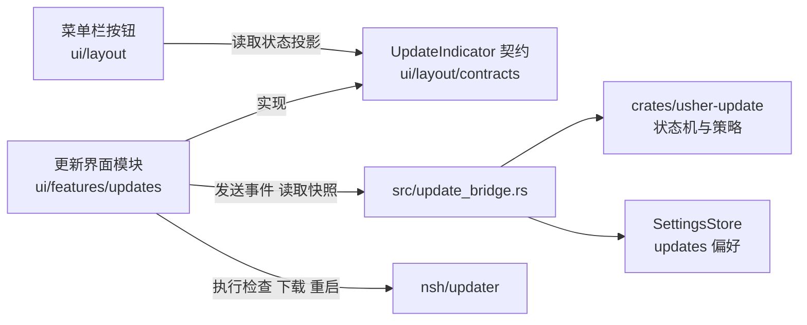

# 应用更新方案

本文是更新模块的唯一设计依据。更新的行为、目录结构、发布流程或配置发生调整时，**先修改本文，再按本文实施**；代码与本文不一致时，以本文为准，并把差异当作待修复的缺陷或待更新的文档，二者不可并存。

本文区分三类内容：**已决定**的设计、**待验证**的假设、**当前实现**的状态。待验证项在第 11 节登记，验证结果回写到本文后才能据此实施。模块职责与依赖边界的通用规则见 [architecture.md](../architecture.md)，编码规范见 [CONTRIBUTING.md](../CONTRIBUTING.md)，任务状态见 [scaffolding.md](../scaffolding.md) 批次 06，发布流水线见 [deploy.md](deploy.md)。

## 1. 范围

| 在范围内 | 不在范围内 |
| --- | --- |
| 检查更新、下载、校验、待重启、重启或替换安装、失败处理 | 更新公告内容（06.07）、全局消息通知（06.08） |
| 代码包热更新与整包更新两条路径 | 开发期 HMR 热重载，它与用户更新无关 |
| 正式版通道（唯一通道） | 预览、alpha、beta、rc 等预发布通道；Windows、Linux、iOS、Android 的更新适配（当前只发布 macOS Apple Silicon） |
| 菜单栏更新按钮、设置页"更新"分区、更新面板 | 托盘与应用菜单入口（02.02 完成后接入同一语义动作） |

## 2. 决策记录

| 编号 | 决定 | 依据 |
| --- | --- | --- |
| D1 | 信任与清单采用 NSH 原生体系，不再自建签名 | 避免两套密钥和吊销机制并存；NSH 运行时本身会复验 |
| D2 | 两种更新路径合并为一次检查，由检查结果决定走哪条 | 与 NSH 官方流程一致：先找代码包，必要时才退回整包 |
| D3 | 整包路径：用户确认后下载、校验，自动替换并重启，无需手动安装 | 对齐 Slint 版 Usher 的更新体验；手动下载只作兜底 |
| D4 | 代码包路径：自动检查开启时静默下载，仅在待重启时提示 | 代码包小、不替换应用，打扰成本低 |
| D5 | 外壳版本过旧（需要整包）时只提示，不强制更新 | 用户决定 |
| D6 | 暂不启用 Apple 签名与公证，功能保留，拿到证书后启用 | 当前没有 Developer ID；NSH 包签名校验不受影响，始终开启 |
| D7 | **只有正式版一个通道**，不提供预览、alpha、beta、rc 的更新。预发布版本不发布更新，也不被任何客户端接收 | 用户决定（取代此前的稳定与预览双通道方案）；V2 验证更新源写在打包时的 `nsh-updater.json`，本就无法运行时切换 |
| D8 | 清单从 GitHub Release 读取：`updater.github` 指向本仓库，同时配置 `publicKey` | 用户决定；V1 验证 `github` 字段的地址固定为 `releases/latest/download/latest.json`，GitHub 的 latest 不含草稿与预发布 |
| D9 | 外壳兼容分两层：发布门禁按文件差异判断，外壳输入有改动的版本只发整包；**且外壳有改动时必须升主版本或次版本**，客户端只在代码包与外壳的主次版本相同时使用代码包 | 官方只用 `minRuntime`，无法拦截 Rust 与桥接变更。只比较相邻版本会漏掉累积错配：0.1.0 → 0.1.1（改 Rust，只发整包）→ 0.1.2（只改 TSX，发代码包），装着 0.1.0 外壳的用户会收到依赖 0.1.1 外壳的代码包 |
| D10 | 设置页新增"更新"分区：自动检查开关、检查按钮、版本信息；自动检查关闭时不检查、不静默下载 | 用户决定 |
| D11 | 更新模块的界面层（菜单栏按钮除外）独立成一个模块；逻辑层独立成 crate | 解耦，便于独立测试与替换 |
| D12 | 旧的自建签名与发布工具不为兼容历史而保留，用不到即删除 | 用户决定 |
| D13 | 第一次发布的版本是 `0.1.0`，此前的 `0.0.1-alpha.1` 不发布 | 用户决定；D7 之后门禁只接受正式版标签 |
| D14 | 提供本地更新模拟命令与 mock 数据，修改更新流程后可在本机走完整个流程，不依赖 GitHub 与真实密钥 | 用户决定；`nsh-updater` 的 `check_url` 允许 `http://127.0.0.1`、`localhost`、`[::1]`（"a local test"），无需自签名证书 |

## 3. 两种更新

| | 代码包热更新 | 整包更新 |
| --- | --- | --- |
| NSH 接口 | `checkForPackage`、`downloadPackage`、`restartToPackage` | `checkForUpdate`、`downloadUpdate`、`installAndRestart` |
| 内容 | 应用的 TSX、导入的图片与字体 | 整个应用：Rust 代码、原生组件、运行时、`nsh.json`、权限 |
| 生效 | 下次启动，或立即重启进入 | 替换已安装的应用并重启 |
| 校验 | 离线根密钥背书的发布密钥签名，限定本应用，构建号高于运行中与信任库下限，适配运行时 | 清单签名加哈希与大小校验 |
| 失败处理 | NSH 试运行：首帧后 10 秒或正常退出视为健康，否则删除并回滚 | 替换失败时保持旧版本 |
| 权限 | 不超过外壳 | 取决于新外壳 |

代码包**只含 TSX**。以下变更必须发整包：应用自己的 Rust crate、原生组件、桥接接口、权限、`nsh.json`（含 `updater` 配置）、编进二进制的资源。第一次引入 `updater` 配置的版本必然是整包，旧安装只能手动安装一次。

### 路径判断

```text
检查（读取 GitHub 最新正式版的清单）
 ├─ 清单含代码包，外壳满足 minRuntime，且代码包与外壳主次版本相同  → 代码包路径
 ├─ 有新版本，但没有可用的代码包         → 整包路径（只提示，面板写明"需要更新应用"）
 └─ 无新版本                             → 已是最新
```

同时存在两者时，外壳满足要求就走代码包。一次整包更新带上了代码，整包完成后不再单独更新代码包。`minRuntime` 只比较 NSH 运行时版本，不比较应用外壳；外壳兼容靠 D9 的两层：门禁保证外壳变了就升主次版本，客户端用 `shellInfo().version` 与代码包版本的主次版本比较，不同就按整包处理，面板写明"需要更新应用"。**客户端这一半尚未实现，属于批次 4、5。**

## 4. 发布侧

### 4.1 密钥与信任

NSH 原生体系有三类互相独立的材料，其中清单密钥与代码包的信任链是两条线：

| 材料 | 用途 | 保管 |
| --- | --- | --- |
| 清单密钥（`nsh keygen`） | 签署更新清单 `latest.json`；公钥写入 `updater.publicKey` | CI Secret，另有离线备份 |
| 根密钥 | 为发布密钥签发证书，签发吊销列表；公钥写入 `updater.packages.roots` | **离线**，由维护者在离线环境生成，不进入仓库，不进入 CI |
| 发布密钥与证书 | 签署 `.nshpkg`（`nsh publish --key --cert`），证书随包分发，可轮换而无需更新应用；`nsh certify` 限定可签的应用 ID 与有效天数 | CI Secret |

旧体系的发布密钥与恢复密钥在切换后作废，`trusted_keys.txt` 随之删除。Apple 签名与公证与以上密钥无关，沿用 `MACOS_SIGNING_NOTARIZATION_ENABLED`，默认关闭（D6）。

证书有有效期（`nsh certify --days`，默认 365 天）。到期前必须重新签发，否则新发布的代码包会被拒绝；到期时间应记入发布检查清单。

### 4.2 外壳输入与门禁（D9）

门禁脚本对比上一个发布标签：外壳输入文件有改动，则本次发布**只含整包**，不生成 `.nshpkg`；没有改动才同时生成代码包。

外壳输入的范围由配置文件 `scripts/release/shell-inputs.txt` 定义，脚本不写死路径。范围包括：

- `src/`、`platforms/`、`crates/`、`build.rs`、`Cargo.toml`、`Cargo.lock`。
- `ui/theme/` 与 `ui/config/background.json`：它们被 `include_str!` 编进二进制，改动需要重编译。
- `nsh.json`，比较时忽略 `version` 与 `build`，它们每次发布都会变。

**版本线约束（D9）。** 门禁用 `shell_inputs.py changed --version <本次版本> --strict` 找到上一个正式版标签，外壳输入有改动且主次版本没有升高时，真实发布失败，演练只给警告。预发布标签与格式不对的标签不算发布，不会成为比较基准。补丁版本因此只能是 TSX 变更：

| 变更 | 版本 | 产物 |
| --- | --- | --- |
| 只改 TSX、文案、样式之外的非外壳文件 | 补丁版本（0.1.0 → 0.1.1） | 整包与代码包 |
| 改了外壳输入 | 次版本或主版本（0.1.x → 0.2.0） | 只有整包 |

遗漏防护：CI 扫描 Rust 源码里所有 `include_str!` 与 `include_bytes!` 引用的文件，凡不在上述范围内即失败。新增编译期嵌入的资源目录时，必须同时更新该配置文件。

### 4.3 产物与清单（D7、D8）

| 项 | 内容 |
| --- | --- |
| 清单位置 | `releases/latest/download/latest.json` 与同目录的签名。GitHub 的 latest 只指向最新的非草稿、非预发布 Release，所以只有正式版 Release 会成为更新源 |
| `nsh.json` 的 `updater` | `github: "<owner>/<repo>"`、`publicKey`、`packages.roots`。只有这一种配置，不需要按构建生成多份 |
| 每次发布的产物 | 整包归档、`.nshpkg`（外壳输入未变时）、清单及签名 |

- 发布门禁只接受正式版标签（`v<major>.<minor>.<patch>`，无预发布后缀）。带连字符的标签被拒绝，不构建、不发布；`scripts/release_gate.py` 的 `channel_for` 与 `prerelease` 输出随之删除。**当前门禁与 [deploy.md](deploy.md) 仍按旧设计支持预发布标签，这部分在批次 2 改造，改造前以代码实际行为为准。**
- Release 创建时不带 `--prerelease`，保证它会成为 latest。
- 构建号单调递增（`nsh.json` 的 `build`，门禁已要求）。NSH 信任库记录每个应用已接受的最高构建号，据此拒绝降级。
- `.nshpkg` 内的 `nsh.json` 不含 `updater`，更新源始终来自外壳，不随代码包变化。

演练模式沿用临时密钥，不读真实密钥，不写 Release。演练在没有标签时运行，版本可以是预发布，仅用于验证构建链路；真实发布必须是正式版。

### 4.4 更新源的可见性

更新器用匿名 HTTP 读取 `https://github.com/<owner>/<repo>/releases/latest/download/latest.json`，不带任何凭据，也无法带（客户端没有令牌，也不应该有）。**仓库为私有时，该地址对所有用户返回 404，应用永远读不到更新。** 2026-11-12 未登录访问 `tianlai10000000/usher-nsh` 返回 404，仓库当前是私有的。

处理办法三选一，由维护者决定，**在此之前不能真实发布 `0.1.0`**：

| 办法 | 做法 | 代价 |
| --- | --- | --- |
| 仓库改为公开 | 在 GitHub 设置里改可见性 | 源码公开 |
| 单独的公开发布仓库 | 新建一个只放 Release 的公开仓库，`updater.github` 指向它，工作流用令牌把产物发到那里 | 多一个仓库与一个跨仓库令牌，发布作业要改 |
| 自托管更新源 | `updater.url` 指向自己的 HTTPS 地址（须同时配置 `publicKey`，已配置），发布时把文件传上去 | 要有托管，且 D8 的"从 GitHub Release 读取"不再成立 |

门禁目前要求 `updater.github` 等于本仓库，并拒绝 `updater.url`。选第二或第三种办法时，这条规则要随之修改，并同步本文 D8。

### 4.5 首次发布（D13）

- 第一次发布是 `0.1.0`。发布前按 [deploy.md](deploy.md) 的"发一个版本"步骤，把 `nsh.json` 与根 `Cargo.toml` 的版本同改为 `0.1.0`，`build` 加一，并在 `CHANGELOG.md` 写 `## 0.1.0` 小节。版本号现在仍是 `0.0.1-alpha.1`，**在发布前不改**，避免打断平时的开发构建。
- `0.1.0` 是第一个带 `updater` 配置的版本，没有任何旧安装能更新到它，用户只能手动安装一次（第 3 节）。
- 因为只有正式版通道，**`0.1.0` 本身验证不了更新**：端到端验证需要再发一个更高的正式版（例如 `0.1.1`），让已安装的 `0.1.0` 去检查、下载、替换。代码包路径同样需要外壳输入没变的 `0.1.1`；整包路径需要外壳输入有变的 `0.1.1`。所以至少要连续发布两个版本才能把两条路径各验证一遍。
- 在 `0.1.0` 发布前，只能用演练模式和本地的临时更新源验证；演练证明不了真实更新密钥、发布步骤和 Release 的 latest 行为。真实 Release 一旦发布，标签不可移动，所以 `0.1.0` 的发布前检查要比往常更严格：根密钥与证书有效期、`publicKey` 与 `roots` 写入 `nsh.json`、`nsh verify --root` 对产出的 `.nshpkg` 通过。

## 5. 客户端流程

### 5.1 步骤

```text
检查 → 验证清单 → 下载 → 校验 → 待重启 → 重启（代码包）或保存状态后替换并重启（整包） → 首次启动确认
```

- 重启前先保存设置，设置 Store 已有原子写入。
- 每一步失败都清理临时文件并回到可重试状态；整包替换失败时旧版本保持可用。
- 代码包的试运行与回滚由 NSH 负责。应用额外记录失败的版本与次数，用于面板显示；**同一版本连续失败两次后停止自动提示**，只在用户手动检查时重试。这条规则是为了避免"更新失败后反复提示同一个更新"的循环。
- 失败信息保存失败类别与版本，面板翻译显示；整包失败时给出手动下载链接。

### 5.2 触发与下载策略（D4、D10）

| 自动检查 | 检查时机 | 代码包 | 整包 |
| --- | --- | --- | --- |
| 开启 | 启动后延迟一次，之后定期 | 静默下载，待重启时提示 | 只提示，用户点击后才下载 |
| 关闭 | 只在用户点击"检查更新"时 | 手动检查后由用户确认下载 | 同左 |

后台检查失败只记日志，不打扰用户；手动检查的结果在面板中反馈，不使用系统弹窗。从不强制重启，待重启状态保留到用户点击或下次启动。

### 5.3 更新源（D7、D8）

- 更新源是构建属性。NSH 在打包时把 `nsh.json` 的 `updater` 写入应用包内的 `nsh-updater.json`，`checkForUpdate` 与 `checkForPackage` 只读这份配置，运行时不能更改（V2）。
- 应用只有一个更新源：本仓库最新的正式版 Release。设置里没有通道选项，也没有通道偏好。
- 状态机不再有通道概念：不接收预发布版本、不降级，两条规则都由 NSH（`latest` 地址与 `version <= current` 判断）保证，状态机只保留一道防御性校验，拒绝带预发布后缀的候选。
- 构建号只增不减：接受过某个构建的安装不会再接受构建号更低的包（NSH 信任库），这也是防降级的依据。

## 6. 菜单栏按钮

按钮由 `ui/layout/components/Rail.tsx` 渲染，只读取 `ui/layout/contracts/updates.ts` 定义的状态投影并上报按下，不依赖更新模块的内部实现。

### 6.1 视觉形态

参考成熟客户端（ChatGPT 桌面端）的菜单栏更新按钮，按钮只有三种形态，状态靠形态而不是角标区分：

| 形态 | 画法 | 用在 |
| --- | --- | --- |
| 静默 | 与设置按钮同款的普通图标（`arrow.down.circle`，文字色），悬停时有浅灰圆角底 | 已是最新、检查中、代码包静默下载中 |
| 强调 | **实心强调色圆**，圆内是白色（强调前景色）的下载图标；不再用角标小圆点。圆的直径取 `size-avatar`，与下方头像对齐 | 发现新版本、需要更新应用、待重启 |
| 进度 | 灰色底环加一段较深的弧表示进度，弧从 12 点钟方向顺时针增长；环中央是一个小圆角方块（参考图的样式） | 下载中 |

悬停时按钮背景出现浅灰圆角底，提示在按钮右侧弹出，样式沿用 `ButtonTooltip`。强调形态在悬停时只做不透明度变化，不叠加灰底。尺寸、颜色、弧宽与动画时长全部走主题令牌，不在组件里写字面量；新增令牌须同步所有内置主题。总大小未知时弧改为匀速旋转，减少动效时静止显示。

**中央方块不表示"取消"**：NSH 的下载没有取消接口（V12），按钮在进度形态下**不可按**，只作状态展示，详情在面板里。因此中央方块是纯装饰，不承诺可中断；如果之后要支持取消，需要 NSH 先提供接口，再改本节。进度形态不使用禁用的半透明样式，保持原样显示。

### 6.2 状态表

| 状态 | 形态 | 提示文案 | 按下后 |
| --- | --- | --- | --- |
| 已是最新 | 静默 | 检查更新 | 立即检查，面板反馈结果 |
| 检查中 | 静默，图标旋转 | 正在检查更新 | 打开面板 |
| 代码包静默下载中 | 静默，不打扰 | 检查更新 | 打开面板可看进度 |
| 代码包待重启 | 强调（对勾替换下载图标） | 重启以应用更新 | 面板里"立即重启"或"下次启动时" |
| 发现新版本（整包，或手动检查到） | 强调 | 发现新版本 X | 面板里"下载并更新" |
| 下载、校验中 | 进度（有总大小时为确定进度，否则旋转） | 正在下载 X | 不可按；面板可看详情。NSH 无取消接口，校验含在下载内，不单独显示（V12） |
| 整包待重启 | 强调（对勾） | 重启以完成更新 | 保存设置后替换并重启 |
| 需要更新应用（外壳过旧） | 强调 | 需要更新应用 | 面板说明并提供整包更新 |
| 失败 | 强调，改用警示色 | 更新失败 | 面板显示原因、重试、手动下载 |
| 系统管理、不适用 | 禁用 | 更新由系统管理 | 无 |

契约现在只有布尔的 `available()` 与 `request()`，需要扩展为上表的状态投影，仍由布局模块拥有，更新模块实现它。

## 7. 设置页"更新"分区

内容：自动检查开关（D10）、"检查更新"按钮、当前外壳版本、代码包版本与构建号（来自 `shellInfo()` 与 `runningPackage()`）、上次检查时间与结果、整包失败时的手动下载链接。

设置页通过 `settingsSections` 注册该分区，分区内容由更新模块提供。设置页只持有一个分区 ID 与一行挂载，不读取更新模块内部状态。

## 8. 模块与目录

### 8.1 总览



依赖方向：更新界面模块依赖布局契约，**布局不依赖更新模块**；更新 crate 不依赖 NSH、窗口与界面；NSH 的更新接口只由更新界面模块调用。

### 8.2 逻辑层：`crates/usher-update/`

沿用现有 crate，按本文重塑，删除用不到的部分（D12）：

| 部分 | 处置 |
| --- | --- |
| `state.rs`（状态机） | **保留并改造**：增加更新种类（代码包、整包）、失败版本与次数、外壳过旧的结果；删除 `Channel`、`ChannelChanged` 与通道切换逻辑，只保留"拒绝预发布候选"的防御性校验；删除自建签名相关的 `verified` 与 `Unverified`、`min_version` |
| `signature.rs`、`trusted_keys.txt` | **删除**：被 NSH 原生校验取代 |
| `crates/usher-update-tool/` | **删除**：密钥与清单由 `nsh keygen`、`nsh update-manifest` 等命令处理 |
| 依赖 `ed25519-dalek`、`base64`、`sha2` | **删除** |

crate 保持无 I/O、无 NSH 依赖：输入事件，输出状态与效果。网络与文件操作由调用方执行后把结果作为事件送回，沿用现有的票据机制丢弃迟到回执。

### 8.3 桥接层：`src/update_bridge.rs`

持有进程内唯一的状态机实例、DTO 转换和事件入口；把 `auto_check` 偏好委托给 `SettingsStore`，不另存一份。更新源来自构建，不是偏好。业务错误返回稳定错误码，界面翻译。设置新增 `[updates]` 段，只含 `auto_check`，缺省时不写入文件，沿用现有的 schema 迁移与保存规则。

### 8.4 界面层：`ui/features/updates/`

| 文件 | 职责 |
| --- | --- |
| `controller.ts` | 把状态机的效果翻译成 `nsh/updater` 调用，再把结果作为事件送回桥接；负责定时检查与清理 |
| `indicator.ts` | 把更新状态适配成布局的 `UpdateIndicator` 契约 |
| `UpdatePanel.tsx` | 按钮旁的浮层 |
| `UpdatesSettings.tsx` | 设置页分区 |
| `index.ts` | 对外只导出 `createUpdates`，由 `App.tsx` 创建并传给 `Frame` 与设置页 |

菜单栏按钮的渲染留在 `ui/layout/`。布局组件使用 NSH 组件库的公开接口，遵循 CONTRIBUTING 对布局的限制。文案使用 `i18n/messages/` 的 `update.*` 键，中英文同步。

### 8.5 发布工具

不新建 crate。外壳输入检查与发布门禁写成 `scripts/release/` 下的脚本，由 `release_gate.py` 与工作流调用，测试放在 `scripts/tests/`。

## 9. 配置

检查延迟、检查间隔、失败停止阈值等放在 `ui/config/updates.json`，TSX 侧读取，不在代码里写字面量。**具体数值在实施前单独列出，经批准后写入**，见 CONTRIBUTING 对硬编码的要求。更新源地址属于外壳，写在 `nsh.json` 的 `updater` 中（字段名见 V1）。

## 10. 安全与失败边界

- NSH 包签名与根密钥校验始终开启，**不提供运行时跳过校验的开关**。D6 只关闭 Apple 签名与公证。
- 根密钥私钥不进入仓库与 CI。
- 清单与包的校验失败不得回退到未校验的路径。
- 吊销列表与防降级下限由 NSH 信任库持久化，应用不另存。
- 日志使用结构化事件，不记录凭据与用户正文。

## 11. 验证记录与待验证项

第 1 批在本机 `nsh 0.5.0`（`nsh-core` 固定为 0.5.0）上验证，方法是读 `nsh-updater`、`nsh-engine`、`nsh-macos-app` 0.5.0 的源码，并在临时目录的项目副本和临时 `HOME` 中用一次性密钥实际打包、签名、运行；没有改动仓库文件，临时文件已删除。

| 编号 | 问题 | 结论 | 状态 |
| --- | --- | --- | --- |
| V1 | 更新源字段 | `updater.github`（`owner/repo`）或 `updater.url`（HTTPS）二选一；`publicKey` 是清单密钥，用 `url` 时必填，用 `github` 时设置后拒绝未签名清单；`packages.roots` 至少一个根公钥。`github` 的地址固定为 `releases/latest/download/latest.json`。打包后写入应用内的 `assets/nsh-updater.json` | 已验证 |
| V2 | 运行时能否切换更新源 | **不能。** 配置在打包时写入应用，`manifest_url()` 只读它。更新源因此是构建属性，单一更新源（D7、5.3） | 已验证 |
| V3 | 应用能否自己加载 `.nshpkg` | **能。** 0.5.0 的运行器 `main()` 调用 `nsh_engine::updates::launch`（此前 06.04 的否定结论基于 0.4.0，已过时）。实测完整周期：`next.nshpkg` 在下次启动被运行并改名 `trying.nshpkg`；进程被杀后下次启动日志为 `the package started last never ran 10s without a fatal error; it is deleted and the app goes back`，包被删除并回到内置代码；正常运行超过 10 秒则晋升为 `current.nshpkg`，并创建 `trust/`。数据目录为 `~/Library/Application Support/<app id>/updates/` | 已验证 |
| V4 | NSH 0.5.0 是否具备本文依赖的接口 | 具备：`nsh` 命令行含 `keygen`、`certify`、`publish`、`update-manifest`、`verify`、`revoke`、`package`；`nsh-updater`、`nsh-package`、`nsh-engine` 源码均在本机 | 已验证 |
| V5 | 整包替换后未签名 `.app` 能否启动 | 替换前 `nsh-updater` 要求 `codesign --verify --deep --strict` 通过；`nsh package` 产物为 ad hoc 签名，实测通过，所以**不依赖 Apple 证书**。替换用目录改名，失败时放回旧的。**替换后首次启动是否被 Gatekeeper 拦截未验证**，取决于下载文件是否带隔离标记 | 部分验证，真机待验 |
| V6 | 发布命令流程 | `keygen`、`certify`、`publish` 已实跑：产出 487 KB 的 `.nshpkg`，`nsh verify --root` 通过，`nsh publish --key --cert --build --app-version -o` 可用。`update-manifest` 只读了参数（`--package`、`--key`、`--notes`、`--base-url`、`--out`、位置参数为整包归档），**未实跑** | 部分验证，批次 2 补 |
| V7 | 与 Sparkle 设想是否冲突 | 不冲突，也不需要 Sparkle：整包替换由 `nsh-updater` 的 `install` 完成。06.04 的 Sparkle 设想作废 | 已验证 |

### 仍待验证

| 编号 | 问题 | 影响 |
| --- | --- | --- |
| V5 | 经真实下载（带隔离标记）的整包替换后，首次启动是否被 Gatekeeper 拦截 | 整包路径在无 Apple 证书下的真实体验；若被拦截，面板需要给出放行说明 |
| V6 | `nsh update-manifest` 的实际输出与签名文件格式 | 批次 2 的发布流水线 |
| V8 | `installAndRestart` 在应用位于 `/Applications`（用户可写、系统管理员安装）与其他位置时的行为，以及 `canInstall` 的判定 | 面板何时给手动下载链接 |
| V9 | AppKit 变体（`macos-appkit`）与标准变体的整包是否可以用同一份更新清单 | **已决定**：清单只列 `standard` 变体的 `.tar.gz`（`update-manifest` 按 `<os>-<arch>` 只收一个），`appkit` 变体只作为手动下载的 zip。`appkit` 用户经更新会换成 `standard`，是否可接受待确认 |
| V10 | 仓库私有时更新器能否读到更新 | **不能**，见 4.4。实测未登录访问返回 404 |
| V12 | 进度环用什么画 | **已查 `nsh-core` 0.5.0 源码**：`nsh/base` 的 `Progress` 只有线性条；NSH 有 `<canvas>`（2D 上下文含 `arc`、`lineCap`，数值可绑定动画值）和 `<svg>`（需 `svg` feature）。倾向 `<canvas>` 画环，**但本仓库尚未用过 canvas，TSX 侧 API 与动画写法待在 `tests/ui` 里实测**；不需要新增原生组件 |

已验证（V12 之外）：`downloadUpdate` 与 `downloadPackage` 的 `onProgress` 回调给出 `{ received, total? }`，`total` 在服务端不给长度且清单没有大小时为空（空则退化为不确定旋转）；**没有取消接口**，下载是一个不可中断的异步任务，且同一时刻只允许一个更新操作（再次调用会被拒绝）；校验在下载 Promise 内部完成，**没有独立的校验阶段回调**，所以界面无法区分"下载中"与"校验中"。

## 12. 本地更新模拟（D14）

修改更新逻辑后，用一条命令在本机把"检查、下载、校验、待重启、替换或重启"走完，不碰 GitHub，不用真实密钥。它是回归验证的入口，更新流程变化时，场景与断言要同步更新。

### 12.1 命令

```bash
scripts/update-sim/sim.sh list                  # 列出场景
scripts/update-sim/sim.sh run <场景>            # 运行一个场景并断言结果
scripts/update-sim/sim.sh run --all             # 运行全部场景
scripts/update-sim/sim.sh serve <场景>          # 只起模拟更新源，手动打开应用观察界面
scripts/update-sim/sim.sh clean                 # 删除 .nsh/update-sim/
```

### 12.2 工作方式

| 部分 | 做法 |
| --- | --- |
| 更新源 | 本机 `http://127.0.0.1:<端口>`，用 Python 标准库的 HTTP 服务器提供静态文件，可按场景限速、中途断开、篡改响应；不新增依赖 |
| 密钥 | 每次运行用 `nsh keygen` 现场生成一次性的清单密钥、根密钥与发布密钥，`nsh certify` 签发证书，放在 `.nsh/update-sim/`。**不读取任何真实密钥**，该目录已被 `.gitignore` 忽略 |
| 被测应用 | 用 `nsh package` 打出"旧版"应用，`updater.url` 指向本机更新源。编译约 5 分钟，所以按外壳输入的哈希缓存，外壳没变时不重打 |
| 新版产物 | 用 `nsh publish` 签 `.nshpkg`（不到 1 秒），`nsh update-manifest` 写清单与签名 |
| 隔离 | 每个场景用独立的临时 `HOME`，数据目录是其下的 `Library/Application Support/<app id>/updates/`，不触碰真实数据 |
| 判定 | 对每个场景检查应用数据目录的文件状态（`next`、`trying`、`current`、`trust/`）和应用日志，不靠截图 |

### 12.3 场景与 mock 数据

场景由 `scripts/update-sim/scenarios/*.json` 定义，每个文件描述清单内容、更新源行为、应用启动动作和预期。新增场景只加文件，不改脚本。

场景有两种状态。**有效**的场景走预置 `next.nshpkg` 的启动路径，应用不需要检查更新就能触发，已在本机运行通过。**`pending`** 的场景需要应用自己调用 `checkForUpdate` 或 `checkForPackage`，而这些调用要到批次 4、5 才有；它们在 `run --all` 里显示为 SKIP，不计入通过，也不影响退出码。批次 5 完成后删除场景文件里的 `pending` 字段并跑通，才算验收。

| 场景 | 模拟什么 | 预期 |
| --- | --- | --- |
| `up-to-date` `pending` | 清单构建号不高于当前 | 检查结果为已是最新，数据目录无变化 |
| `package-update` ✅ | 更高构建号的代码包，外壳满足要求，预置为 `next.nshpkg` | 启动后运行新包，10 秒后晋升为 `current.nshpkg`，`trust/` 创建，无残留。已通过 |
| `shell-update` `pending` | 清单只有整包，没有代码包 | 不提供代码包；整包下载、校验、替换后新版本启动。模拟里的整包是占位文件，真正的替换还需要真实整包归档 |
| `bad-signature` `pending` | 清单签名被篡改 | 拒绝，报签名错误，数据目录无变化 |
| `wrong-app-id` `pending` | 清单属于别的应用 | 拒绝，报应用不符 |
| `tampered-package` ✅ | 包内容被改一个字节 | 启动时拒绝，日志含 `the signature does not verify`，不出现 `trying` 与 `current`。已通过 |
| `downgrade` ✅ | 包构建号不高于应用的 | 拒绝运行，日志含 `is not newer than the app's`。已通过 |
| `crash-on-start` ✅ | 新包从未证明健康（进程被杀） | 下次启动回滚，包被删除，日志含 `never ran 10s without a fatal error`。已通过 |
| `download-fail` `pending` | 更新源中途断开 | 失败，可重试，不留残留的 `.part` 文件 |
| `slow-download` `pending` | 限速 | 进度单调递增；取消后可重新开始，用 `serve` 在界面上观察 |
| `offline` `pending` | 更新源不可达 | 后台检查静默，手动检查报网络错误 |

### 12.4 范围与限制

- 当前只有 4 个场景有效，7 个是 `pending`（见 12.3）。有效场景覆盖的是 NSH 引擎启动时的校验、试运行与回滚；检查、下载、取消等应用侧行为要等批次 4、5。
- 模拟覆盖 NSH 更新接口与应用数据目录的行为，**不覆盖 UI**：按钮状态与面板由界面用例（`tests/ui/`）覆盖，批次 5 加入。`serve` 命令用来手动观察界面。
- 整包替换在模拟里替换的是临时目录里的 `.app`，不碰真实安装。Gatekeeper 与隔离标记无法在本机模拟（V5），仍需真机验证。
- 它证明不了真实 GitHub Release、真实密钥与证书有效期的行为。
- 与真实更新的差异：更新源是 HTTP 而不是 HTTPS（NSH 只对本机地址放行），其余校验路径相同。
- 缓存的"旧版"应用只在外壳输入变化时失效；改了 `updater` 配置结构或 NSH 版本时要手动 `clean`。

## 13. 实施批次

| 批次 | 内容 | 状态 |
| --- | --- | --- |
| 1 | 验证 V1 至 V7，回写本文 | 已完成大部分，V5、V6 部分项和 V8、V9 留待后续 |
| 2 | 信任与发布（以首次发布 `0.1.0` 为目标，D13）：离线根密钥（由维护者生成）、`nsh.json` 的 `updater` 配置、外壳输入门禁、门禁只接受正式版标签、流水线产出 `.nshpkg` 与清单 | **已完成，待真实发布验证**。密钥已生成并写入 `nsh.json`，三个 Secret 已配置，门禁、外壳输入检查、清单检查器、`make-update-files.sh`、`rehearsal-sign.sh` 与 `release.yml` 已改并在本机实跑通过；流水线从未在 GitHub 上运行。**阻塞项：仓库私有（未登录访问返回 404），更新器无法匿名读取更新**，见 4.4 |
| 3 | 逻辑层：删除 `signature.rs`、`usher-update-tool`、`trusted_keys.txt`，改造状态机，更新 crate 测试 | 待办 |
| 4 | 桥接：`update_bridge.rs`、`[updates]` 设置（仅 `auto_check`）、稳定错误码 | 待办 |
| 5 | 界面：`ui/features/updates/`、布局契约扩展、`Rail.tsx` 状态、文案与界面用例 | 待办 |
| 6 | 文档与验收：同步 architecture、scaffolding、deploy、README，真机验收 | 待办 |

验证限制：`checkForUpdate` 在开发运行下返回 null，且更新源必须是 HTTPS，端到端验证需要打包构建和真实的 GitHub Release；发布流水线从未在 GitHub 上真实运行过，第一次真实发布必须是正式版标签；在此之前只用演练模式验证构建链路。

## 14. 变更记录

| 日期 | 变更 |
| --- | --- |
| 2026-11-12 | 建立本文：记录 D1 至 D12、第 3 至 12 节方案与 V1 至 V7 待验证项。 |
| 2026-11-12 | 新增第 12 节本地更新模拟（D14）：命令、工作方式、11 个场景与限制。4 个场景已在本机通过，7 个标为 `pending`，等批次 4、5 的检查逻辑。 |
| 2026-11-12 | 批次 2 实施：门禁改为只接受正式版并要求 `updater` 完整；新增外壳输入清单与检查、版本线约束、清单检查器、`make-update-files.sh`；`release.yml` 的 `publish` 与 `rehearse` 改用 NSH 原生命令；`rehearsal-sign.sh` 改为同一链路加损坏用例；删除 `collect-release-files.sh`。发现仓库私有，新增 4.4 与 V10。 |
| 2026-11-12 | 确定第一次发布为 `0.1.0`（D13），新增 4.5 说明首次发布的限制与验证办法。 |
| 2026-11-12 | 取消预览通道，只保留正式版（D7、D8）：删除预览清单与滚动 Release、通道状态与按构建生成两份配置的设计，门禁只接受正式版标签。 |
| 2026-11-12 | 第 1 批验证回写：通道改为构建属性（V2），设置页不再提供通道切换，`[updates]` 只含 `auto_check`；代码包路径可行（V3，推翻 06.04 的否定结论）；Sparkle 设想作废（V7）；新增 V8、V9；4.3 补充两个通道对应两种构建，预览用户升到正式版后仍留在预览通道。 |
