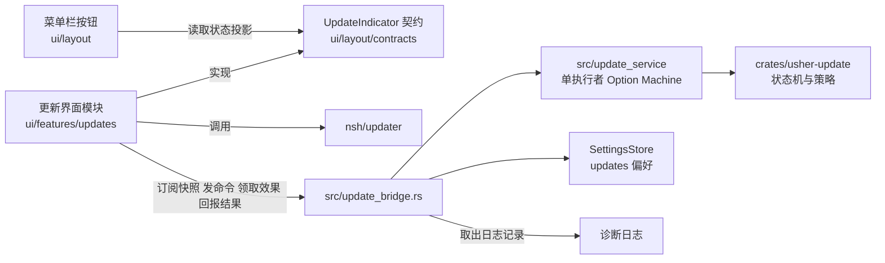

# 应用更新方案

本文是更新模块的唯一设计依据。更新的行为、目录结构、发布流程或配置发生调整时，**先修改本文，再按本文实施**；代码与本文不一致时，以本文为准，并把差异当作待修复的缺陷或待更新的文档，二者不可并存。

本文只维护更新模块设计与接口边界。假设核验、批次、完成状态和测试结果统一记录于 [迭代台账](todo.md)；实施前核对对应批次的前置条件。模块边界见 [项目架构](../architecture.md)，发布流程见 [部署设计](deploy.md)。

## 1. 范围

| 在范围内 | 不在范围内 |
| --- | --- |
| 检查更新、下载、校验、待重启、重启或替换安装、失败处理 | 更新公告内容（06.07）、全局消息通知（06.08） |
| 代码包热更新与整包更新两条路径 | 开发期 HMR 热重载，它与用户更新无关 |
| 正式版通道（唯一通道） | 预览、alpha、beta、rc 等预发布通道；Windows、Linux、iOS、Android 的更新适配（当前只发布 macOS Apple Silicon） |
| 菜单栏更新按钮、设置页"更新"分区、更新面板 | 托盘与应用菜单入口（02.02 完成后接入同一语义动作） |

## 2. 决策记录

| 编号 | 决定 | 依据 |
| --- | --- | --- |
| D1 | 信任与清单采用 NSH 原生体系，不再自建签名 | 避免两套密钥和吊销机制并存；NSH 运行时本身会复验 |
| D2 | 两种更新路径合并为一次检查，由检查结果决定走哪条 | 与 NSH 官方流程一致：先找代码包，必要时才退回整包 |
| D3 | 整包路径：用户确认后下载、校验，自动替换并重启，无需手动安装 | 对齐 Slint 版 Usher 的更新体验；手动下载只作兜底 |
| D4 | 代码包路径：自动检查开启时静默下载，下载时显示进度环，待重启时提示 | 代码包小、不替换应用，打扰成本低 |
| D5 | 外壳版本过旧（需要整包）时只提示，不强制更新 | 用户决定 |
| D6 | 暂不启用 Apple 签名与公证，功能保留，拿到证书后启用 | 当前没有 Developer ID；NSH 包签名校验不受影响，始终开启 |
| D7 | **只有正式版一个通道**，不提供预览、alpha、beta、rc 的更新。预发布版本不发布更新，也不被任何客户端接收 | 用户决定（取代此前的稳定与预览双通道方案）；V2 验证更新源写在打包时的 `nsh-updater.json`，本就无法运行时切换 |
| D8 | 清单从 GitHub Release 读取：`updater.github` 指向本仓库，同时配置 `publicKey` | 用户决定；V1 验证 `github` 字段的地址固定为 `releases/latest/download/latest.json`，GitHub 的 latest 不含草稿与预发布 |
| D9 | 外壳兼容分两层：发布门禁按文件差异判断，外壳输入有改动的版本只发整包；**且外壳有改动时必须升主版本或次版本**，客户端只在代码包与外壳的主次版本相同时使用代码包 | 官方只用 `minRuntime`，无法拦截 Rust 与桥接变更。只比较相邻版本会漏掉累积错配：0.1.0 → 0.1.1（改 Rust，只发整包）→ 0.1.2（只改 TSX，发代码包），装着 0.1.0 外壳的用户会收到依赖 0.1.1 外壳的代码包 |
| D10 | 设置页新增"更新"分区：自动检查开关、检查按钮、版本信息；自动检查关闭时不检查、不静默下载 | 用户决定 |
| D11 | 更新模块的界面层（菜单栏按钮除外）独立成一个模块；逻辑层独立成 crate | 解耦，便于独立测试与替换 |
| D12 | 旧的自建签名与发布工具不为兼容历史而保留，用不到即删除 | 用户决定 |
| D13 | 第一次发布的版本是 `0.1.0`，此前的 `0.0.1-alpha.1` 不发布 | 用户决定；D7 之后门禁只接受正式版标签 |
| D14 | 提供本地更新模拟命令与 mock 数据，修改更新流程后可在本机走完整个流程，不依赖 GitHub 与真实密钥 | 用户决定；`nsh-updater` 的 `check_url` 允许 `http://127.0.0.1`、`localhost`、`[::1]`（"a local test"），无需自签名证书 |

## 3. 两种更新

| | 代码包热更新 | 整包更新 |
| --- | --- | --- |
| NSH 接口 | `checkForPackage`、`downloadPackage`、`restartToPackage` | `checkForUpdate`、`downloadUpdate`、`installAndRestart` |
| 内容 | 应用的 TSX、导入的图片与字体 | 整个应用：Rust 代码、原生组件、运行时、`nsh.json`、权限 |
| 生效 | 下次启动，或立即重启进入 | 替换已安装的应用并重启 |
| 校验 | 离线根密钥背书的发布密钥签名，限定本应用，构建号高于运行中与信任库下限，适配运行时 | 清单签名加哈希与大小校验 |
| 失败处理 | NSH 试运行：首帧后 10 秒或正常退出视为健康，否则删除并回滚 | 替换失败时保持旧版本 |
| 权限 | 不超过外壳 | 取决于新外壳 |

代码包**只含 TSX**。以下变更必须发整包：应用自己的 Rust crate、原生组件、桥接接口、权限、`nsh.json`（含 `updater` 配置）、编进二进制的资源。第一次引入 `updater` 配置的版本必然是整包，旧安装只能手动安装一次。

### 路径判断

```text
检查（读取 GitHub 最新正式版的清单）
 ├─ 清单含代码包，外壳满足 minRuntime，且代码包与外壳主次版本相同  → 代码包路径
 ├─ 有新版本，但没有可用的代码包         → 整包路径（只提示，面板写明"需要更新应用"）
 └─ 无新版本                             → 已是最新
```

同时存在两者时，外壳满足要求就走代码包。一次整包更新带上了代码，整包完成后不再单独更新代码包。`minRuntime` 只比较 NSH 运行时版本，不比较应用外壳；外壳兼容靠 D9 的两层：门禁保证外壳变了就升主次版本，客户端用 `shellInfo().version` 与代码包版本的主次版本比较，不同就按整包处理，面板写明"需要更新应用"。

## 4. 发布侧

### 4.1 密钥与信任

NSH 原生体系有三类互相独立的材料，其中清单密钥与代码包的信任链是两条线：

| 材料 | 用途 | 保管 |
| --- | --- | --- |
| 清单密钥（`nsh keygen`） | 签署更新清单 `latest.json`；公钥写入 `updater.publicKey` | CI Secret，另有离线备份 |
| 根密钥 | 为发布密钥签发证书，签发吊销列表；公钥写入 `updater.packages.roots` | **离线**，由维护者在离线环境生成，不进入仓库，不进入 CI |
| 发布密钥与证书 | 签署 `.nshpkg`（`nsh publish --key --cert`），证书随包分发，可轮换而无需更新应用；`nsh certify` 限定可签的应用 ID 与有效天数 | CI Secret |

旧体系的发布密钥与恢复密钥在切换后作废，`trusted_keys.txt` 随之删除。Apple 签名与公证与以上密钥无关，沿用 `MACOS_SIGNING_NOTARIZATION_ENABLED`，默认关闭（D6）。

证书有有效期（`nsh certify --days`，默认 365 天）。到期前必须重新签发，否则新发布的代码包会被拒绝；到期时间应记入发布检查清单。

### 4.2 外壳输入与门禁（D9）

门禁脚本对比上一个发布标签：外壳输入文件有改动，则本次发布**只含整包**，不生成 `.nshpkg`；没有改动才同时生成代码包。

外壳输入的范围由配置文件 `scripts/release/shell-inputs.txt` 定义，脚本不写死路径。范围包括：

- `src/`、`platforms/`、`crates/`、`build.rs`、`Cargo.toml`、`Cargo.lock`。
- `ui/theme/` 与 `ui/config/background.json`：它们被 `include_str!` 编进二进制，改动需要重编译。
- `nsh.json`，比较时忽略 `version` 与 `build`，它们每次发布都会变。
- 根 `Cargo.toml` 的 `package.version` 及 `Cargo.lock` 中同名本地根包的版本属于发布身份，比较时仅忽略这两处版本字段。依赖版本、来源、校验和、特性及其他 Cargo 配置仍属于外壳输入；根包名称取自 Cargo 清单，解析失败时拒绝判定。

**版本线约束（D9）。** 门禁用 `shell_inputs.py changed --version <本次版本> --strict` 找到上一个正式版标签，外壳输入有改动且主次版本没有升高时，真实发布失败，演练只给警告。预发布标签与格式不对的标签不算发布，不会成为比较基准。补丁版本因此只能是 TSX 变更：

| 变更 | 版本 | 产物 |
| --- | --- | --- |
| 只改 TSX、文案、样式之外的非外壳文件 | 补丁版本（0.1.0 → 0.1.1） | 整包与代码包 |
| 改了外壳输入 | 次版本或主版本（0.1.x → 0.2.0） | 只有整包 |

遗漏防护：CI 扫描 Rust 源码里所有 `include_str!` 与 `include_bytes!` 引用的文件，凡不在上述范围内即失败。新增编译期嵌入的资源目录时，必须同时更新该配置文件。

### 4.3 产物与清单（D7、D8）

| 项 | 内容 |
| --- | --- |
| 清单位置 | `releases/latest/download/latest.json` 与同目录的签名。GitHub 的 latest 只指向最新的非草稿、非预发布 Release，所以只有正式版 Release 会成为更新源 |
| `nsh.json` 的 `updater` | `github: "<owner>/<repo>"`、`publicKey`、`packages.roots`。只有这一种配置，不需要按构建生成多份 |
| 每次发布的产物 | 整包归档、`.nshpkg`（外壳输入未变时）、清单及签名 |

- 发布门禁只接受正式版标签（`v<major>.<minor>.<patch>`，无预发布后缀）。带连字符的标签被拒绝，不构建、不发布；`scripts/release_gate.py` 的 `channel_for` 与 `prerelease` 输出随之删除。门禁与工作流按单一正式版通道执行。
- Release 创建时不带 `--prerelease`，保证它会成为 latest。
- 构建号单调递增（`nsh.json` 的 `build`，门禁已要求）。NSH 信任库记录每个应用已接受的最高构建号，据此拒绝降级。
- `.nshpkg` 内的 `nsh.json` 不含 `updater`，更新源始终来自外壳，不随代码包变化。

演练模式沿用临时密钥，不读真实密钥，不写 Release。演练在没有标签时运行，版本可以是预发布，仅用于验证构建链路；真实发布必须是正式版。

### 4.4 更新源的可见性

更新器用匿名 HTTP 读取 `https://github.com/<owner>/<repo>/releases/latest/download/latest.json`，不带任何凭据，也无法带（客户端没有令牌，也不应该有）。**仓库为私有时，该地址对所有用户返回 404，应用永远读不到更新。** 2026-11-12 曾记录未登录访问 `tianlai10000000/usher-nsh` 返回 404；这是历史观察，404 本身不能区分私有仓库、未发布 Release 或资源缺失，不能据此断言当前仓库可见性。正式发布前须重新验证匿名访问与资源存在性。

若发布前确认当前源不能匿名读取，须由维护者选择下列办法并验证后再正式发布：

| 办法 | 做法 | 代价 |
| --- | --- | --- |
| 仓库改为公开 | 在 GitHub 设置里改可见性 | 源码公开 |
| 单独的公开发布仓库 | 新建一个只放 Release 的公开仓库，`updater.github` 指向它，工作流用令牌把产物发到那里 | 多一个仓库与一个跨仓库令牌，发布作业要改 |
| 自托管更新源 | `updater.url` 指向自己的 HTTPS 地址（须同时配置 `publicKey`，已配置），发布时把文件传上去 | 要有托管，且 D8 的"从 GitHub Release 读取"不再成立 |

门禁目前要求 `updater.github` 等于本仓库，并拒绝 `updater.url`。选第二或第三种办法时，这条规则要随之修改，并同步本文 D8。

### 4.5 首次发布（D13）

- 第一次发布是 `0.1.0`。当前 `nsh.json` 与根 `Cargo.toml` 已同为 `0.1.0`，`build` 为 1，`CHANGELOG.md` 已有 `0.1.0` 小节。版本已准备不代表正式发布已执行；发布前仍须按 [批次与验收记录](todo.md) 核对版本、构建号、变更日志与正式密钥。
- `0.1.0` 是第一个带 `updater` 配置的版本，没有任何旧安装能更新到它，用户只能手动安装一次（第 3 节）。
- 因为只有正式版通道，**`0.1.0` 本身验证不了更新**：端到端验证需要再发一个更高的正式版（例如 `0.1.1`），让已安装的 `0.1.0` 去检查、下载、替换。代码包路径同样需要外壳输入没变的 `0.1.1`；整包路径需要外壳输入有变且主次版本递增的版本（例如 `0.2.0`）。因此完整验证两条路径需要初始版、无外壳变更的补丁版和有外壳变更的主次版本，不能用 `0.1.1` 同时承担两种外壳兼容性。
- 在 `0.1.0` 发布前，只能用演练模式和本地的临时更新源验证；演练证明不了真实更新密钥、发布步骤和 Release 的 latest 行为。真实 Release 一旦发布，标签不可移动，所以 `0.1.0` 的发布前检查要比往常更严格：根密钥与证书有效期、`publicKey` 与 `roots` 写入 `nsh.json`、`nsh verify --root` 对产出的 `.nshpkg` 通过。

## 5. 客户端流程

### 5.1 步骤

```text
检查 → 验证清单 → 下载 → 校验 → 待重启 → 重启（代码包）或保存状态后替换并重启（整包） → 首次启动确认
```

- 重启前先保存设置，设置 Store 已有原子写入。
- 可返回的失败清理临时文件并回到可重试状态；已验收的下载 / 身份 / 签名 / 权限失败保持旧版本可用。NSH 0.5.0 整包替换使用两次 rename，本地续验已确认进程在两者之间终止会留下缺失的应用路径，需要从保留旧包外部恢复；目前没有应用外恢复器，不能承诺自动恢复。
- 代码包的试运行与回滚由 NSH 负责。应用额外记录失败的版本与次数，用于面板显示；**同一版本连续失败两次后停止自动提示**，只在用户手动检查时重试。这条规则是为了避免"更新失败后反复提示同一个更新"的循环。
- 失败信息保存失败类别与版本，面板翻译显示；整包失败时给出手动下载链接。

### 5.2 触发与下载策略（D4、D10）

| 自动检查 | 检查时机 | 代码包 | 整包 |
| --- | --- | --- | --- |
| 开启 | 启动后延迟一次，之后定期 | 静默下载，待重启时提示 | 只提示，用户点击后才下载 |
| 关闭 | 只在用户点击"检查更新"时 | 手动检查后由用户确认下载 | 同左 |

后台检查失败只记日志，不打扰用户；手动检查的结果在发起位置反馈，不使用系统弹窗。失败时设置页 / 已打开的更新面板保留具体原因和重试；侧栏保留可打开面板的错误提示图标，关闭面板不会清除失败。后台检查失败不显示该入口，也不自动弹窗。从不强制重启，待重启状态保留到用户点击或下次启动。

### 5.3 更新源（D7、D8）

- 更新源是构建属性。NSH 在打包时把 `nsh.json` 的 `updater` 写入应用包内的 `nsh-updater.json`，`checkForUpdate` 与 `checkForPackage` 只读这份配置，运行时不能更改（V2）。
- 应用只有一个更新源：本仓库最新的正式版 Release。设置里没有通道选项，也没有通道偏好。
- 状态机不再有通道概念：不接收预发布版本、不降级，两条规则都由 NSH（`latest` 地址与 `version <= current` 判断）保证，状态机只保留一道防御性校验，拒绝带预发布后缀的候选。
- 构建号只增不减：接受过某个构建的安装不会再接受构建号更低的包（NSH 信任库），这也是防降级的依据。

## 6. 菜单栏按钮

按钮由 `ui/layout/components/Rail.tsx` 渲染，只读取 `ui/layout/contracts/updates.ts` 定义的状态投影并上报按下，不依赖更新模块的内部实现。

### 6.1 视觉形态

参考成熟客户端（ChatGPT 桌面端）的菜单栏更新按钮，无更新时隐藏入口；显示时按阶段区分形态，不使用角标：

| 形态 | 画法 | 用在 |
| --- | --- | --- |
| 检查 | 无实心底的灰色细环，短弧匀速旋转；无中心图标、无百分比，使用现有 Canvas 和主题尺寸 / 动效 | 检查中 |
| 强调 | **实心强调色圆**，圆内是白色（强调前景色）的下载图标；不再用角标小圆点。圆的直径取 `size-button-small`，内部优先使用系统 `square.and.arrow.down`（箭头落入开口方框），通过现有 SystemIcon 组件显示并按主题着色；图标尺寸取 `size-update-icon`（默认 14pt），非 macOS 沿用字符回退，保持侧栏点击区域大小不变 | 发现新版本、需要更新应用、待重启 |
| 进度 | 灰色底环加一段较深的弧表示进度，弧从 12 点钟方向顺时针增长；环中央是小菱形装饰；环位于按钮内缘，代码包和整包下载统一显示 | 下载中 |

悬停时按钮背景出现浅灰圆角底，提示在按钮右侧弹出，样式沿用 `ButtonTooltip`。强调形态在悬停时只做不透明度变化，不叠加灰底。尺寸、颜色、弧宽与动画时长全部走主题令牌，不在组件里写字面量；新增令牌须同步所有内置主题。总大小未知时弧改为匀速旋转，减少动效时静止显示。

**中央菱形不表示"取消"**：NSH 的下载没有取消接口（V12），按钮在进度形态下**不可按**，只作状态展示，详情在面板里。因此中央菱形是纯装饰，不承诺可中断；如果之后要支持取消，需要 NSH 先提供接口，再改本节。进度形态不使用禁用的半透明样式，保持原样显示。

### 6.2 状态表

| 状态 | 形态 | 提示文案 | 按下后 |
| --- | --- | --- | --- |
| 未检查、已是最新 | 隐藏，不占位 | — | 从设置页发起检查 |
| 检查中 | 灰色细环旋转，无实心底和中心图标 | 正在检查更新 | 不可按，避免重复检查；减少动效时静止显示 |
| 代码包静默下载中 | 进度，不自动弹窗 | 正在下载 X | 不可按；设置页可看详情 |
| 代码包待重启 | 强调（小尺寸下载托盘图标） | 重启以应用更新 | 面板里"立即重启"或"下次启动时" |
| 发现新版本（整包，或手动检查到） | 强调 | 有可用更新 | 面板里"下载并更新" |
| 下载、校验中 | 进度（有总大小时为确定进度，否则旋转） | 正在下载 X | 不可按；面板可看详情。NSH 无取消接口，校验含在下载内，不单独显示（V12） |
| 整包待重启 | 强调（小尺寸下载托盘图标） | 重启以完成更新 | 保存设置后替换并重启 |
| 需要更新应用（外壳过旧） | 强调 | 需要更新应用 | 面板说明并提供整包更新 |
| 后台检查失败且无更新候选 | 隐藏 | — | 设置页记录原因并可重试 |
| 手动检查失败且无更新候选 | 实心警示色圆底配系统下载图标（与下载 / 安装失败同款） | 具体失败原因 | 打开面板查看原因并重试；已打开的面板保留 |
| 下载或安装失败（有更新候选） | 强调，改用警示色 | 更新失败 | 面板显示原因、重试、手动下载 |
| 未配置、系统管理、不适用 | 隐藏 | — | 设置页说明原因 |

契约已提供形态、进度、可按状态和提示文案，仍由布局模块拥有，更新模块实现它。

2026-11-13 界面整改：静默只表示不自动弹窗，不隐藏下载进度。就绪时隐藏不可用的检查按钮；状态、可换行说明和操作分别成行。浮层使用紧凑标题，标题右侧使用主题图标按钮显示 × 关闭，不再在操作行显示关闭 / 稍后，所有文本约束到容器宽度；设置页复用同一详情组件。

本次按钮调整限定在更新详情内的操作按钮（弹窗及其复用的设置详情）。菜单栏入口继续遵循 6.2 的显隐、点击、禁用和失败保留规则，不因详情按钮的加载样式而改变。

检查按钮的加载反馈遵循 [交互设计规范](interaction-design.md#按钮加载状态)。检查期间通过 NSH `Button` 的 children 组合预留图标空间中的加载圆环与固定的“检查更新”文案（状态说明仍显示正在检查），并保持禁用；NSH 0.5.0 的 Button 没有内置 loading 属性。加载圆环复用菜单栏进度绘制与主题尺寸、颜色和动效配置，减少动效时静止。检查按钮统一使用 NSH Button，避免 AppKit 按钮在加载期间切换实现。浮层通过 Popover 的公开尺寸属性按内容定宽，并受窗口安全区域限制；“下载更新”和“检查更新”在同一操作行排列。

下载和重启按钮在 `downloading`、`installing` / `awaiting_first_launch` 阶段继续显示，并在按钮内显示加载图标、保持禁用；不能因检查 / 下载命令已提交而提前清除加载状态。阶段与完成、失败恢复由 Rust 更新状态驱动，设置页和浮层读取相同状态。此项不调整最左侧窄菜单栏的更新按钮。

## 7. 设置页"更新"分区

内容：自动检查开关（D10）、"检查更新"按钮、当前外壳版本、代码包版本与构建号（来自 `shellInfo()` 与 `runningPackage()`）、上次检查时间与结果、整包失败时的手动下载链接。

不支持更新时，展示层通过 `appInfo().development` 区分开发模式：中文提示“开发模式不支持应用更新，请使用打包后的应用”，英文提示“Updates are unavailable in development mode. Please use the packaged app.”；其他不支持更新的环境保留通用提示。该区分只影响文案，更新能力与按钮状态仍以共享更新状态为准。

设置页通过 `settingsSections` 注册该分区，分区内容由更新模块提供。设置页只持有一个分区 ID 与一行挂载，不读取更新模块内部状态。

## 8. 模块与目录

### 8.1 总览

NSH 的更新接口（`checkForUpdate`、`downloadPackage`、`installAndRestart` 等）是 `nsh/updater` 这个 **JS 模块**，Rust 侧没有等价入口，所以**执行者只能是 TSX 控制器**。Rust 的 `update_bridge` 是把 `update_service` 暴露给 TSX 的传输层，自己不碰 NSH 更新接口。



依赖方向：更新界面模块依赖布局契约，**布局不依赖更新模块**；更新 crate 不依赖 NSH、窗口与界面；NSH 的更新接口只由更新界面模块调用；Rust 侧不调用 NSH 更新接口。

**服务先创建，再配置**（用户决定，选项 A）。`UpdateService` 在应用装配时就创建，`Machine` 要等版本已知才存在：

- 服务持有 `Option<Machine>`，配置之前为 `None`。除 `Configure` 外的业务命令以及执行租约获取、效果领取均返回稳定错误码 `NotConfigured`（`updates_not_configured`），快照里 `domain` 为 `None`，界面据此显示"准备中"，不能显示"已是最新"。
- `Command::Configure(Settings)` 在 `None` 时创建 `Machine`；已有 `Machine` 时拒绝（`Invalid`）。`shell` 版本在进程生命周期内不变，代码包重启会重建进程，所以不提供"改配置"。
- `Machine` 本身不变，没有"未配置"状态，规则仍然纯。把"未配置"放在服务层，是为了版本来源与服务生命周期解耦：以后 Rust 能直接读到外壳版本、托盘在没有窗口时触发检查、或窗口全部关闭后应用仍驻留，都只改配置的调用方，不改服务结构。
- 配置**一定会发生**：控制器读到空的 `shellInfo().version`（开发运行、不支持更新的环境）时，发的是 `capability: Unsupported` 的配置，而不是什么都不发，否则服务会一直停在未配置。

### 8.2 逻辑层：`crates/usher-update/`

现有 crate 已按 D12 完成改造，当前保留与删除情况如下：

| 部分 | 处置 |
| --- | --- |
| `state.rs`（状态机） | **已改造**：支持更新种类（代码包、整包）、失败版本与次数、外壳过旧的结果；删除 `Channel`、`ChannelChanged` 与通道切换逻辑，只保留"拒绝预发布候选"的防御性校验；删除自建签名相关的 `verified` 与 `Unverified`、`min_version` |
| `signature.rs`、`trusted_keys.txt` | **已删除**：被 NSH 原生校验取代 |
| `crates/usher-update-tool/` | **已删除**：密钥与清单由 `nsh keygen`、`nsh update-manifest` 等命令处理 |
| 依赖 `ed25519-dalek`、`base64`、`sha2` | **已删除** |

crate 保持无 I/O、无 NSH 依赖：输入事件，输出状态与效果。网络与文件操作由调用方执行后把结果作为事件送回，沿用现有的票据机制丢弃迟到回执。

#### 状态机设计

**一个状态机，两条路径共用状态与事件，差异放在策略里。** 阶段为 `Idle`、`Checking`、`Checked`、`Downloading`、`ReadyToInstall`、`Installing`、`AwaitingFirstLaunch`、`InstallFailed`；NSH 下载包含校验，因此删除独立 `Verifying` 阶段，每个候选带 `Kind`（`Package` 或 `Shell`）。代码包路径的"安装"就是"重启进入新包"，整包路径的"安装"是替换并重启。

| 旧 | 新 |
| --- | --- |
| `Outcome::InAppUpdate` | 拆成 `PackageUpdate(Candidate)` 与 `ShellUpdate(Candidate)` |
| `Outcome::ManualUpgrade { reason }` | 保留 `Environment`（`canInstall` 为 false，给手动下载链接）；`ShellTooOld` 是 `ShellUpdate` 的原因；删除 `ReleasePolicy`、`Unverified` |
| `Channel`、`Event::ChannelChanged`、`Channel::accepts` | 删除。仅保留"拒绝带预发布后缀的候选"的防御性校验 |
| `Candidate.min_version`、`Candidate.verified` | 删除 |
| `Failure::Signature` | 删除，由下面的六类取代 |
| `Event::Cancel`、`Effect::CancelRunning`、下载中取消 | **删除。** NSH 没有取消接口（V12）：更新操作串行，进行中再次调用返回 `an update operation is already in progress`，`updater.d.ts` 里没有 cancel 或 abort。保留一个调不到的取消事件会让状态机表达做不到的事 |

**失败分类**（用户决定，分得细以便排查；每一类对应面板上的一种处理。共六类，`Busy` 对应 NSH 操作互斥）：

| 类别 | 含义 | 重试有用吗 | 面板处理 | 日志级别 |
| --- | --- | --- | --- | --- |
| `Network` | 连不上、超时、连接被中断 | 有用 | 重试 | `WARN` |
| `Busy` | NSH 报 `an update operation is already in progress`：更新操作串行，另一个还没结束（窗口重建撞上进行中的操作时会出现） | 有用，但要等 | 提示"另一个更新操作进行中，请稍后"，不自动重试 | `WARN` |
| `Rejected` | NSH 拒绝了包：签名、应用 ID、构建号不新于已接受的、运行时太旧、哈希或大小不符 | **没用** | 此版本无法安装；同一版本失败后后台不再提示 | `ERROR` |
| `Disk` | 写临时文件或替换应用失败 | 视情况 | 提示检查磁盘与目录权限 | `ERROR` |
| `Cancelled` | 应用侧放弃且已确认没有继续执行的原生操作，**不是 NSH 取消**；关闭面板不得据此完成仍在运行的领取 | 无需 | 回到可重试状态，不计入失败次数 | `INFO` |
| `Unknown` | 以上都不是 | 不确定 | 重试，并建议导出日志 | `ERROR` |

`Rejected` 内部无法由状态机再细分，因为 NSH 只返回一条消息。细分原因放在日志里（见"更新日志"），不影响状态机逻辑。

**失败次数的计法**：只有 `Rejected`、`Disk`、`Unknown` 计入某版本的失败次数（它们重试大概率仍失败，达到上限后后台不再提示）。`Network`、`Busy` 是暂时性的，`Cancelled` 不是失败，三者都**不计入**，否则离线或窗口重建两次就会让一个正常的更新被永久压下。

**外壳过旧**（D9 的客户端一半）。检查输入带两个版本：`shell`（`shellInfo().version`，安装的应用外壳）与 `running`（当前运行的版本，运行着代码包时高于外壳）。判断是纯函数：

- 候选版本不高于 `running`：已是最新；
- 候选带代码包，且候选与 `shell` 的主版本、次版本都相同：`PackageUpdate`；
- 其余，即候选没有代码包，或主次版本与外壳不同：`ShellUpdate`（面板写"需要更新应用"）。

**失败记忆**（防止反复提示同一个失败的更新）。状态机记录每个版本的失败次数；某版本失败次数达到上限后，**后台检查不再提示它**，手动检查仍会重试。上限是构造参数，数值放配置（第 9 节），不写在逻辑里。

**不取消、不交接**（执行策略的独立决定，与服务初始化的 A 方案无关）。NSH 不能取消更新操作（V12），所以应用层也不提供取消，也不提供执行者交接：

- `src/update_service/` 中以下内容删除：`Command::Cancel`、`Command::Channel`、`reset_after_stop`、`Model.recovery` 与 `Model.draining`、`Settlement`、`Recovery`、`revoke`、`settle`、`reconcile`、`Execution::Draining`、`Execution::RecoveryRequired`、`Error::RecoveryRequired`。它们存在的全部理由是"撤销旧身份后确认原操作已停止"，而这个确认在 NSH 下做不到。
- 保留单执行者的核心：`acquire`、`claim`、`progress`、`complete`、`Lease`、`Claim`、票据与迟到回执拒绝、`close`。
- 执行者持有租约直到应用作用域关闭。目录设置服务创建时同时创建未配置的更新服务；窗口仅借用，关闭窗口或释放订阅不关闭共享服务。无目录的测试会话随其宿主结束而关闭。进程重启后重新创建并配置，状态机从 `Idle` 开始。HMR 若仅重建视图，服务与配置保留；若销毁持有执行租约的 JS 执行环境，当前无交接协议，不能重新领取执行身份，也不能假定原操作停止，须重启应用恢复执行。任意 VM 重载均可继续更新不属于当前承诺。

**更新日志**（用户决定：错误详情要记录到日志，日志开启才写）。纯逻辑 crate 不做 I/O，所以状态机只**产生**日志记录，由调用方写出：

- 每次状态变化与每次失败产生 `Effect::Log(Record)`，`Record` 含级别、事件名和结构化字段（版本、种类、失败类别、票据、已失败次数），不含自由文本。字段是类型化的，可以直接用 `cargo test` 断言"某个失败产生某条记录"，不需要真的写日志。
- 桥接执行 `Effect::Log`，调用日志 crate 写出；日志级别关闭时日志 crate 自己丢弃，不需要状态机判断。
- NSH 返回的错误消息是自由文本，由桥接作为 `detail` 字段与 `reason` 一并写入：`reason` 用一张映射表把已知的 NSH 消息归为更细的原因（如 `signature`、`build_not_newer`、`runtime_too_old`），映射不上记 `unclassified`。**`reason` 只进日志，不影响状态机**，所以 NSH 升级后消息文字变化只会让 `reason` 变成 `unclassified`，应用行为不变，排查时看 `detail`。
- 脱敏由独立日志 crate 统一完成：凭据字段与自由文本凭据掩码，用户主目录前缀替换为 `~`；不按 `body`、`content`、`email`、`cookie` 字段名一概删除。禁止主动收集用户正文，详见 8.6。

**下载策略**（D4、D10）。构造参数 `auto_check` 与路径共同决定：开启时代码包直接产生 `StartDownload`，不需要用户操作，整包只产生 `Notify`；关闭时后台检查不发生，手动检查的结果都只产生 `Notify`，由用户确认后才下载。

### 8.3 桥接层：`src/update_bridge.rs`

提供 DTO 转换和事件入口，状态机实例由应用装配在同一状态作用域内唯一持有；把 `auto_check` 偏好委托给 `SettingsStore`，不另存一份。更新源来自构建，不是偏好。业务错误返回稳定错误码，界面翻译。设置新增 `[updates]` 段，只含 `auto_check`，默认开启（用户已确认）；默认值时不写入该段，沿用现有的 schema 迁移与保存规则。

共享状态接入遵循 [状态管理设计](state-management.md)：业务状态机继续留在 `usher-update`，应用装配按作用域持有实例，桥接负责动作适配和订阅投递，复用独立 `usher-state` crate 的后端无关接口。watch 仅为可选内部实现，更新模块不得依赖其通道类型；TSX 更新状态通过项目门面和集中的 NSH 响应式适配访问，菜单、面板与设置分区不各自保存状态副本。不得把更新阶段、下载策略或 `nsh/updater` 调用移入通用 crate。多窗口只订阅同一状态，效果由单一执行者领取；沿用界面侧调用 NSH 更新接口的边界。

#### 服务契约（无取消、无交接；初始化采用 A 方案）

`src/update_service/` 是应用层协调器，业务转换调用 `usher-update::Machine`。NSH 不能取消更新操作（V12），所以服务不建模停止与交接；取舍与删除清单见 8.2"不取消、不交接"。

- 应用注册表以宿主设置服务的 StoreId 为作用域；同目录的消费方借用同一更新服务，不同临时目录独立。无数据目录的会话由所属装配持有并显式关闭。
- 纯领域转换在副本中计算，快照成功提交后才更换内部模型和效果队列；发布失败不丢任务、不推进票据、不允许执行候选效果。订阅只含状态和队列数量，不广播效果。
- 单一执行租约与单一在途领取均由服务签发，绑定 StoreId、租约代次、效果 ID 和原领域票据。重复领取返回空；普通消费方只能提交用户命令，不能伪造网络回执。租约持有到服务关闭，没有撤销。
- 状态机产生的日志记录不是执行者的工作，服务自己收集，由 `take_logs` 取走；积压有上限，调用方不取也不会无限增长。
- 执行者的 NSH 调用撞上"另一个更新操作进行中"时，回报 `Failure::Busy`，不计入失败次数。
- 本批 mock 执行器留在更新集成测试，使用可控完成顺序、隔离设置目录及 `usher-test-support`；不会访问真实更新源、密钥或应用安装位置。

#### 桥接的传输面

`update_bridge.rs` 是 `usher/nsh` 的一个模块，沿用 `diagnostic_bridge.rs` 的写法：`#[module]`、`subscribe(callback) -> Stop`、经 `state_bridge::forward` 投递，订阅只释放本引擎绑定。TSX 通过它读写，不接触 Rust 类型：

| 入口 | 作用 |
| --- | --- |
| `snapshot()`、`subscribe(callback)` | 读取与订阅更新状态；`domain` 为空表示未配置 |
| `configure(settings)` | 创建状态机；`shell`、`running`、初始 `capability` 由控制器根据运行环境给出；`canInstall` 随检查候选回报，不是初始化前置条件 |
| `request(command)` | 用户意图：检查、下载、安装、确认首次启动、开关自动检查 |
| `acquire()`、`claim(lease)`、`progress(...)`、`complete(...)` | 单执行者的领取与回报，只有控制器调用 |
| `takeLogs()` | 取出状态机的日志记录，由桥接写入诊断日志；详情与原因见下 |

传输使用显式 DTO；复杂负载沿用路由桥接的 JSON 字符串，含字符串、布尔值、可空字段与稳定错误码，错误码翻译在界面层，与现有设置桥接一致。版本号用 SemVer 字符串；票据、字节数和序号等无符号数用十进制字符串，沿用 `Envelope` 的约定。

配置负载为 `{ shell: string | null, running: string | null, capability: "in_app" | "manual_only" | "system_managed" | "unsupported", failure_limit: string }`；失败阈值必须为正整数。请求用 `type` 区分 `check`（含 background）、`download`、`install`、`confirm_first_launch`、`auto_check`（含 enabled）。完成负载用 `type` 区分 `checked`（可空 offer，含 version / has_package）、`downloaded`、`installed`、`failed`（failure / 可空 detail）、`notified`。未知字段、非法枚举、非十进制字节数均拒绝。桥接返回设置偏好变更后的更新快照；保存状态仍由 SettingsState 的 saved / problem 发布，安装前保存失败返回 `updates_settings_unsaved`。

**写日志。** 桥接把 `Record` 写进诊断日志，模块名固定为 `update`，事件名取记录的 `event`。NSH 返回的失败消息是自由文本，TSX 不能直接写日志（既有约束），所以控制器在回报失败时把消息作为 `detail` 交给桥接，桥接：

1. 把用户主目录前缀替换成 `~`，其余不过滤（用户决定，不做过多脱敏，保留排查线索；凭据类仍由诊断模块处理）；
2. 用一张映射表把已知的 NSH 消息归为更细的 `reason`（`signature`、`build_not_newer`、`runtime_too_old`、`hash_mismatch`、`already_in_progress` 等），映射不上记 `unclassified`；
3. 把 `detail` 与 `reason` 作为字段写入。**`reason` 只进日志，不影响状态机**，所以 NSH 升级后消息文字变化只会让它变成 `unclassified`，应用行为不变。

分类（`Failure`）由控制器根据 NSH 的错误给出；NSH 0.5.0 的 `update install: the archive holds …, this app is …` 属于应用身份拒绝，必须先归入 Rejected，不能被通用 install 匹配归成 Disk。桥接不重新判断；映射表只服务于日志的可读性。

应用装配约束：设置服务拥有更新服务，创建不依赖 TSX 版本配置；自动检查偏好在设置事务内与状态机同步，配置时从设置读取，桥接不接受第二份偏好。桥接只接受服务签发的租约 / 领取标识，错误回执通过校验后才写详情日志。无版本环境以 Unsupported 配置，版本为空时使用构建元数据作为不可执行的占位身份，不发起检查。

运行配置：用户确认启动延迟 30 秒、周期 6 小时、失败阈值 2 次，统一保存在 ui/config/updates.json。NSH 的 canInstall 随 AppUpdate 返回，因此初始桌面能力为 InApp；每次检查候选另带 can_install，整包不可安装时归 ManualUpgrade，代码包不受写应用目录权限影响。构建号、上次检查时间和结果、手动下载 URL 由 Rust 应用快照持有，不在页面间复制。失败检查不伪装成已是最新。

控制器在同一 JS 执行环境按 StoreId 复用，视图挂载只借用；最后一个视图释放时停止计时器和订阅，保留租约与已开始的 Promise，重挂后复用同一控制器。不得以卸载代替原生结束，不在传输失败后重新执行原生效果。领取循环记录在途期间的唤醒信号；空领取与新效果入队并发时须再次领取，避免丢失工作。完整 VM 被销毁仍按无交接限制需重启恢复；普通视图 HMR 不重复下载。检查串行调用 package / shell 接口，任何签名或网络错误均回报失败，不以失败当作无代码包。若代码包要求换壳，但两次检查得到不同版本或缺少对应整包，则回报检查失败，不能以代码包版本展示并下载另一个整包。安装 Promise 成功时进程退出，只在拒绝时回报失败，不伪造首次启动确认。

进度环使用 NSH Canvas 的公开绘制 API；浮层使用 nsh/base Popover 的 trigger / popupStyle，不实现额外布局或碰撞系统。形态尺寸和动画复用现有主题 token，几何计算不引入业务数值。

### 8.4 界面层：`ui/features/updates/`

| 文件 | 职责 |
| --- | --- |
| `controller.ts` | 把状态机的效果翻译成 `nsh/updater` 调用，再把结果作为事件送回桥接；负责定时检查与清理 |
| `indicator.ts` | 把更新状态适配成布局的 `UpdateIndicator` 契约 |
| `UpdatePanel.tsx` | 按钮旁的浮层 |
| `UpdatesSettings.tsx` | 设置页分区 |
| `index.tsx` | 对外只导出 `createUpdates`，由 `App.tsx` 创建并传给 `Frame` 与设置页 |

菜单栏按钮的渲染留在 `ui/layout/`。布局组件使用 NSH 组件库的公开接口，遵循 CONTRIBUTING 对布局的限制。文案使用 `i18n/messages/` 的 `update.*` 键，中英文同步。

### 8.5 发布工具

不新建 crate。外壳输入检查与发布门禁写成 `scripts/release/` 下的脚本，由 `release_gate.py` 与工作流调用，测试放在 `scripts/tests/`。

### 8.6 日志 crate

日志核心已拆为 `crates/usher-logging/`，不依赖应用、NSH 或窗口，提供初始化、结构化写入、级别、归档导出与 `StatusObserver`。应用 `src/diagnostics.rs` 只保留健康状态适配，采样在应用状态发布锁内完成，旧日志源不能覆盖新源。现有队列、留存与归档限制保持不变。 普通业务调用收敛为 Logger / Fields / Level，装配和导出使用 runtime 命名空间；更新桥接另向可独立关闭的结构化流写入 state_transition，领域状态机不感知输出配置。详见 [日志设计](log.md)。

只按凭据类字段（token、secret、authorization、bearer、password、passwd、apikey、api_key、credential）掩码，并递归处理数组、嵌套对象和自由文本凭据；主目录前缀替换为 `~`。body、content、email、cookie 不再仅按字段名删除。仍禁止主动采集用户正文。TSX 普通日志接口只接受短标识，更新失败详情须经类型化完成回执验证后由 Rust 写出。

## 9. 配置

检查延迟、检查间隔、失败停止阈值等放在 `ui/config/updates.json`，TSX 侧读取，不在代码里写字面量。**已确认的配置：启动延迟 30 秒、间隔 6 小时、同版本失败阈值 2 次；后续更改数值须先确认**，见 CONTRIBUTING 对硬编码的要求。更新源地址属于外壳，写在 `nsh.json` 的 `updater` 中（字段与信任边界见第 4 节）。

## 10. 安全与失败边界

- NSH 包签名与根密钥校验始终开启，**不提供运行时跳过校验的开关**。D6 只关闭 Apple 签名与公证。
- 根密钥私钥不进入仓库与 CI。
- 清单与包的校验失败不得回退到未校验的路径。
- 吊销列表与防降级下限由 NSH 信任库持久化，应用不另存。
- 日志使用结构化事件，不记录凭据与用户正文。

## 12. 本地更新模拟（D14）

本地模拟用于更新流程回归，不访问 GitHub 或真实密钥。当前覆盖生产控制器检查、签名代码包下载 / 再启动晋升，以及预置代码包校验、健康晋升和回滚；独立 shell-update 命令已补真实整包归档替换验收，证据见 [迭代台账](todo.md#updates)。更新流程变化时，场景与断言同步更新。

隔离机制：将模拟器改为每轮唯一测试应用 ID，旧壳与新代码包使用相同测试身份和一次性测试密钥；每个场景的数据、缓存和 saved-state 均位于独立临时根。通过系统目录 API 为测试 ID 创建专属链接，不改 HOME，拒绝覆盖现有目录或悬空链接。先停止并确认测试进程退出，再删除本轮链接和临时树；停止失败时保留隔离并报告失败。源码、应用和密钥在整轮结束后清理，构建仅复用 Cargo 缓存，执行日志与 JSON 证据保留。`serve` 由脚本启动及拥有测试应用，Ctrl+C 后统一清理，不再输出可脱离隔离生命周期的手工启动命令。有效场景完整执行与 pending 分开统计；仅有 pending 的运行不得作为验证成功。隔离与清理单测位于 scripts/tests/test_update_sim.py，共享链接保护逻辑复用于发布路由验收。逐场景状态、进程日志和清理证据保留在 target/test-reports/update-sim-*/；测试密钥不进入报告。

### 12.1 命令

```bash
scripts/update-sim/sim.sh list                  # 列出场景
scripts/update-sim/sim.sh run <场景>            # 运行一个场景并断言结果
scripts/update-sim/sim.sh run --all             # 运行全部场景
scripts/update-sim/sim.sh serve <场景>          # 启动隔离测试应用与更新源，Ctrl+C 后清理
scripts/update-sim/sim.sh clean                 # 删除旧 .nsh/update-sim/ 缓存，保留验收报告
```

### 12.2 工作方式

| 部分 | 做法 |
| --- | --- |
| 更新源 | 本机 `http://127.0.0.1:<端口>`，用 Python 标准库的 HTTP 服务器提供静态文件，可按场景限速、中途断开、篡改响应；不新增依赖 |
| 密钥 | 每次运行用 `nsh keygen` 现场生成一次性的清单密钥、根密钥与发布密钥，`nsh certify` 签发证书，放在本轮临时树，结束后删除。**不读取任何真实密钥** |
| 被测应用 | 用 `nsh package` 打出"旧版"应用，`updater.url` 指向本机更新源。每轮生成唯一测试 ID，旧壳与新代码包身份相同，测试副本移除公开 scheme；只复用 target/update-sim-build 的 Cargo 产物，临时应用不跨轮复用 |
| 新版产物 | 用 `nsh publish` 签 `.nshpkg`，`nsh update-manifest` 写清单与签名 |
| 隔离 | 不改 HOME。系统 API 提供 data/cache/library 位置，只在唯一测试 ID 的命名空间创建链接，指向每个场景的临时数据根；已有路径或悬空链接均拒绝。进程确认退出后删除拥有的链接和数据；停止失败或路径归属变化则保留隔离并失败 |
| 判定 | 对每个场景检查应用数据目录的文件状态（`next`、`trying`、`current`、`trust/`）和应用日志，不靠截图 |

### 12.3 场景与 mock 数据

场景由 `scripts/update-sim/scenarios/*.json` 定义，每个文件描述清单内容、更新源行为、应用启动动作和预期。新增场景只加文件，不改脚本。

场景包括检查与 `package-download`。网络场景的运行时长为已确认的启动延迟加现有观察时长，不缩短生产计时器；断网、损坏清单与下载失败同时断言应用诊断记录，避免未执行检查也被判通过。预置 `next.nshpkg` 的场景继续覆盖 NSH 启动恢复。每次运行必须至少执行一个场景，且所有执行场景成功才能返回 0。运行结果统一写入 [迭代台账](todo.md)。

| 场景 | 模拟什么 | 预期 |
| --- | --- | --- |
| `up-to-date` | 清单构建号不高于当前 | 检查结果为已是最新，数据目录无变化 |
| `package-download` | 通过真实控制器下载签名代码包并再次启动 | 请求 `.nshpkg`、记录 download_finished，下一次启动晋升 current，无残留 |
| `package-update` ✅ | 更高构建号的代码包，外壳满足要求，预置为 `next.nshpkg` | 启动后运行新包，10 秒后晋升为 `current.nshpkg`，`trust/` 创建，无残留。已通过 |
| `shell-update` | 清单只有整包，没有代码包 | 发现整包候选但不自动下载；模拟归档是占位文件，未验证整包替换 |
| `bad-signature` | 清单签名被篡改 | 拒绝，报签名错误，数据目录无变化 |
| `wrong-app-id` | 清单属于别的应用 | 拒绝，报应用不符 |
| `tampered-package` ✅ | 包内容被改一个字节 | 启动时拒绝，日志含 `the signature does not verify`，不出现 `trying` 与 `current`。已通过 |
| `downgrade` ✅ | 包构建号不高于应用的 | 拒绝运行，日志含 `is not newer than the app's`。已通过 |
| `crash-on-start` ✅ | 新包从未证明健康（进程被杀） | 下次启动回滚，包被删除，日志含 `never ran 10s without a fatal error`。已通过 |
| `download-fail` | 更新源中途断开 | 失败，可重试，不留残留的 `.part` 文件 |
| `slow-download` | 限速 | 进度单调递增；下载不可取消，用 `serve` 在界面上观察 |
| `offline` | 更新源不可达 | 后台检查静默，手动检查报网络错误 |

### 12.4 范围与限制

- 当前 12 个场景均启用，分别覆盖控制器检查 / 下载和 NSH 启动校验 / 试运行 / 回滚；整包发现不等于整包替换验收。
- 模拟覆盖 NSH 更新接口与应用数据目录的行为，**不覆盖 UI**：按钮状态与面板由 `tests/integration/updates_feature.test.tsx`（真实 Rust 桥接、可控原生 I/O）覆盖，控制器就近单测，布局回归仍在 `tests/ui/`。`serve` 命令由脚本拥有应用进程并提供人工观察会话，Ctrl+C / SIGTERM 后统一停止、清理；结果记录为 observed，不计作自动验收通过。
- 此模拟器的整包归档为占位文件，不执行整包替换；真实归档由独立 shell-update 命令在临时应用目录验收。人工隔离标记的本机策略评估已补验；真实分发后的首次打开仍待验（V5）。
- 它证明不了真实 GitHub Release、真实密钥与证书有效期的行为。
- 与真实更新的差异：更新源是 HTTP 而不是 HTTPS（NSH 只对本机地址放行），其余校验路径相同。
- 每轮重新构建唯一身份的旧版应用，只复用 Cargo 编译缓存，不复用旧应用或测试密钥。clean 保留报告及停止失败时保留的隔离树，后者须先确认进程已退出再人工处理。
