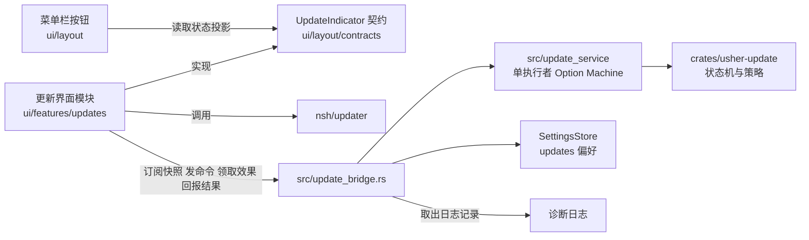

# 应用更新方案

本文是更新模块的唯一设计依据。更新的行为、目录结构、发布流程或配置发生调整时，**先修改本文，再按本文实施**；代码与本文不一致时，以本文为准，并把差异当作待修复的缺陷或待更新的文档，二者不可并存。

本文区分三类内容：**已决定**的设计、**待验证**的假设、**当前实现**的状态。待验证项在第 11 节登记，验证结果回写到本文后才能据此实施。模块职责与依赖边界的通用规则见 [architecture.md](../architecture.md)，编码规范见 [CONTRIBUTING.md](../CONTRIBUTING.md)，任务状态见 [scaffolding.md](../scaffolding.md) 批次 06，发布流水线见 [deploy.md](deploy.md)。

## 1. 范围

| 在范围内 | 不在范围内 |
| --- | --- |
| 检查更新、下载、校验、待重启、重启或替换安装、失败处理 | 更新公告内容（06.07）、全局消息通知（06.08） |
| 代码包热更新与整包更新两条路径 | 开发期 HMR 热重载，它与用户更新无关 |
| 正式版通道（唯一通道） | 预览、alpha、beta、rc 等预发布通道；Windows、Linux、iOS、Android 的更新适配（当前只发布 macOS Apple Silicon） |
| 菜单栏更新按钮、设置页"更新"分区、更新面板 | 托盘与应用菜单入口（02.02 完成后接入同一语义动作） |

## 2. 决策记录

| 编号 | 决定 | 依据 |
| --- | --- | --- |
| D1 | 信任与清单采用 NSH 原生体系，不再自建签名 | 避免两套密钥和吊销机制并存；NSH 运行时本身会复验 |
| D2 | 两种更新路径合并为一次检查，由检查结果决定走哪条 | 与 NSH 官方流程一致：先找代码包，必要时才退回整包 |
| D3 | 整包路径：用户确认后下载、校验，自动替换并重启，无需手动安装 | 对齐 Slint 版 Usher 的更新体验；手动下载只作兜底 |
| D4 | 代码包路径：自动检查开启时静默下载，下载时显示进度环，待重启时提示 | 代码包小、不替换应用，打扰成本低 |
| D5 | 外壳版本过旧（需要整包）时只提示，不强制更新 | 用户决定 |
| D6 | 暂不启用 Apple 签名与公证，功能保留，拿到证书后启用 | 当前没有 Developer ID；NSH 包签名校验不受影响，始终开启 |
| D7 | **只有正式版一个通道**，不提供预览、alpha、beta、rc 的更新。预发布版本不发布更新，也不被任何客户端接收 | 用户决定（取代此前的稳定与预览双通道方案）；V2 验证更新源写在打包时的 `nsh-updater.json`，本就无法运行时切换 |
| D8 | 清单从 GitHub Release 读取：`updater.github` 指向本仓库，同时配置 `publicKey` | 用户决定；V1 验证 `github` 字段的地址固定为 `releases/latest/download/latest.json`，GitHub 的 latest 不含草稿与预发布 |
| D9 | 外壳兼容分两层：发布门禁按文件差异判断，外壳输入有改动的版本只发整包；**且外壳有改动时必须升主版本或次版本**，客户端只在代码包与外壳的主次版本相同时使用代码包 | 官方只用 `minRuntime`，无法拦截 Rust 与桥接变更。只比较相邻版本会漏掉累积错配：0.1.0 → 0.1.1（改 Rust，只发整包）→ 0.1.2（只改 TSX，发代码包），装着 0.1.0 外壳的用户会收到依赖 0.1.1 外壳的代码包 |
| D10 | 设置页新增"更新"分区：自动检查开关、检查按钮、版本信息；自动检查关闭时不检查、不静默下载 | 用户决定 |
| D11 | 更新模块的界面层（菜单栏按钮除外）独立成一个模块；逻辑层独立成 crate | 解耦，便于独立测试与替换 |
| D12 | 旧的自建签名与发布工具不为兼容历史而保留，用不到即删除 | 用户决定 |
| D13 | 第一次发布的版本是 `0.1.0`，此前的 `0.0.1-alpha.1` 不发布 | 用户决定；D7 之后门禁只接受正式版标签 |
| D14 | 提供本地更新模拟命令与 mock 数据，修改更新流程后可在本机走完整个流程，不依赖 GitHub 与真实密钥 | 用户决定；`nsh-updater` 的 `check_url` 允许 `http://127.0.0.1`、`localhost`、`[::1]`（"a local test"），无需自签名证书 |

## 3. 两种更新

| | 代码包热更新 | 整包更新 |
| --- | --- | --- |
| NSH 接口 | `checkForPackage`、`downloadPackage`、`restartToPackage` | `checkForUpdate`、`downloadUpdate`、`installAndRestart` |
| 内容 | 应用的 TSX、导入的图片与字体 | 整个应用：Rust 代码、原生组件、运行时、`nsh.json`、权限 |
| 生效 | 下次启动，或立即重启进入 | 替换已安装的应用并重启 |
| 校验 | 离线根密钥背书的发布密钥签名，限定本应用，构建号高于运行中与信任库下限，适配运行时 | 清单签名加哈希与大小校验 |
| 失败处理 | NSH 试运行：首帧后 10 秒或正常退出视为健康，否则删除并回滚 | 替换失败时保持旧版本 |
| 权限 | 不超过外壳 | 取决于新外壳 |

代码包**只含 TSX**。以下变更必须发整包：应用自己的 Rust crate、原生组件、桥接接口、权限、`nsh.json`（含 `updater` 配置）、编进二进制的资源。第一次引入 `updater` 配置的版本必然是整包，旧安装只能手动安装一次。

### 路径判断

```text
检查（读取 GitHub 最新正式版的清单）
 ├─ 清单含代码包，外壳满足 minRuntime，且代码包与外壳主次版本相同  → 代码包路径
 ├─ 有新版本，但没有可用的代码包         → 整包路径（只提示，面板写明"需要更新应用"）
 └─ 无新版本                             → 已是最新
```

同时存在两者时，外壳满足要求就走代码包。一次整包更新带上了代码，整包完成后不再单独更新代码包。`minRuntime` 只比较 NSH 运行时版本，不比较应用外壳；外壳兼容靠 D9 的两层：门禁保证外壳变了就升主次版本，客户端用 `shellInfo().version` 与代码包版本的主次版本比较，不同就按整包处理，面板写明"需要更新应用"。客户端版本线判断已在批次 3 至 5 实施。

## 4. 发布侧

### 4.1 密钥与信任

NSH 原生体系有三类互相独立的材料，其中清单密钥与代码包的信任链是两条线：

| 材料 | 用途 | 保管 |
| --- | --- | --- |
| 清单密钥（`nsh keygen`） | 签署更新清单 `latest.json`；公钥写入 `updater.publicKey` | CI Secret，另有离线备份 |
| 根密钥 | 为发布密钥签发证书，签发吊销列表；公钥写入 `updater.packages.roots` | **离线**，由维护者在离线环境生成，不进入仓库，不进入 CI |
| 发布密钥与证书 | 签署 `.nshpkg`（`nsh publish --key --cert`），证书随包分发，可轮换而无需更新应用；`nsh certify` 限定可签的应用 ID 与有效天数 | CI Secret |

旧体系的发布密钥与恢复密钥在切换后作废，`trusted_keys.txt` 随之删除。Apple 签名与公证与以上密钥无关，沿用 `MACOS_SIGNING_NOTARIZATION_ENABLED`，默认关闭（D6）。

证书有有效期（`nsh certify --days`，默认 365 天）。到期前必须重新签发，否则新发布的代码包会被拒绝；到期时间应记入发布检查清单。

### 4.2 外壳输入与门禁（D9）

门禁脚本对比上一个发布标签：外壳输入文件有改动，则本次发布**只含整包**，不生成 `.nshpkg`；没有改动才同时生成代码包。

外壳输入的范围由配置文件 `scripts/release/shell-inputs.txt` 定义，脚本不写死路径。范围包括：

- `src/`、`platforms/`、`crates/`、`build.rs`、`Cargo.toml`、`Cargo.lock`。
- `ui/theme/` 与 `ui/config/background.json`：它们被 `include_str!` 编进二进制，改动需要重编译。
- `nsh.json`，比较时忽略 `version` 与 `build`，它们每次发布都会变。

**版本线约束（D9）。** 门禁用 `shell_inputs.py changed --version <本次版本> --strict` 找到上一个正式版标签，外壳输入有改动且主次版本没有升高时，真实发布失败，演练只给警告。预发布标签与格式不对的标签不算发布，不会成为比较基准。补丁版本因此只能是 TSX 变更：

| 变更 | 版本 | 产物 |
| --- | --- | --- |
| 只改 TSX、文案、样式之外的非外壳文件 | 补丁版本（0.1.0 → 0.1.1） | 整包与代码包 |
| 改了外壳输入 | 次版本或主版本（0.1.x → 0.2.0） | 只有整包 |

遗漏防护：CI 扫描 Rust 源码里所有 `include_str!` 与 `include_bytes!` 引用的文件，凡不在上述范围内即失败。新增编译期嵌入的资源目录时，必须同时更新该配置文件。

### 4.3 产物与清单（D7、D8）

| 项 | 内容 |
| --- | --- |
| 清单位置 | `releases/latest/download/latest.json` 与同目录的签名。GitHub 的 latest 只指向最新的非草稿、非预发布 Release，所以只有正式版 Release 会成为更新源 |
| `nsh.json` 的 `updater` | `github: "<owner>/<repo>"`、`publicKey`、`packages.roots`。只有这一种配置，不需要按构建生成多份 |
| 每次发布的产物 | 整包归档、`.nshpkg`（外壳输入未变时）、清单及签名 |

- 发布门禁只接受正式版标签（`v<major>.<minor>.<patch>`，无预发布后缀）。带连字符的标签被拒绝，不构建、不发布；`scripts/release_gate.py` 的 `channel_for` 与 `prerelease` 输出随之删除。**当前门禁与 [deploy.md](deploy.md) 仍按旧设计支持预发布标签，这部分在批次 2 改造，改造前以代码实际行为为准。**
- Release 创建时不带 `--prerelease`，保证它会成为 latest。
- 构建号单调递增（`nsh.json` 的 `build`，门禁已要求）。NSH 信任库记录每个应用已接受的最高构建号，据此拒绝降级。
- `.nshpkg` 内的 `nsh.json` 不含 `updater`，更新源始终来自外壳，不随代码包变化。

演练模式沿用临时密钥，不读真实密钥，不写 Release。演练在没有标签时运行，版本可以是预发布，仅用于验证构建链路；真实发布必须是正式版。

### 4.4 更新源的可见性

更新器用匿名 HTTP 读取 `https://github.com/<owner>/<repo>/releases/latest/download/latest.json`，不带任何凭据，也无法带（客户端没有令牌，也不应该有）。**仓库为私有时，该地址对所有用户返回 404，应用永远读不到更新。** 2026-11-12 未登录访问 `tianlai10000000/usher-nsh` 返回 404，仓库当前是私有的。

处理办法三选一，由维护者决定，**在此之前不能真实发布 `0.1.0`**：

| 办法 | 做法 | 代价 |
| --- | --- | --- |
| 仓库改为公开 | 在 GitHub 设置里改可见性 | 源码公开 |
| 单独的公开发布仓库 | 新建一个只放 Release 的公开仓库，`updater.github` 指向它，工作流用令牌把产物发到那里 | 多一个仓库与一个跨仓库令牌，发布作业要改 |
| 自托管更新源 | `updater.url` 指向自己的 HTTPS 地址（须同时配置 `publicKey`，已配置），发布时把文件传上去 | 要有托管，且 D8 的"从 GitHub Release 读取"不再成立 |

门禁目前要求 `updater.github` 等于本仓库，并拒绝 `updater.url`。选第二或第三种办法时，这条规则要随之修改，并同步本文 D8。

### 4.5 首次发布（D13）

- 第一次发布是 `0.1.0`。发布前按 [deploy.md](deploy.md) 的"发一个版本"步骤，把 `nsh.json` 与根 `Cargo.toml` 的版本同改为 `0.1.0`，`build` 加一，并在 `CHANGELOG.md` 写 `## 0.1.0` 小节。版本号现在仍是 `0.0.1-alpha.1`，**在发布前不改**，避免打断平时的开发构建。
- `0.1.0` 是第一个带 `updater` 配置的版本，没有任何旧安装能更新到它，用户只能手动安装一次（第 3 节）。
- 因为只有正式版通道，**`0.1.0` 本身验证不了更新**：端到端验证需要再发一个更高的正式版（例如 `0.1.1`），让已安装的 `0.1.0` 去检查、下载、替换。代码包路径同样需要外壳输入没变的 `0.1.1`；整包路径需要外壳输入有变且主次版本递增的版本（例如 `0.2.0`）。因此完整验证两条路径需要初始版、无外壳变更的补丁版和有外壳变更的主次版本，不能用 `0.1.1` 同时承担两种外壳兼容性。
- 在 `0.1.0` 发布前，只能用演练模式和本地的临时更新源验证；演练证明不了真实更新密钥、发布步骤和 Release 的 latest 行为。真实 Release 一旦发布，标签不可移动，所以 `0.1.0` 的发布前检查要比往常更严格：根密钥与证书有效期、`publicKey` 与 `roots` 写入 `nsh.json`、`nsh verify --root` 对产出的 `.nshpkg` 通过。

## 5. 客户端流程

### 5.1 步骤

```text
检查 → 验证清单 → 下载 → 校验 → 待重启 → 重启（代码包）或保存状态后替换并重启（整包） → 首次启动确认
```

- 重启前先保存设置，设置 Store 已有原子写入。
- 每一步失败都清理临时文件并回到可重试状态；整包替换失败时旧版本保持可用。
- 代码包的试运行与回滚由 NSH 负责。应用额外记录失败的版本与次数，用于面板显示；**同一版本连续失败两次后停止自动提示**，只在用户手动检查时重试。这条规则是为了避免"更新失败后反复提示同一个更新"的循环。
- 失败信息保存失败类别与版本，面板翻译显示；整包失败时给出手动下载链接。

### 5.2 触发与下载策略（D4、D10）

| 自动检查 | 检查时机 | 代码包 | 整包 |
| --- | --- | --- | --- |
| 开启 | 启动后延迟一次，之后定期 | 静默下载，待重启时提示 | 只提示，用户点击后才下载 |
| 关闭 | 只在用户点击"检查更新"时 | 手动检查后由用户确认下载 | 同左 |

后台检查失败只记日志，不打扰用户；手动检查的结果在发起位置反馈，不使用系统弹窗。失败时设置页 / 已打开的更新面板保留具体原因和重试；侧栏保留可打开面板的错误提示图标，关闭面板不会清除失败。后台检查失败不显示该入口，也不自动弹窗。从不强制重启，待重启状态保留到用户点击或下次启动。

### 5.3 更新源（D7、D8）

- 更新源是构建属性。NSH 在打包时把 `nsh.json` 的 `updater` 写入应用包内的 `nsh-updater.json`，`checkForUpdate` 与 `checkForPackage` 只读这份配置，运行时不能更改（V2）。
- 应用只有一个更新源：本仓库最新的正式版 Release。设置里没有通道选项，也没有通道偏好。
- 状态机不再有通道概念：不接收预发布版本、不降级，两条规则都由 NSH（`latest` 地址与 `version <= current` 判断）保证，状态机只保留一道防御性校验，拒绝带预发布后缀的候选。
- 构建号只增不减：接受过某个构建的安装不会再接受构建号更低的包（NSH 信任库），这也是防降级的依据。

## 6. 菜单栏按钮

按钮由 `ui/layout/components/Rail.tsx` 渲染，只读取 `ui/layout/contracts/updates.ts` 定义的状态投影并上报按下，不依赖更新模块的内部实现。

### 6.1 视觉形态

参考成熟客户端（ChatGPT 桌面端）的菜单栏更新按钮，无更新时隐藏入口；显示时按阶段区分形态，不使用角标：

| 形态 | 画法 | 用在 |
| --- | --- | --- |
| 检查 | 无实心底的灰色细环，短弧匀速旋转；无中心图标、无百分比，使用现有 Canvas 和主题尺寸 / 动效 | 检查中 |
| 强调 | **实心强调色圆**，圆内是白色（强调前景色）的下载图标；不再用角标小圆点。圆的直径取 `size-button-small`，内部优先使用系统 `square.and.arrow.down`（箭头落入开口方框），通过现有 SystemIcon 组件显示并按主题着色；图标尺寸取 `size-update-icon`（默认 14pt），非 macOS 沿用字符回退，保持侧栏点击区域大小不变 | 发现新版本、需要更新应用、待重启 |
| 进度 | 灰色底环加一段较深的弧表示进度，弧从 12 点钟方向顺时针增长；环中央是小菱形装饰；环位于按钮内缘，代码包和整包下载统一显示 | 下载中 |

悬停时按钮背景出现浅灰圆角底，提示在按钮右侧弹出，样式沿用 `ButtonTooltip`。强调形态在悬停时只做不透明度变化，不叠加灰底。尺寸、颜色、弧宽与动画时长全部走主题令牌，不在组件里写字面量；新增令牌须同步所有内置主题。总大小未知时弧改为匀速旋转，减少动效时静止显示。

**中央菱形不表示"取消"**：NSH 的下载没有取消接口（V12），按钮在进度形态下**不可按**，只作状态展示，详情在面板里。因此中央菱形是纯装饰，不承诺可中断；如果之后要支持取消，需要 NSH 先提供接口，再改本节。进度形态不使用禁用的半透明样式，保持原样显示。

### 6.2 状态表

| 状态 | 形态 | 提示文案 | 按下后 |
| --- | --- | --- | --- |
| 未检查、已是最新 | 隐藏，不占位 | — | 从设置页发起检查 |
| 检查中 | 灰色细环旋转，无实心底和中心图标 | 正在检查更新 | 不可按，避免重复检查；减少动效时静止显示 |
| 代码包静默下载中 | 进度，不自动弹窗 | 正在下载 X | 不可按；设置页可看详情 |
| 代码包待重启 | 强调（小尺寸下载托盘图标） | 重启以应用更新 | 面板里"立即重启"或"下次启动时" |
| 发现新版本（整包，或手动检查到） | 强调 | 有可用更新 | 面板里"下载并更新" |
| 下载、校验中 | 进度（有总大小时为确定进度，否则旋转） | 正在下载 X | 不可按；面板可看详情。NSH 无取消接口，校验含在下载内，不单独显示（V12） |
| 整包待重启 | 强调（小尺寸下载托盘图标） | 重启以完成更新 | 保存设置后替换并重启 |
| 需要更新应用（外壳过旧） | 强调 | 需要更新应用 | 面板说明并提供整包更新 |
| 后台检查失败且无更新候选 | 隐藏 | — | 设置页记录原因并可重试 |
| 手动检查失败且无更新候选 | 实心警示色圆底配系统下载图标（与下载 / 安装失败同款） | 具体失败原因 | 打开面板查看原因并重试；已打开的面板保留 |
| 下载或安装失败（有更新候选） | 强调，改用警示色 | 更新失败 | 面板显示原因、重试、手动下载 |
| 未配置、系统管理、不适用 | 隐藏 | — | 设置页说明原因 |

契约已提供形态、进度、可按状态和提示文案，仍由布局模块拥有，更新模块实现它。

2026-11-13 界面整改：静默只表示不自动弹窗，不隐藏下载进度。就绪时隐藏不可用的检查按钮；状态、可换行说明和操作分别成行。浮层使用紧凑标题，标题右侧使用主题图标按钮显示 × 关闭，不再在操作行显示关闭 / 稍后，所有文本约束到容器宽度；设置页复用同一详情组件。

## 7. 设置页"更新"分区

内容：自动检查开关（D10）、"检查更新"按钮、当前外壳版本、代码包版本与构建号（来自 `shellInfo()` 与 `runningPackage()`）、上次检查时间与结果、整包失败时的手动下载链接。

设置页通过 `settingsSections` 注册该分区，分区内容由更新模块提供。设置页只持有一个分区 ID 与一行挂载，不读取更新模块内部状态。

## 8. 模块与目录

### 8.1 总览

NSH 的更新接口（`checkForUpdate`、`downloadPackage`、`installAndRestart` 等）是 `nsh/updater` 这个 **JS 模块**，Rust 侧没有等价入口，所以**执行者只能是 TSX 控制器**。Rust 的 `update_bridge` 是把 `update_service` 暴露给 TSX 的传输层，自己不碰 NSH 更新接口。



依赖方向：更新界面模块依赖布局契约，**布局不依赖更新模块**；更新 crate 不依赖 NSH、窗口与界面；NSH 的更新接口只由更新界面模块调用；Rust 侧不调用 NSH 更新接口。

**服务先创建，再配置**（用户决定，选项 A）。`UpdateService` 在应用装配时就创建，`Machine` 要等版本已知才存在：

- 服务持有 `Option<Machine>`，配置之前为 `None`。除 `Configure` 外的业务命令以及执行租约获取、效果领取均返回稳定错误码 `NotConfigured`（`updates_not_configured`），快照里 `domain` 为 `None`，界面据此显示"准备中"，不能显示"已是最新"。
- `Command::Configure(Settings)` 在 `None` 时创建 `Machine`；已有 `Machine` 时拒绝（`Invalid`）。`shell` 版本在进程生命周期内不变，代码包重启会重建进程，所以不提供"改配置"。
- `Machine` 本身不变，没有"未配置"状态，规则仍然纯。把"未配置"放在服务层，是为了版本来源与服务生命周期解耦：以后 Rust 能直接读到外壳版本、托盘在没有窗口时触发检查、或窗口全部关闭后应用仍驻留，都只改配置的调用方，不改服务结构。
- 配置**一定会发生**：控制器读到空的 `shellInfo().version`（开发运行、不支持更新的环境）时，发的是 `capability: Unsupported` 的配置，而不是什么都不发，否则服务会一直停在未配置。

### 8.2 逻辑层：`crates/usher-update/`

沿用现有 crate，按本文重塑，删除用不到的部分（D12）：

| 部分 | 处置 |
| --- | --- |
| `state.rs`（状态机） | **保留并改造**：增加更新种类（代码包、整包）、失败版本与次数、外壳过旧的结果；删除 `Channel`、`ChannelChanged` 与通道切换逻辑，只保留"拒绝预发布候选"的防御性校验；删除自建签名相关的 `verified` 与 `Unverified`、`min_version` |
| `signature.rs`、`trusted_keys.txt` | **删除**：被 NSH 原生校验取代 |
| `crates/usher-update-tool/` | **删除**：密钥与清单由 `nsh keygen`、`nsh update-manifest` 等命令处理 |
| 依赖 `ed25519-dalek`、`base64`、`sha2` | **删除** |

crate 保持无 I/O、无 NSH 依赖：输入事件，输出状态与效果。网络与文件操作由调用方执行后把结果作为事件送回，沿用现有的票据机制丢弃迟到回执。

#### 状态机设计

**一个状态机，两条路径共用状态与事件，差异放在策略里。** 阶段为 `Idle`、`Checking`、`Checked`、`Downloading`、`ReadyToInstall`、`Installing`、`AwaitingFirstLaunch`、`InstallFailed`；NSH 下载包含校验，因此删除独立 `Verifying` 阶段，每个候选带 `Kind`（`Package` 或 `Shell`）。代码包路径的"安装"就是"重启进入新包"，整包路径的"安装"是替换并重启。

| 旧 | 新 |
| --- | --- |
| `Outcome::InAppUpdate` | 拆成 `PackageUpdate(Candidate)` 与 `ShellUpdate(Candidate)` |
| `Outcome::ManualUpgrade { reason }` | 保留 `Environment`（`canInstall` 为 false，给手动下载链接）；`ShellTooOld` 是 `ShellUpdate` 的原因；删除 `ReleasePolicy`、`Unverified` |
| `Channel`、`Event::ChannelChanged`、`Channel::accepts` | 删除。仅保留"拒绝带预发布后缀的候选"的防御性校验 |
| `Candidate.min_version`、`Candidate.verified` | 删除 |
| `Failure::Signature` | 删除，由下面的六类取代 |
| `Event::Cancel`、`Effect::CancelRunning`、下载中取消 | **删除。** NSH 没有取消接口（V12）：更新操作串行，进行中再次调用返回 `an update operation is already in progress`，`updater.d.ts` 里没有 cancel 或 abort。保留一个调不到的取消事件会让状态机表达做不到的事 |

**失败分类**（用户决定，分得细以便排查；每一类对应面板上的一种处理。共六类，`Busy` 对应 NSH 操作互斥）：

| 类别 | 含义 | 重试有用吗 | 面板处理 | 日志级别 |
| --- | --- | --- | --- | --- |
| `Network` | 连不上、超时、连接被中断 | 有用 | 重试 | `WARN` |
| `Busy` | NSH 报 `an update operation is already in progress`：更新操作串行，另一个还没结束（窗口重建撞上进行中的操作时会出现） | 有用，但要等 | 提示"另一个更新操作进行中，请稍后"，不自动重试 | `WARN` |
| `Rejected` | NSH 拒绝了包：签名、应用 ID、构建号不新于已接受的、运行时太旧、哈希或大小不符 | **没用** | 此版本无法安装；同一版本失败后后台不再提示 | `ERROR` |
| `Disk` | 写临时文件或替换应用失败 | 视情况 | 提示检查磁盘与目录权限 | `ERROR` |
| `Cancelled` | 应用侧放弃且已确认没有继续执行的原生操作，**不是 NSH 取消**；关闭面板不得据此完成仍在运行的领取 | 无需 | 回到可重试状态，不计入失败次数 | `INFO` |
| `Unknown` | 以上都不是 | 不确定 | 重试，并建议导出日志 | `ERROR` |

`Rejected` 内部无法由状态机再细分，因为 NSH 只返回一条消息。细分原因放在日志里（见"更新日志"），不影响状态机逻辑。

**失败次数的计法**：只有 `Rejected`、`Disk`、`Unknown` 计入某版本的失败次数（它们重试大概率仍失败，达到上限后后台不再提示）。`Network`、`Busy` 是暂时性的，`Cancelled` 不是失败，三者都**不计入**，否则离线或窗口重建两次就会让一个正常的更新被永久压下。

**外壳过旧**（D9 的客户端一半）。检查输入带两个版本：`shell`（`shellInfo().version`，安装的应用外壳）与 `running`（当前运行的版本，运行着代码包时高于外壳）。判断是纯函数：

- 候选版本不高于 `running`：已是最新；
- 候选带代码包，且候选与 `shell` 的主版本、次版本都相同：`PackageUpdate`；
- 其余，即候选没有代码包，或主次版本与外壳不同：`ShellUpdate`（面板写"需要更新应用"）。

**失败记忆**（防止反复提示同一个失败的更新）。状态机记录每个版本的失败次数；某版本失败次数达到上限后，**后台检查不再提示它**，手动检查仍会重试。上限是构造参数，数值放配置（第 9 节），不写在逻辑里。

**不取消、不交接**（执行策略的独立决定，与服务初始化的 A 方案无关）。NSH 不能取消更新操作（V12），所以应用层也不提供取消，也不提供执行者交接：

- `src/update_service/` 中以下内容删除：`Command::Cancel`、`Command::Channel`、`reset_after_stop`、`Model.recovery` 与 `Model.draining`、`Settlement`、`Recovery`、`revoke`、`settle`、`reconcile`、`Execution::Draining`、`Execution::RecoveryRequired`、`Error::RecoveryRequired`。它们存在的全部理由是"撤销旧身份后确认原操作已停止"，而这个确认在 NSH 下做不到。
- 保留单执行者的核心：`acquire`、`claim`、`progress`、`complete`、`Lease`、`Claim`、票据与迟到回执拒绝、`close`。
- 执行者持有租约直到应用作用域关闭。目录设置服务创建时同时创建未配置的更新服务；窗口仅借用，关闭窗口或释放订阅不关闭共享服务。无目录的测试会话随其宿主结束而关闭。进程重启后重新创建并配置，状态机从 `Idle` 开始。HMR 若仅重建视图，服务与配置保留；若销毁持有执行租约的 JS 执行环境，当前无交接协议，不能重新领取执行身份，也不能假定原操作停止，须重启应用恢复执行。批次 5 必须据此验证控制器生命周期，不能宣称任意 VM 重载都可继续更新。

**更新日志**（用户决定：错误详情要记录到日志，日志开启才写）。纯逻辑 crate 不做 I/O，所以状态机只**产生**日志记录，由调用方写出：

- 每次状态变化与每次失败产生 `Effect::Log(Record)`，`Record` 含级别、事件名和结构化字段（版本、种类、失败类别、票据、已失败次数），不含自由文本。字段是类型化的，可以直接用 `cargo test` 断言"某个失败产生某条记录"，不需要真的写日志。
- 桥接（批次 4）执行 `Effect::Log`，调用日志 crate 写出；日志级别关闭时日志 crate 自己丢弃，不需要状态机判断。
- NSH 返回的错误消息是自由文本，由桥接作为 `detail` 字段与 `reason` 一并写入：`reason` 用一张映射表把已知的 NSH 消息归为更细的原因（如 `signature`、`build_not_newer`、`runtime_too_old`），映射不上记 `unclassified`。**`reason` 只进日志，不影响状态机**，所以 NSH 升级后消息文字变化只会让 `reason` 变成 `unclassified`，应用行为不变，排查时看 `detail`。
- 脱敏由独立日志 crate 统一完成：凭据字段与自由文本凭据掩码，用户主目录前缀替换为 `~`；不按 `body`、`content`、`email`、`cookie` 字段名一概删除。禁止主动收集用户正文，详见 8.6。

**下载策略**（D4、D10）。构造参数 `auto_check` 与路径共同决定：开启时代码包直接产生 `StartDownload`，不需要用户操作，整包只产生 `Notify`；关闭时后台检查不发生，手动检查的结果都只产生 `Notify`，由用户确认后才下载。

### 8.3 桥接层：`src/update_bridge.rs`

提供 DTO 转换和事件入口，状态机实例由应用装配在同一状态作用域内唯一持有；把 `auto_check` 偏好委托给 `SettingsStore`，不另存一份。更新源来自构建，不是偏好。业务错误返回稳定错误码，界面翻译。设置新增 `[updates]` 段，只含 `auto_check`，默认开启（用户已确认）；默认值时不写入该段，沿用现有的 schema 迁移与保存规则。

共享状态接入遵循 [通用状态管理方案](state-management.md)：业务状态机继续留在 `usher-update`，应用装配按作用域持有实例，桥接负责动作适配和订阅投递，复用独立 `usher-state` crate 的后端无关接口。watch 仅为可选内部实现，更新模块不得依赖其通道类型；TSX 更新状态通过项目门面和集中的 NSH 响应式适配访问，菜单、面板与设置分区不各自保存状态副本。不得把更新阶段、下载策略或 `nsh/updater` 调用移入通用 crate。多窗口只订阅同一状态，效果由单一执行者领取；沿用界面侧调用 NSH 更新接口的边界。通用 crate 与 SM1 至 SM4 已实施。

#### 服务契约（无取消、无交接；初始化采用 A 方案）

`src/update_service/` 是应用层协调器，业务转换调用 `usher-update::Machine`。NSH 不能取消更新操作（V12），所以服务不建模停止与交接；取舍与删除清单见 8.2"不取消、不交接"。

- 应用注册表以宿主设置服务的 StoreId 为作用域；同目录的消费方借用同一更新服务，不同临时目录独立。无数据目录的会话由所属装配持有并显式关闭。
- 纯领域转换在副本中计算，快照成功提交后才更换内部模型和效果队列；发布失败不丢任务、不推进票据、不允许执行候选效果。订阅只含状态和队列数量，不广播效果。
- 单一执行租约与单一在途领取均由服务签发，绑定 StoreId、租约代次、效果 ID 和原领域票据。重复领取返回空；普通消费方只能提交用户命令，不能伪造网络回执。租约持有到服务关闭，没有撤销。
- 状态机产生的日志记录不是执行者的工作，服务自己收集，由 `take_logs` 取走；积压有上限，调用方不取也不会无限增长。
- 执行者的 NSH 调用撞上"另一个更新操作进行中"时，回报 `Failure::Busy`，不计入失败次数。
- 本批 mock 执行器留在更新集成测试，使用可控完成顺序、隔离设置目录及 `usher-test-support`；不会访问真实更新源、密钥或应用安装位置。

#### 桥接的传输面（批次 4）

`update_bridge.rs` 是 `usher/nsh` 的一个模块，沿用 `diagnostic_bridge.rs` 的写法：`#[module]`、`subscribe(callback) -> Stop`、经 `state_bridge::forward` 投递，订阅只释放本引擎绑定。TSX 通过它读写，不接触 Rust 类型：

| 入口 | 作用 |
| --- | --- |
| `snapshot()`、`subscribe(callback)` | 读取与订阅更新状态；`domain` 为空表示未配置 |
| `configure(settings)` | 创建状态机；`shell`、`running`、`capability` 由控制器根据 `shellInfo()` 与 `canInstall` 给出 |
| `request(command)` | 用户意图：检查、下载、安装、确认首次启动、开关自动检查 |
| `acquire()`、`claim(lease)`、`progress(...)`、`complete(...)` | 单执行者的领取与回报，只有控制器调用 |
| `takeLogs()` | 取出状态机的日志记录，由桥接写入诊断日志；详情与原因见下 |

传输使用显式 DTO；复杂负载沿用路由桥接的 JSON 字符串，含字符串、布尔值、可空字段与稳定错误码，错误码翻译在界面层，与现有设置桥接一致。版本号用 SemVer 字符串；票据、字节数和序号等无符号数用十进制字符串，沿用 `Envelope` 的约定。

配置负载为 `{ shell: string | null, running: string | null, capability: "in_app" | "manual_only" | "system_managed" | "unsupported", failure_limit: string }`；失败阈值必须为正整数。请求用 `type` 区分 `check`（含 background）、`download`、`install`、`confirm_first_launch`、`auto_check`（含 enabled）。完成负载用 `type` 区分 `checked`（可空 offer，含 version / has_package）、`downloaded`、`installed`、`failed`（failure / 可空 detail）、`notified`。未知字段、非法枚举、非十进制字节数均拒绝。桥接返回设置偏好变更后的更新快照；保存状态仍由 SettingsState 的 saved / problem 发布，安装前保存失败返回 `updates_settings_unsaved`。

**写日志。** 桥接把 `Record` 写进诊断日志，模块名固定为 `update`，事件名取记录的 `event`。NSH 返回的失败消息是自由文本，TSX 不能直接写日志（既有约束），所以控制器在回报失败时把消息作为 `detail` 交给桥接，桥接：

1. 把用户主目录前缀替换成 `~`，其余不过滤（用户决定，不做过多脱敏，保留排查线索；凭据类仍由诊断模块处理）；
2. 用一张映射表把已知的 NSH 消息归为更细的 `reason`（`signature`、`build_not_newer`、`runtime_too_old`、`hash_mismatch`、`already_in_progress` 等），映射不上记 `unclassified`；
3. 把 `detail` 与 `reason` 作为字段写入。**`reason` 只进日志，不影响状态机**，所以 NSH 升级后消息文字变化只会让它变成 `unclassified`，应用行为不变。

分类（`Failure`）由控制器根据 NSH 的错误给出；NSH 0.5.0 的 `update install: the archive holds …, this app is …` 属于应用身份拒绝，必须先归入 Rejected，不能被通用 install 匹配归成 Disk。桥接不重新判断；映射表只服务于日志的可读性。

本轮批次 3 / 4 实施约束：设置服务拥有更新服务，创建不依赖 TSX 版本配置；自动检查偏好在设置事务内与状态机同步，配置时从设置读取，桥接不接受第二份偏好。桥接只接受服务签发的租约 / 领取标识，错误回执通过校验后才写详情日志。无版本环境以 Unsupported 配置，版本为空时使用构建元数据作为不可执行的占位身份，不发起检查。这部分于批次 3 / 4 交付；批次 5 接入见下文。

批次 5 接入补充：用户确认启动延迟 30 秒、周期 6 小时、失败阈值 2 次，统一保存在 ui/config/updates.json。NSH 的 canInstall 随 AppUpdate 返回，因此初始桌面能力为 InApp；每次检查候选另带 can_install，整包不可安装时归 ManualUpgrade，代码包不受写应用目录权限影响。构建号、上次检查时间和结果、手动下载 URL 由 Rust 应用快照持有，不在页面间复制。失败检查不伪装成已是最新。

控制器在同一 JS 执行环境按 StoreId 复用，视图挂载只借用；最后一个视图释放时停止计时器和订阅，保留租约与已开始的 Promise，重挂后复用同一控制器。不得以卸载代替原生结束，不在传输失败后重新执行原生效果。领取循环记录在途期间的唤醒信号；空领取与新效果入队并发时须再次领取，避免丢失工作。完整 VM 被销毁仍按无交接限制需重启恢复；普通视图 HMR 不重复下载。检查串行调用 package / shell 接口，任何签名或网络错误均回报失败，不以失败当作无代码包。若代码包要求换壳，但两次检查得到不同版本或缺少对应整包，则回报检查失败，不能以代码包版本展示并下载另一个整包。安装 Promise 成功时进程退出，只在拒绝时回报失败，不伪造首次启动确认。

进度环使用 NSH Canvas 的公开绘制 API；浮层使用 nsh/base Popover 的 trigger / popupStyle，不实现额外布局或碰撞系统。形态尺寸和动画复用现有主题 token，几何计算不引入业务数值。

### 8.4 界面层：`ui/features/updates/`

| 文件 | 职责 |
| --- | --- |
| `controller.ts` | 把状态机的效果翻译成 `nsh/updater` 调用，再把结果作为事件送回桥接；负责定时检查与清理 |
| `indicator.ts` | 把更新状态适配成布局的 `UpdateIndicator` 契约 |
| `UpdatePanel.tsx` | 按钮旁的浮层 |
| `UpdatesSettings.tsx` | 设置页分区 |
| `index.tsx` | 对外只导出 `createUpdates`，由 `App.tsx` 创建并传给 `Frame` 与设置页 |

菜单栏按钮的渲染留在 `ui/layout/`。布局组件使用 NSH 组件库的公开接口，遵循 CONTRIBUTING 对布局的限制。文案使用 `i18n/messages/` 的 `update.*` 键，中英文同步。

### 8.5 发布工具

不新建 crate。外壳输入检查与发布门禁写成 `scripts/release/` 下的脚本，由 `release_gate.py` 与工作流调用，测试放在 `scripts/tests/`。

### 8.6 日志 crate

日志核心已拆为 `crates/usher-logging/`，不依赖应用、NSH 或窗口，提供初始化、结构化写入、级别、归档导出与 `StatusObserver`。应用 `src/diagnostics.rs` 只保留健康状态适配，采样在应用状态发布锁内完成，旧日志源不能覆盖新源。现有队列、留存与归档限制保持不变。

只按凭据类字段（token、secret、authorization、bearer、password、passwd、apikey、api_key、credential）掩码，并递归处理数组、嵌套对象和自由文本凭据；主目录前缀替换为 `~`。body、content、email、cookie 不再仅按字段名删除。仍禁止主动采集用户正文。TSX 普通日志接口只接受短标识，更新失败详情须经类型化完成回执验证后由 Rust 写出。

## 9. 配置

检查延迟、检查间隔、失败停止阈值等放在 `ui/config/updates.json`，TSX 侧读取，不在代码里写字面量。**本轮已获确认：启动延迟 30 秒、间隔 6 小时、同版本失败阈值 2 次；后续更改数值须先确认**，见 CONTRIBUTING 对硬编码的要求。更新源地址属于外壳，写在 `nsh.json` 的 `updater` 中（字段名见 V1）。

## 10. 安全与失败边界

- NSH 包签名与根密钥校验始终开启，**不提供运行时跳过校验的开关**。D6 只关闭 Apple 签名与公证。
- 根密钥私钥不进入仓库与 CI。
- 清单与包的校验失败不得回退到未校验的路径。
- 吊销列表与防降级下限由 NSH 信任库持久化，应用不另存。
- 日志使用结构化事件，不记录凭据与用户正文。

## 11. 验证记录与待验证项

第 1 批在本机 `nsh 0.5.0`（`nsh-core` 固定为 0.5.0）上验证，方法是读 `nsh-updater`、`nsh-engine`、`nsh-macos-app` 0.5.0 的源码，并在临时目录的项目副本和临时 `HOME` 中用一次性密钥实际打包、签名、运行；没有改动仓库文件，临时文件已删除。

| 编号 | 问题 | 结论 | 状态 |
| --- | --- | --- | --- |
| V1 | 更新源字段 | `updater.github`（`owner/repo`）或 `updater.url`（HTTPS）二选一；`publicKey` 是清单密钥，用 `url` 时必填，用 `github` 时设置后拒绝未签名清单；`packages.roots` 至少一个根公钥。`github` 的地址固定为 `releases/latest/download/latest.json`。打包后写入应用内的 `assets/nsh-updater.json` | 已验证 |
| V2 | 运行时能否切换更新源 | **不能。** 配置在打包时写入应用，`manifest_url()` 只读它。更新源因此是构建属性，单一更新源（D7、5.3） | 已验证 |
| V3 | 应用能否自己加载 `.nshpkg` | **能。** 0.5.0 的运行器 `main()` 调用 `nsh_engine::updates::launch`（此前 06.04 的否定结论基于 0.4.0，已过时）。实测完整周期：`next.nshpkg` 在下次启动被运行并改名 `trying.nshpkg`；进程被杀后下次启动日志为 `the package started last never ran 10s without a fatal error; it is deleted and the app goes back`，包被删除并回到内置代码；正常运行超过 10 秒则晋升为 `current.nshpkg`，并创建 `trust/`。数据目录为 `~/Library/Application Support/<app id>/updates/` | 已验证 |
| V4 | NSH 0.5.0 是否具备本文依赖的接口 | 具备：`nsh` 命令行含 `keygen`、`certify`、`publish`、`update-manifest`、`verify`、`revoke`、`package`；`nsh-updater`、`nsh-package`、`nsh-engine` 源码均在本机 | 已验证 |
| V5 | 整包替换后无 Apple 证书的 `.app` 能否启动 | macOS arm64 标准变体已实测真实归档下载、目录替换及 NSH 自行重启，新进程版本 / 构建号正确且设置保留。应用为 ad hoc 签名，替换前后 `codesign --verify --deep --strict` 通过。身份 / 签名错误、目录不可写时旧版未变且可重新启动。此轮没有下载隔离标记，未覆盖两次 rename 之间的崩溃恢复 | 本地真实替换通过；Gatekeeper 待验 |
| V6 | 发布命令流程 | keygen / certify / publish / verify 已实跑；批次 2 演练和本地模拟已执行 update-manifest。批次 6 又以真实 tar.gz 生成 latest.json / latest.json.sig，由 NSH 检查、校验并安装。正式密钥和 GitHub 线上分发不在本地验收范围 | 本地工具链已验证 |
| V7 | 与 Sparkle 设想是否冲突 | 不冲突，也不需要 Sparkle：整包替换由 `nsh-updater` 的 `install` 完成。06.04 的 Sparkle 设想作废 | 已验证 |

### 仍待验证

| 编号 | 问题 | 影响 |
| --- | --- | --- |
| V5 | 经真实下载（带隔离标记）的整包替换后，首次启动是否被 Gatekeeper 拦截 | 整包路径在无 Apple 证书下的真实体验；若被拦截，面板需要给出放行说明 |
| V8 | `installAndRestart` 在应用位于 `/Applications`（用户可写、系统管理员安装）与其他位置时的行为，以及 `canInstall` 的判定 | 面板何时给手动下载链接 |
| V9 | AppKit 变体（`macos-appkit`）与标准变体的整包是否可以用同一份更新清单 | **已决定**：清单只列 `standard` 变体的 `.tar.gz`（`update-manifest` 按 `<os>-<arch>` 只收一个），`appkit` 变体只作为手动下载的 zip。`appkit` 用户经更新会换成 `standard`，是否可接受待确认 |
| V10 | 仓库私有时更新器能否读到更新 | **不能**，见 4.4。实测未登录访问返回 404 |
| V12 | 进度环用什么画 | **已实施并在隔离 macOS 宿主实测**：公共 `Canvas` API 绘制圆环，未知总量时用原生 spin 动画，reduceMotion 时停止旋转；进度按钮禁用且保持不透明。详情区使用 `Progress` 的 trackStyle / indicatorStyle 设置高度与填充。无需新增原生组件；headless 另验状态、禁用和未知总量。 |

已验证：`downloadUpdate` 与 `downloadPackage` 的 `onProgress` 回调给出 `{ received, total? }`，`total` 在服务端不给长度且清单没有大小时为空（空则退化为不确定旋转）；**没有取消接口**，下载是一个不可中断的异步任务，且同一时刻只允许一个更新操作（再次调用会被拒绝）；校验在下载 Promise 内部完成，**没有独立的校验阶段回调**，所以界面无法区分"下载中"与"校验中"。

## 12. 本地更新模拟（D14）

本地模拟用于更新流程回归，不访问 GitHub 或真实密钥。当前覆盖生产控制器检查、签名代码包下载 / 再启动晋升，以及预置代码包校验、健康晋升和回滚；独立 shell-update 命令已补真实整包归档替换验收，见第 13 节。更新流程变化时，场景与断言同步更新。

隔离机制（SM6 本机续验建立，批次 5 复用）：将模拟器改为每轮唯一测试应用 ID，旧壳与新代码包使用相同测试身份和一次性测试密钥；每个场景的数据、缓存和 saved-state 均位于独立临时根。通过系统目录 API 为测试 ID 创建专属链接，不改 HOME，拒绝覆盖现有目录或悬空链接。先停止并确认测试进程退出，再删除本轮链接和临时树；停止失败时保留隔离并报告失败。源码、应用和密钥在整轮结束后清理，构建仅复用 Cargo 缓存，执行日志与 JSON 证据保留。`serve` 由脚本启动及拥有测试应用，Ctrl+C 后统一清理，不再输出可脱离隔离生命周期的手工启动命令。有效场景完整执行与 pending 分开统计；仅有 pending 的运行不得作为验证成功。隔离与清理单测位于 scripts/tests/test_update_sim.py，共享链接保护逻辑复用于发布路由验收。逐场景状态、进程日志和清理证据保留在 target/test-reports/update-sim-*/；测试密钥不进入报告。2026-11-13 在本机 macOS arm64 最终完整运行通过 4 项、失败 0 项、pending 7 项，报告为 target/test-reports/update-sim-d8uds6dq/report.json；核对 16 个唯一隔离路径，残留为 0。真实 SIGTERM 清理另外验证通过，中断运行不计入成功数量。

### 12.1 命令

```bash
scripts/update-sim/sim.sh list                  # 列出场景
scripts/update-sim/sim.sh run <场景>            # 运行一个场景并断言结果
scripts/update-sim/sim.sh run --all             # 运行全部场景
scripts/update-sim/sim.sh serve <场景>          # 启动隔离测试应用与更新源，Ctrl+C 后清理
scripts/update-sim/sim.sh clean                 # 删除旧 .nsh/update-sim/ 缓存，保留验收报告
```

### 12.2 工作方式

| 部分 | 做法 |
| --- | --- |
| 更新源 | 本机 `http://127.0.0.1:<端口>`，用 Python 标准库的 HTTP 服务器提供静态文件，可按场景限速、中途断开、篡改响应；不新增依赖 |
| 密钥 | 每次运行用 `nsh keygen` 现场生成一次性的清单密钥、根密钥与发布密钥，`nsh certify` 签发证书，放在本轮临时树，结束后删除。**不读取任何真实密钥** |
| 被测应用 | 用 `nsh package` 打出"旧版"应用，`updater.url` 指向本机更新源。每轮生成唯一测试 ID，旧壳与新代码包身份相同，测试副本移除公开 scheme；只复用 target/update-sim-build 的 Cargo 产物，临时应用不跨轮复用 |
| 新版产物 | 用 `nsh publish` 签 `.nshpkg`，`nsh update-manifest` 写清单与签名 |
| 隔离 | 不改 HOME。系统 API 提供 data/cache/library 位置，只在唯一测试 ID 的命名空间创建链接，指向每个场景的临时数据根；已有路径或悬空链接均拒绝。进程确认退出后删除拥有的链接和数据；停止失败或路径归属变化则保留隔离并失败 |
| 判定 | 对每个场景检查应用数据目录的文件状态（`next`、`trying`、`current`、`trust/`）和应用日志，不靠截图 |

### 12.3 场景与 mock 数据

场景由 `scripts/update-sim/scenarios/*.json` 定义，每个文件描述清单内容、更新源行为、应用启动动作和预期。新增场景只加文件，不改脚本。

批次 5 启用全部检查场景，并新增 `package-download`。网络场景的运行时长为已确认的启动延迟加现有观察时长，不缩短生产计时器；断网、损坏清单与下载失败同时断言应用诊断记录，避免未执行检查也被判通过。预置 `next.nshpkg` 的场景继续覆盖 NSH 启动恢复。每次运行必须至少执行一个场景，且所有执行场景成功才能返回 0。运行结果见本轮验收记录。

| 场景 | 模拟什么 | 预期 |
| --- | --- | --- |
| `up-to-date` | 清单构建号不高于当前 | 检查结果为已是最新，数据目录无变化 |
| `package-download` | 通过真实控制器下载签名代码包并再次启动 | 请求 `.nshpkg`、记录 download_finished，下一次启动晋升 current，无残留 |
| `package-update` ✅ | 更高构建号的代码包，外壳满足要求，预置为 `next.nshpkg` | 启动后运行新包，10 秒后晋升为 `current.nshpkg`，`trust/` 创建，无残留。已通过 |
| `shell-update` | 清单只有整包，没有代码包 | 发现整包候选但不自动下载；模拟归档是占位文件，未验证整包替换 |
| `bad-signature` | 清单签名被篡改 | 拒绝，报签名错误，数据目录无变化 |
| `wrong-app-id` | 清单属于别的应用 | 拒绝，报应用不符 |
| `tampered-package` ✅ | 包内容被改一个字节 | 启动时拒绝，日志含 `the signature does not verify`，不出现 `trying` 与 `current`。已通过 |
| `downgrade` ✅ | 包构建号不高于应用的 | 拒绝运行，日志含 `is not newer than the app's`。已通过 |
| `crash-on-start` ✅ | 新包从未证明健康（进程被杀） | 下次启动回滚，包被删除，日志含 `never ran 10s without a fatal error`。已通过 |
| `download-fail` | 更新源中途断开 | 失败，可重试，不留残留的 `.part` 文件 |
| `slow-download` | 限速 | 进度单调递增；下载不可取消，用 `serve` 在界面上观察 |
| `offline` | 更新源不可达 | 后台检查静默，手动检查报网络错误 |

### 12.4 范围与限制

- 当前 12 个场景均启用，分别覆盖控制器检查 / 下载和 NSH 启动校验 / 试运行 / 回滚；整包发现不等于整包替换验收。
- 模拟覆盖 NSH 更新接口与应用数据目录的行为，**不覆盖 UI**：按钮状态与面板由 `tests/integration/updates_feature.test.tsx`（真实 Rust 桥接、可控原生 I/O）覆盖，控制器就近单测，布局回归仍在 `tests/ui/`。`serve` 命令由脚本拥有应用进程并提供人工观察会话，Ctrl+C / SIGTERM 后统一停止、清理；结果记录为 observed，不计作自动验收通过。
- 此模拟器的整包归档为占位文件，不执行整包替换；真实归档由独立 shell-update 命令在临时应用目录验收。Gatekeeper 与隔离标记仍需真机验证（V5）。
- 它证明不了真实 GitHub Release、真实密钥与证书有效期的行为。
- 与真实更新的差异：更新源是 HTTP 而不是 HTTPS（NSH 只对本机地址放行），其余校验路径相同。
- 每轮重新构建唯一身份的旧版应用，只复用 Cargo 编译缓存，不复用旧应用或测试密钥。clean 保留报告及停止失败时保留的隔离树，后者须先确认进程已退出再人工处理。

## 13. 实施批次

通用状态管理的前置关系见 [状态管理实施计划](state-management.md#9-分批实施计划)：本方案批次 3 的纯业务改造可独立进行；批次 4 的共享状态桥接以 SM1 至 SM3 为前置，批次 5 的界面投影以 SM4 为前置，第二领域复用与效果单执行者在 SM5 验收。此依赖不改变下表批次 3、4、5 的串行顺序；当前按 A 方案交付批次 3 至 5；批次 6 已完成 macOS arm64 标准变体的本地真实整包替换，正式发布及其余验收仍待完成。

| 批次 | 内容 | 状态 |
| --- | --- | --- |
| 1 | 验证 V1 至 V7，回写本文 | 已完成大部分；V6 本地工具链已补验，V5 Gatekeeper 和 V8、V9 剩余项留待后续 |
| 2 | 信任与发布（以首次发布 `0.1.0` 为目标，D13）：离线根密钥（由维护者生成）、`nsh.json` 的 `updater` 配置、外壳输入门禁、门禁只接受正式版标签、流水线产出 `.nshpkg` 与清单 | **演练已在 GitHub 上通过，真实发布待做**。密钥已生成并写入 `nsh.json`，三个 Secret 已配置。2026-11-12 在 GitHub 上手动运行 Release 演练：`gate`、`verify`、两个变体的 `build-macos`、`rehearse` 全部通过，`Sign and publish` 按设计跳过；`rehearse` 的三种损坏（换归档、去掉签名、与外壳结论不符）都被拒绝。**仍未验证，只有真实发布才会暴露**：三个真实 Secret 是否配对，`release` 环境、草稿转正式、`--latest`、构建来源证明。**代码包路径（`nsh publish`、`nsh verify`、换根被拒）没有在 CI 上执行过**，因为没有标签，`shell_changed=true`，只在本机跑过。更新源可见性见 4.4（仓库私有，更新器暂时读不到更新） |
| 3 | 双路径状态机、删除旧签名工具、应用服务按 A 方案初始化、独立日志 crate | **已实施，本机 Rust 验证通过**。无取消 / 无交接；日志通过观察接口适配应用状态。 |
| 4 | `UpdateState` 桥接、`[updates].auto_check`、DTO、稳定错误码、更新日志 | **已实施**。真实桥接用例纳入 state-ui / CI；批次 5 已验证本地源代码包下载与再启动；批次 6 已补本地真实整包替换验收。 |
| 5 | 执行控制器、定时检查、`ui/features/updates/`、布局契约、Rail 状态、文案与测试 | **已实施**。真实桥接配合可控原生 I/O 的界面旅程、执行生命周期测试与隔离 macOS 视觉检查通过；本地真实下载模拟结果见本轮验收记录。 |
| 6 | 文档与验收：同步 architecture、scaffolding、deploy、README，真机验收 | **部分完成**。macOS arm64 标准变体的本地真实归档替换、重启、设置保留与失败恢复已验；正式发布、Gatekeeper、公证、替换中断及其余平台 / 变体验收待办。 |

验证限制：开发运行无可更新的外壳版本；正式更新源要求 HTTPS，本机回环 HTTP 是 NSH 允许的模拟例外。本轮已用隔离打包应用验证真实代码包检查 / 下载 / 再启动，本地真实整包替换也已另行验收；仍不能替代正式 GitHub Release、真实密钥与 Gatekeeper 验收。流水线演练已运行，正式发布仍未执行，第一次正式发布必须使用正式版标签。

### 批次 6：真实整包归档验收范围

本轮先验收 macOS arm64 的标准变体整包路径。新增独立 `shell-update` 测试命令，复用模拟器的一次性密钥、本机源和数据隔离。构建同一唯一测试 ID 的旧 / 新 `.app`，用真实新版生成 tar.gz 和签名清单；生产 App 仅在临时源码副本注入测试驱动，调用与界面相同的 check / download / install 动作，不替换控制器、更新桥接或 NSH 安装器。

验收证据必须同时包含：下载的是签名清单列出的真实归档；替换后应用文件清单与新版相符；旧进程退出且 NSH 自行启动的新进程上报正确 shellInfo 版本 / 构建号；已保存设置字节与新进程读到的偏好一致；安装暂存目录 / 旧目录清理。测试宿主拥有重启后的进程，确认全数退出才清理命名空间；无法证明退出时保留隔离树并报失败。

负向场景包括归档哈希不符、归档内应用身份不符、应用代码签名无效、下载完成后安装目录不可写。失败时核对旧应用文件未变、旧版可重新启动；可恢复的下载 / 权限失败再走正常动作完成升级。故障只注入本轮临时应用、归档及父目录，不改真实安装、系统信任或 NSH 源码。此轮不声称覆盖两次 rename 之间的进程崩溃、Gatekeeper 隔离标记、Apple 公证、正式 GitHub 分发或 AppKit 变体切换。

### 批次 6 本轮验收结果（2026-11-13）

在本机 macOS arm64 解锁桌面执行 `CARGO_NET_OFFLINE=true python3 scripts/test.py shell-update`，最终 **5 项通过、0 失败、0 跳过**。完整报告为 `target/test-reports/shell-update-yft7wbty/report.json`，统一入口报告为 `target/test-reports/shell-update.json`，JUnit 为 `target/test-reports/shell-archive-macos.xml`。

| 场景 | 实际结果 |
| --- | --- |
| success | 真实归档下载后替换，NSH 启动 0.2.0 / build 3；安装文件与新版一致，旧版专有资源移除，设置保留 |
| archive-tampered | SHA-256 不符归入 Rejected；旧版未变且可重开，恢复正确归档后升级成功 |
| wrong-identity | 清单身份正确但归档内身份不符，原生拒绝且产品归入 Rejected；旧版未变且可重开 |
| invalid-signature | 清单与归档哈希有效，但内部代码签名损坏，拒绝安装；旧版未变且可重开 |
| install-denied | 下载完成后使安装父目录不可写，失败归入 Disk；旧版可重开，恢复权限后正常升级 |

每项均确认不下载代码包、未确认不下载整包、已保存设置字节不变、安装暂存 / 备份目录无残留。最终清理复核 `cleanup-audit.json` 检查了 19 个唯一隔离路径，测试进程、系统链接与临时源码 / 应用 / 密钥 / 数据均无残留。

首轮诊断报告 `shell-update-nywzbldb` 暴露应用身份错误误分类和 JUnit 来源标识不匹配；第二轮 `shell-update-zpm_bsmy` 因哈希诊断文本断言和清理权限错误失败，保留树已在核对进程退出后回收，证据为 cleanup-recovery.json。两轮均不计入最终 5 项通过。修复后重新构建并完整执行全部场景，没有以单项补跑拼接成功结果。

state-ui 39 项、脚本 135 项、nsh check、actionlint 和差异格式检查通过。命令与测试已加入 CI 配置，本轮未运行远端 CI / 正式发布。批次 6 仍为部分完成，剩余边界见上方验收范围与 V5 / V8 / V9。

### 批次 5 本轮验收（2026-11-13）

- 工作区 216 项、state-ui 38 项、UI 29 项、无头旅程 4 项及脚本 120 项通过，Clippy / nsh check 通过；覆盖清单见 [测试方案](testing.md#更新批次-5控制器与产品界面2026-11-13)。
- 隔离 macOS 宿主实测确定 / 不确定 Canvas 环、Popover、就绪图标、失败反馈和线性 Progress 填充；下载中仅热更新设置组件后状态与执行次数保留。此项的原生更新调用为可控适配器，完整 VM 重建不在可恢复范围。
- `scripts/update-sim/sim.sh run --all`：12 项通过、0 失败、0 pending，报告 `target/test-reports/update-sim-d5xkzs26/report.json`。新增 package-download 使用生产控制器和一次性签名密钥，从回环源下载包后再启动，最终存在 current.nshpkg / trust，不存在 next / trying / .part。整包场景仅请求清单与签名，不下载占位归档。
- 首轮中断下载暴露模拟服务器缺少 socket 导入，已修正；单项复验的首次构建遇 crates.io DNS 失败（报告 update-sim-chwwm0xa），未计作通过。随后以 CARGO_NET_OFFLINE=true 复用缓存完整构建并执行该场景，通过且无残留，报告 `target/test-reports/update-sim-fozvm6x9/report.json`。
- 每场景均验证隔离清理；整轮临时源码、应用、密钥和数据根已删除，三个专属系统命名空间链接均无残留。未改变 HOME 或真实应用设置。

## 14. 变更记录

| 日期 | 变更 |
| --- | --- |
| 2026-11-13 | 批次 6 本地真实整包验收：新增 shell-update 五场景、安装后逐文件 / 进程 / 设置 / 清理证据，修正归档内身份拒绝误分类；正式分发与 Gatekeeper 等边界仍待验。 |
| 2026-11-13 | 批次 5：接入单执行者控制器、30 秒 / 6 小时 / 2 次配置、更新设置、菜单栏进度与浮层；共享版本和检查元数据，按候选 canInstall 降级。真实桥接界面、卸载 / 订阅 / 空领取竞态与隔离 macOS 检查通过，本地模拟扩至 12 个有效场景。 |
| 2026-11-13 | 批次 3 / 4 按服务初始化 A 方案实施；设置作用域创建空服务，一次性 Configure；用户确认 auto_check 默认开启。独立日志 crate、真实 UpdateState 桥接与设置同步已接入；工作区 214 项、state-ui 22 项通过，Clippy 和 nsh check 通过。批次 5 的实际执行器 / UI 与真实升级仍待办。 |
| 2026-11-12 | 对接通用状态管理设计：通用层独立为 `usher-state`，更新业务状态机保留在 `usher-update`；明确应用作用域、单执行者和 SM1 至 SM5 的实施前置关系，仅更新文档。 |
| 2026-11-12 | 建立本文：记录 D1 至 D12、第 3 至 12 节方案与 V1 至 V7 待验证项。 |
| 2026-11-12 | 新增第 12 节本地更新模拟（D14）：命令、工作方式、11 个场景与限制。4 个场景已在本机通过，7 个标为 `pending`，等批次 4、5 的检查逻辑。 |
| 2026-11-13 | 决定选项 B：删除取消与执行者交接（`update_service` 中的 `Cancel`、`Settlement`、`Recovery`、`revoke`、`settle`、`reconcile` 等），保留单执行者领取；脱敏范围定为只保留凭据类；并行会话已结束，批次 3 恢复。 |
| 2026-11-13 | 批次 3 状态机设计补充：失败分五类并各自对应面板处理与日志级别；删除 `Cancel` 事件（NSH 无取消接口，V12）；新增更新日志设计（状态机产生记录、桥接写出、只做 `$HOME` 替换为 `~`）；新增 8.6 日志 crate 拆分要求。发现并行会话已在 `Machine` 外加了 `src/update_service/`，批次 3 与日志拆分等其结束后实施。 |
| 2026-11-12 | 批次 2 演练在 GitHub 上通过；批次 3 开始，决定串行推进，删除 `min_version`，"外壳过旧"由代码包与外壳的主次版本是否相同表达。 |
| 2026-11-12 | 批次 2 实施：门禁改为只接受正式版并要求 `updater` 完整；新增外壳输入清单与检查、版本线约束、清单检查器、`make-update-files.sh`；`release.yml` 的 `publish` 与 `rehearse` 改用 NSH 原生命令；`rehearsal-sign.sh` 改为同一链路加损坏用例；删除 `collect-release-files.sh`。发现仓库私有，新增 4.4 与 V10。 |
| 2026-11-12 | 确定第一次发布为 `0.1.0`（D13），新增 4.5 说明首次发布的限制与验证办法。 |
| 2026-11-12 | 取消预览通道，只保留正式版（D7、D8）：删除预览清单与滚动 Release、通道状态与按构建生成两份配置的设计，门禁只接受正式版标签。 |
| 2026-11-12 | 第 1 批验证回写：通道改为构建属性（V2），设置页不再提供通道切换，`[updates]` 只含 `auto_check`；代码包路径可行（V3，推翻 06.04 的否定结论）；Sparkle 设想作废（V7）；新增 V8、V9；4.3 补充两个通道对应两种构建，预览用户升到正式版后仍留在预览通道。 |
| 2026-11-13 | SM6 本机续验：更新模拟采用唯一测试 ID / 临时数据根，禁止 HOME 重定向；补齐 16 项隔离清理单测，脚本全量 120 项通过，真实启动模拟 4 项通过 / 7 项 pending；普通结束与 SIGTERM 均核对无隔离残留。 |
